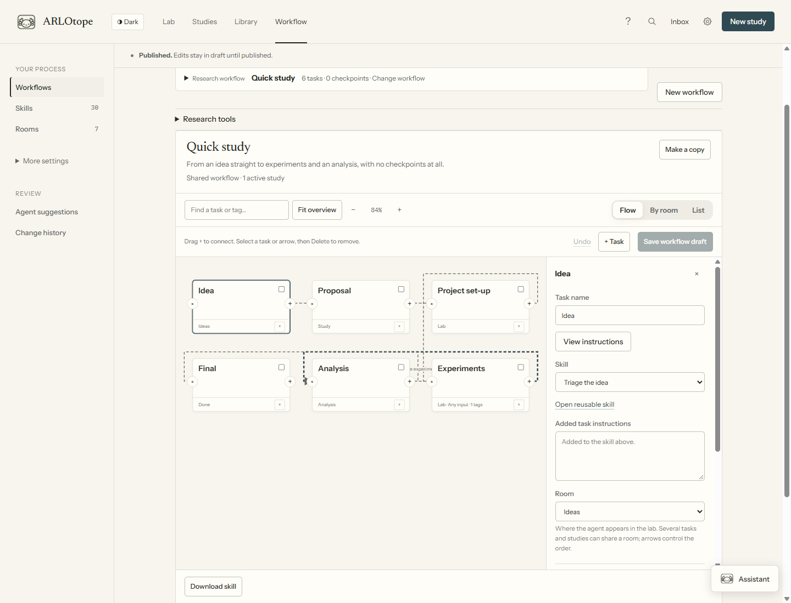
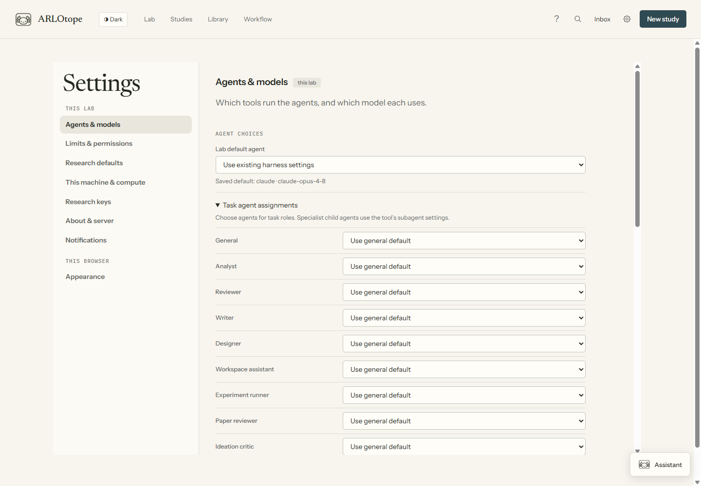
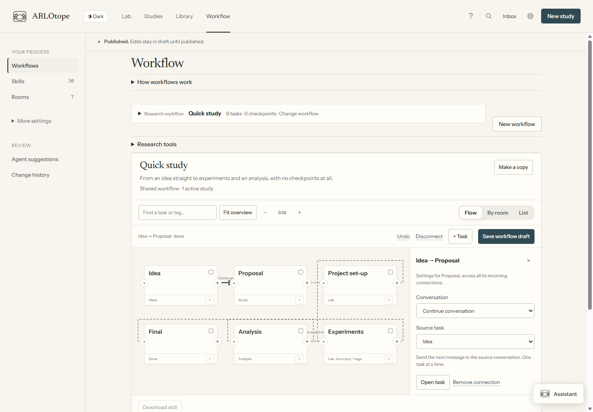
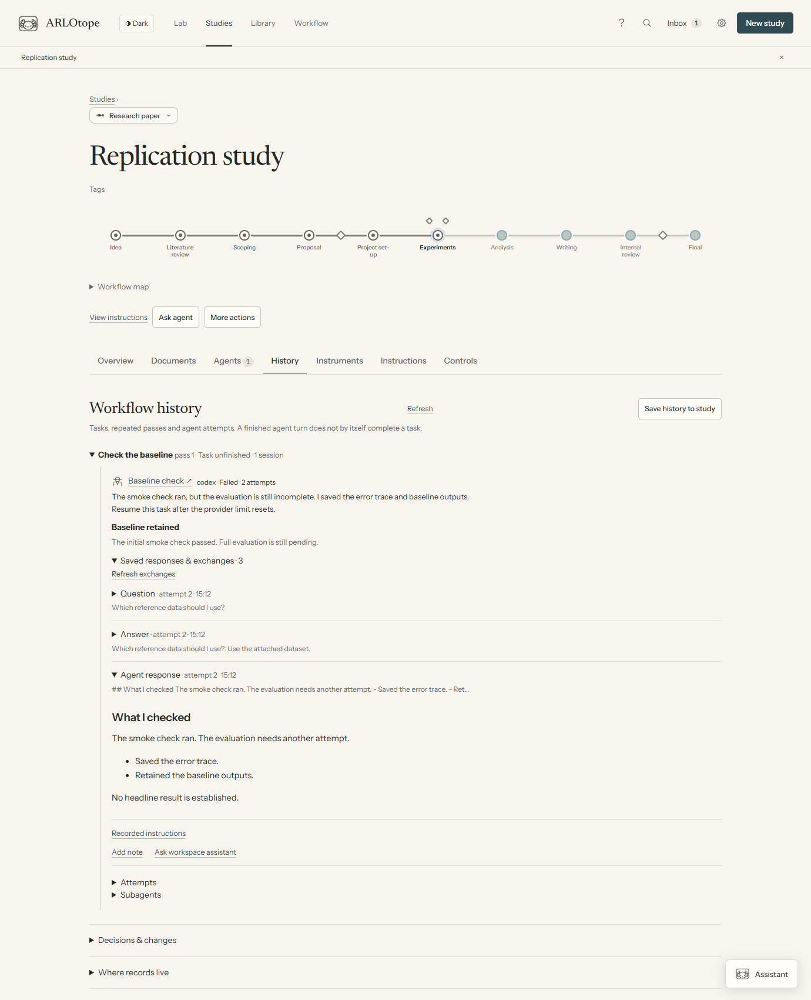

# Tasks, agents and rooms

Use **Workflow** to compose work, choose who performs it and decide which conversation each task uses. The same definition appears in **Flow**, **List** and **By room**. List shows every task, including workflows with branches or loops; Flow shows their connections. Select a task to change its skill or agent.

Screenshots use demonstration data.

## Edit a task

Drag the **+** handle on a task to another task to draw a connection. For keyboard use,
focus **Connect from**, press Enter, then activate the destination's **Connect to** button.
Select a task or arrow and press Delete (or Backspace) to remove it. **Undo** or Ctrl/Cmd+Z
restores edits; typing in a field keeps the usual text shortcuts. Use **+ Task** for an
unconnected task, or the small **+** in a card's footer to insert a task after it.
Keep at least one task in a workflow. Undo keeps the last thirty local edits; publication history
is separate and remains available after saving.

1. Select a task card in **Flow**. Its inspector opens beside the map, or below it on narrow screens.
2. Give the task a useful name. Choose a **Skill** or **Instructions only**, then choose its **Room**. **View instructions** opens the method without leaving the map. With a skill selected, **Added task instructions** supplies extra directions; without one, **Task instructions** defines the task itself.
3. **Outputs & tools** contains expected files, extra skills and external research phases. Paths are relative to the working area; leave expected files blank to use the skill's instructions.
4. **Agent** selects the role and agent. **Context & inputs** chooses which conversation it uses and whether it waits for all branches. Select an arrow to edit these input choices directly beside the map.
5. **Advanced** contains named outcomes, loop limits, tags and a destination list. Model and role overrides stay under **Agent**. Ordinary task connections need none of these fields.
6. **Save workflow draft**, then **Review & publish** the shared change. Use **Change history** to inspect previous publications. A copy opens automatically so edits apply to the version you just created.





**Task starting points** offers Literature, Experiment, Analyze, Independent review and Write. These fill ordinary editable task fields; they do not create a new kind of runner. **Duplicate task** copies an existing task. Changing a role preserves your instructions; choosing Reviewer starts fresh with no author-summary handoff. You can explicitly change that context afterward, but inherited context is not an independent review.

These starting points come from skill metadata, not a fixed list in the editor. A custom skill can
add `ui: {task: {label: "Collect evidence", role: analyst}}` under its `arlotope:` frontmatter.
Remove that entry to hide the shortcut; the skill remains available in the ordinary selector.
Omitting `role` uses General. New workflows can use any skills or instructions-only tasks; the
research stages are supplied defaults, not required stages.
Variants opt into their own shortcut explicitly; copying a skill does not duplicate its shortcut.

Use the Reviewer role for independent review tasks. Reviewers, explainers and assistants remain
visible and monitored but do not count against the default seven-task capacity. Analyst, writer,
designer and custom task roles count normally. See [capacity](compute.md#agent-slots-and-experiment-jobs).

## Choose agents

For an API key, use **Connect API provider**. OpenAI defaults to Codex, Anthropic to Claude Code,
and other providers to OpenCode; **Run with** lets you choose another supported harness.
[Provider setup](api-providers.md) covers keys, models and remote hosts.

Open **Settings → Agents & models → Agent choices** to save named agent configurations (presets).
Each selects an agent and, when needed, a model or effort. Several saved choices may use the same
tool. For another compatible agent, choose **Connect ACP agent**, enter its program and arguments,
**Check connection**, then
**Save agent**. Checking initializes the protocol without sending a model prompt; model access is
tested when work starts. See [ACP setup](acp.md#connect-an-acp-agent) for commands, sign-in and limits.



Choose a Lab default and role-specific choices under **Task agent assignments**. **New study → Study settings** saves study preferences; existing studies expose **Agents**. A general study default preserves inherited specialist choices. **Use study default** on a role deliberately removes that inherited specialization. **Workflow → Subagent roles** edits specialist child-agent instructions; their model settings are under **Tool defaults & subagents**.

For fresh tasks, selection order is:

1. Explicit choice for this launch.
2. Task preset or custom harness settings.
3. Study role setting, then Lab role setting.
4. Study default, then Lab default and the existing machine/backend defaults.

Choose **Use role defaults** for an inherited choice. Changing the role can change that inherited agent; a pinned preset remains pinned. Effort is exposed by the current Claude/Codex adapters. Models depend on the configured harness; do not assume a model identifier works with another provider.

New launches capture their selected options. Editing preferences does not silently change queued/running work. Continued and forked conversations retain their source configuration. A different harness or incompatible model/profile requires a new conversation with handoff. Native child agents use their harness's own role/model facilities; a Lab preset does not make arbitrary internal children cross-provider.

## Choose context

| Inspector choice | Meaning |
|---|---|
| **New conversation** | New native session; optional prior-work handoff |
| **Continue conversation** | Next task in the selected source conversation |
| **Fork conversation** | New native conversation copied from a supported source boundary |

For a new conversation, **Include a summary of prior work** enables handoff; **Choose source tasks** selects its sources. A handoff supplies summaries and evidence links, not hidden model state. It can cross harnesses when the receiving agent can actually access the files.

Continue/fork chooses one source conversation. It may be an earlier causal task rather than an immediate predecessor: Draft → Review → Revise can wait for Review while continuing Draft's writer. It cannot select unrelated live work or rewind a session after later work has changed it. Missing, stale or unsupported sources produce an error instead of silently starting fresh. A task can select its previous loop visit with an initial fresh visit.

An exception is work explicitly supplied through a study's starting plan: it has evidence references, but no native conversation to continue or fork. A task selecting that source starts fresh with those references. Actual run sources still undergo the normal context checks.

Only one task can own a continued session at a time. Native fork support depends on the harness/version; ACP requires advertised capabilities. A native fork creates another conversation, not an isolated repository or worktree. Use `context.mode: native-fork` for a fork, or `mode: fresh` with `handoff: true` for a summary in a new conversation.

Parallel branches can fork and continue the same source. The Lab creates the fork before
letting the original conversation advance. They can then work at the same time, within task limits.

## Connect tasks and outcomes

Arrows choose what runs next. Select an arrow to open its **Connection inspector**. Conversation settings apply to the destination task across all its incoming arrows. **Wait for** appears when multiple tasks feed that destination: choose **All incoming tasks** for parallel branches, or **Any incoming task** for alternative paths. The parallel-task shortcut sets up the waiting join automatically. Waiting for tasks and inheriting their conversation are separate choices.



An arrow drawn on the map is an ordinary `done` route. It does not change the destination's
agent or conversation. Select an arrow for conversation and waiting choices, or to **Disconnect**.
Use **Advanced** for named outcomes and visit limits. Several outgoing arrows create parallel branches; a return
arrow creates a loop. Review the conversation choices and visit limits before running.
Removing a dependency resets a conversation source to fresh if it is no longer upstream;
Undo restores both. Deleting a task also removes its checkpoint placements and routes to it.
The publication review shows these changes before they reach the Lab.

Connections control when tasks become ready. Several ordinary destinations launch parallel branches, subject to execution limits. **Wait for all incoming branches** joins work that must all finish. Leave it off for mutually exclusive outcomes; an all-input join cannot wait for a branch that never ran.

A named outcome replaces the ordinary `done` route. For example, a review can report `revise` to return to writing or `more-experiments` to return to experiments. Set **Maximum task visits** to bound a loop. Rooms only group the display; they do not change these connections.

## What rooms mean

A **task** defines work: instructions, skills, an agent and its conversation. A **room** is
the shared place where that agent appears in the 3D lab while doing the task. **Arrows**
define the order of work. These are separate choices.

For example, Collect evidence → Check evidence → Write report can place the first two
tasks in the Study room and the last in Writing. Another study can use those same rooms
at the same time. Changing a task's room moves its agent's location; it does not change
the task's skill, dependencies, approvals or conversation. **By room** groups the same
tasks by location. You can design a new shared room when the existing places don't fit;
starting a study does not create a room.

## Start with existing work

Select a task in **New study** to choose **Run task**, **Use existing work** or **Skip at start**. No built-in stage names are required. Skipping requires no explanation. Reuse needs file paths, uploaded filenames, knowledge record IDs or source URLs; a note is optional. These references remain claims supplied by the researcher until checked.

Reuse and omission are distinct journal events, separate from an agent's completion. Both follow the task's ordinary route, or a selected named outcome, and participate in branch joins. They change the starting plan only. If a later task routes work back here, an agent runs this task normally. A before-task or during-task checkpoint still blocks resolution until its configured approval is recorded. Creation never launches an agent.

For example, **Use existing work** on Literature review initially continues with your supplied
references. If a later review sends the workflow back to Literature review, that task runs. A
“pass” is reaching a task again, not sending another message to an agent. Separately, a task that
continues its own previous conversation starts fresh on its first pass, because no previous
conversation exists yet. These rules do not withhold documents until a later message.

The study's Overview and History retain the choices and references. **Run remaining tasks normally** cancels pending choices without erasing earlier decisions. Changes to task instructions, skills, connections or checkpoints invalidate pending choices; review the changed workflow or cancel the plan. Presentation changes such as room, label and tags do not invalidate it.

The plan is stored in the study's `new` journal event as `entry: {revision, tasks}`. Each task ID maps to `{action: reuse|omit, note, refs, outcome}`. Resolved choices append `task-reused` or `task-omitted` with the task visit and destinations. The same graph fold handles readiness, loops, checkpoint waits and joins; no second execution engine is involved.

## Run the workflow

**Run ready tasks** starts eligible work. Each task visit has an owning run; finishing a branch does not finish other branches. Declared outputs and the task's accepted outcome matter separately from process exit. A task that stops without its outcome remains unfinished. Inspect it, then **Continue task** or use **New agent with handoff** if the original conversation cannot resume.

### Study history

**Study → History** groups tasks by pass and owning agent sessions. Ordered and graph workflows
both keep repeated passes separate. Expand a task for responses, notes, outputs, attempts and
recorded subagents. **Recorded instructions** opens its saved prompt and skills when available.
A stopped agent remains distinct from a completed task. **Decisions & changes** contains the
workflow events, including reuse, omissions and checkpoint decisions.

History reads the original records. New managed runs retain exported exchanges; older runs
may have only a transcript. Missing, clipped or stale remote records are labelled. See
[record formats and limits](internals.md#conversation-archives).

**Save history to study** refreshes `studies/<id>/history/workflow.md` and `workflow.json`, visible
in **Library → Documents → Workflow history**. The JSON contains workflow events, task passes,
attempts, transitions, log previews, output references and source paths. Full conversations stay
in the run files and load when opened. These generated snapshots can be refreshed after more
work; the live History view reads original records. The exported workflow definition is current,
while saved task labels come from individual runs or their snapshots where available.

Agents can inspect or save the same projection:

```bash
uv run --with pyyaml python tools/study_history.py <study>
uv run --with pyyaml python tools/study_history.py <study> --save
```




## Questions, checkpoints and permissions

Native questions and tool permissions appear in the run and Inbox when the adapter exports them. Terminal/editor sessions still receive input in their terminal. A pending question is answered in its producing conversation; the workspace assistant does not answer it by changing focus.

Checkpoints separately govern authorized research progression. They can use the researcher, named checks or an explicitly configured independent judge. Review the evidence and configured decision routes. A new agent choice does not grant approval, and a fresh model alone does not establish reviewer independence.

For checkpoint fields and commands, see [workflow reference](workflow.md). For agents that stop or fail, use the [dashboard recovery controls](dashboard.md#answer-and-recover).

## Rooms and export

Switch to **By room** after composing tasks. Select tasks and **Group in room**, or **Create room & group**. **Design room** opens a separate preview/apply draft; see [room design](room-design.md).

**Download skill** exports a saved composition as a Markdown skill and ZIP of its local resources. Save edits first. The export describes the workflow; Lab execution is still needed for its recorded gates, parallel tasks and native conversation operations.

For a small process, **New workflow → One lead agent** lets one task follow a skill sequence. Use separate tasks when independent contexts, parallel work or recorded transitions matter.

## Text definitions and agent designers

The visual editor and agents use the same YAML definitions in `workflow/workflows/`, with shared
task definitions in `workflow/steps.yaml`. Task methods are Markdown skills. There is no separate
agent-only workflow language. The [workflow reference](workflow.md) gives examples and fields;
[external tool definitions](external-frameworks.md) add command-based research engines without
another scheduler.

An agent designer can propose tasks, skill sequences, roles, conversation sources, parallel
branches, joins, outcome routes, loops, rooms and checkpoints. **Draft with an agent** gives it the
existing definitions and a private proposal folder. It validates with `arlo check --design`,
then the researcher reviews and publishes the proposal in Workflow.

During execution, agents report declared outcomes and the engine follows their routes. An LLM
judge can select a configured decision route; visit limits bound repeated work. A single task
can also follow several skills and choose its own working steps. These forms of adaptation do
not require rewriting the running graph. Changes to the shared graph use the normal proposal,
validation and publication path; a task is not automatically allowed to publish its own redesign.
