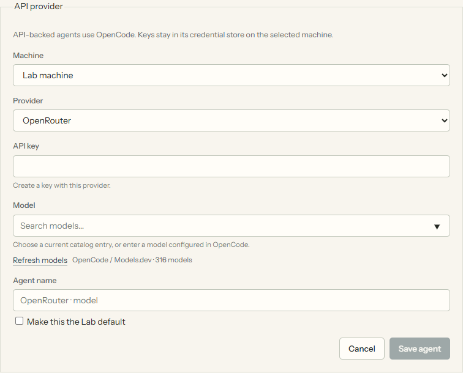

# Use an API provider

API-backed agents use [OpenCode](https://opencode.ai/docs/). Install it on the machine that will
run the work. Claude Code, Codex and ACP agents keep their existing sign-in methods.

1. Open **Settings → Agents & models → Connect API provider**.
2. Choose the execution machine and provider. OpenAI, Anthropic, Google, OpenRouter, xAI,
   DeepSeek, Mistral and Groq appear first; the rest of OpenCode's catalog is available too.
3. Enter a key, choose a model and **Save agent**. Leave the key blank to use an existing connection.
4. Choose that saved agent as the Lab default, for a role, for a study or for an individual task.



**Refresh models** updates OpenCode's Models.dev catalog. Model versions are not hardcoded in
ARLOtope. Catalog updates can lag a provider's release; you may enter a model ID already configured
in OpenCode. Suggestions omit models known not to support tools. Saving a key does not verify
billing, model access or whether a particular model can complete a task; the first run tests those.

Keys are written through OpenCode's native credential API on the selected machine. The native
store is normally `~/.local/share/opencode/auth.json`; OpenCode's environment/configuration can change
that location. ARLOtope keeps the provider/model ID in the saved agent, not the key. Keys are not
returned by the catalog, saved in browser drafts or added to the Lab's action log.
This is a local, same-account application, not a boundary against programs that can read that account's files.

For a remote project, connect its machine first. Its key stays on that host and travels over the
existing SSH connection. A saved agent is reusable; it does not pin work to a machine. Configure
its provider on every host where you use it. **Remove provider connection** removes native
credentials on the selected host; it leaves saved agent choices intact.

You can also enter a key from an interactive terminal without putting it in shell history:

```bash
./arlo api POST /api/providers --data '{action: connect, provider: openrouter}' --secret key
./arlo api GET /api/providers
```

Add `--query refresh=1` to refresh the catalog, or `machine: <machine-id>` in a write body
(`--query machine=<machine-id>` for a read) to use a connected host. See [the local API](api.md)
for saving agent presets. Existing native OpenCode environment variables and custom providers
continue to work; see its [provider guide](https://opencode.ai/docs/providers).
