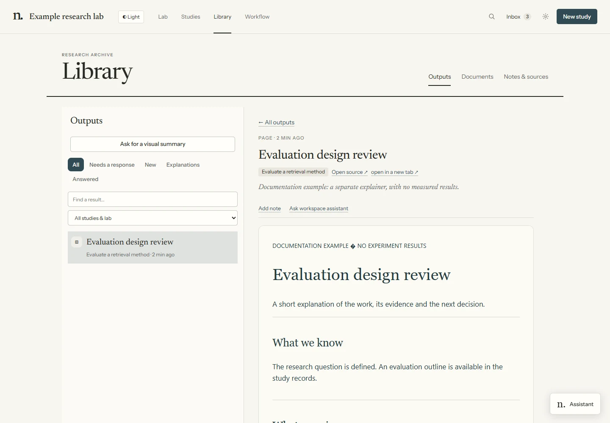

# Outputs and visual summaries

Publish a report, figure, table or interactive page when it gives the researcher something useful to inspect. Published copies appear in **Library → Outputs** and link to the producing run and study.

## Find and inspect an output

1. Open **Library → Outputs**.
2. Choose a study or **Lab-wide**, search titles/notes/study names, and select an output. **Load older results** reaches earlier pages.
3. Read the preview and provenance. Use **Open source** when available to edit the original, or open the published copy in another tab.



*Demonstration fixture: published content has provenance, inert notes, separate Q&A and explicit execution feedback.*

HTML pages can have interactive controls inside the preview. Images, PDFs, tables and text have their own viewers. HTML under a run's **Files it changed** can also be previewed; publishing adds a durable Library copy and feedback controls.

## Note, ask or send feedback

- **Add note** saves separate human context. It does not message an agent or queue work.
- **Ask workspace assistant** opens separate Q&A about this output and saves the answer as a record.
- **Send answer** responds to a published question. **Send instruction** sends other feedback to the producing agent. It can resume that run; if the run cannot accept the message, the Lab queues a directive for the study's next agent.

These messages are not checkpoint approvals. Record approvals in the checkpoint sheet. Feedback on an independently produced explanation goes to its explainer, not the original research agent.

## Request a visual summary

For a particular run or recorded child, choose **Visual summary** in its details. You can also select the run in Assistant and use its summary action. This queues a separate terminal explainer; the source conversation receives no message.

The explainer receives timestamped captured records, prompt/instructions, exported transcript/activity and available child or hook logs. It can inspect further evidence with ordinary tools. Remote run records are mirrored locally; project files can be read through the worker. Summaries must disclose missing child messages, shortened/capped history and stale mirrors. A child's return records what it reported, not private reasoning.

**Outputs → Ask for a visual summary** instead opens a new general report task. Review its scope and launch it when ready. It is not automatically bound to a particular source run.

The ordinary launch switch, assignment, depth and provider-account controls still apply. Explainers do not advance workflows, start gate reviewers or approve work. Their published records retain both the producing run and the original run/child being explained.

```bash
uv run --with pyyaml python tools/executor_cli.py evidence RUN_ID --agent CHILD_ID
uv run --with pyyaml python tools/executor_cli.py evidence RUN_ID --file path/inside/project.md
uv run --with pyyaml python tools/executor_cli.py explain RUN_ID --agent CHILD_ID
```

Omit `--agent` for the whole run. Add `--hub /path/to/lab` before the command when using another working directory.

## When a read fails

Run file lists, Markdown/text previews, activity, technical logs and figure lists distinguish failed reads from empty records. Choose **Retry** after a failure. When a refresh fails, previously loaded data for that same run or study stays visible with a label; switching to another item does not carry that data over. A technical log that has not been created yet is still a genuine empty result.

Image previews offer **Retry** if the image cannot load. HTML and PDF previews check access before opening the embedded file. **Open original file** remains available. A successful access check cannot diagnose every browser PDF problem or an error inside an HTML page; use the original file in those cases. HTML keeps its sandbox when embedded or opened directly.

Conversation reads retry automatically. A failed read appears beside the loaded messages and clears when the connection recovers; it does not mean the agent stopped or the task finished.

## Publish a file

```bash
uv run --with pyyaml python tools/artifact.py publish --title "Replication review" \
  --file artifacts/review.html --study my-study --note "Evidence and open questions."
```

The source folder name is a convention, not a required scaffold. The publisher copies the file into the Lab's output store; dashboard runs supply their producing run and study. Keep the source for future edits.

| File | View |
|---|---|
| HTML | Interactive isolated page |
| Markdown, text, JSON | Readable document |
| PNG, JPEG, WebP, GIF, SVG | Figure |
| CSV, TSV | Table |
| PDF | Document preview |

The file limit is 8 MB. Make HTML self-contained, with inline CSS, JavaScript, SVG and embedded images, so the published copy does not depend on external assets. Its preview permits scripts while isolating the page's origin from the dashboard. This sandbox is not network isolation and does not constrain the agent's own research tools.

Use `--about RUN_ID` or `--about RUN_ID:CHILD_ID` to associate an explanation with its source. The artifact's producing run remains separate. A question can use `--question` and semicolon-separated `--choices`.

## Remote publication

Use the publisher path in the remote run's brief, or its worker runtime:

```bash
python "$ARLOTOPE_WORKER_RUNTIME" artifact publish --title "Remote review" --file artifacts/review.html
```

Publication transfers the output to the owning Lab and waits for its acknowledgement. Retried controller requests reuse the recorded publication. The project stays remote. The runtime's `artifact list` and `artifact replies` commands access its study's publications and feedback.

Publish once per useful milestone. Logs and routine progress belong in the conversation/ledger. Generate scientific figures from run artifacts and keep quantitative claims linked to evidence. See [knowledge records](knowledge.md) for notes, Q&A and retained sources.
