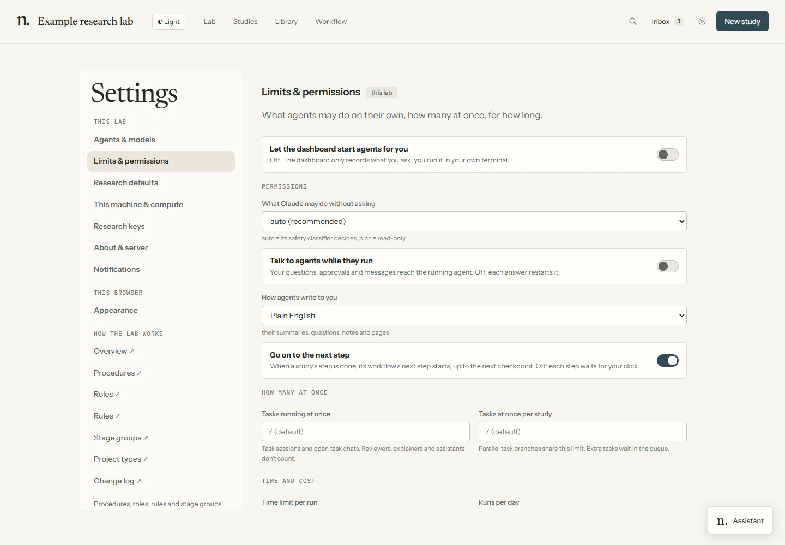

# Configuration

The repository ships `lab/config.defaults.yaml`, which documents every setting. Your own changes live in
the ignored local `lab/config.yaml`, which holds **only the settings you changed**: the Lab reads the
defaults with that file laid over them (sections merge; a list or value replaces; `key: null` goes back
to the default), so a new default reaches you unless you overrode it. The Settings page writes the file;
editing it by hand is fine. A file that does not parse keeps the last good settings and Settings says
so. Include `lab/config.yaml` in your Lab backup. A normal clone needs no template-generation step.

Use **`lab/config.yaml`** for Lab agents, launches and defaults. Generated experiment projects
resolve their run parameters in this order, highest precedence first:

```
-o key=value  >  experiment yaml  >  configs/base.yaml  >  project control.yaml
(the command)    (one experiment)    (the project's base)   (one project, end to end)
```

Experiment parameters use the project layers above. The generated scheduler helper is an exception:
it reads `compute.scheduler` from the hub named by `hub_path`, then applies project scheduler
overrides. Check those settings on the execution host; see [Machines & compute](compute.md).
Agent sessions and the dashboard executor use Lab launch, model and permission settings.

For everyday changes, use **Settings → Agents & models**, **Limits & permissions**, or
**Research defaults**. Workflow tasks, gates and instructions are edited in **Workflow**.
The tables below are the file reference, not a setup checklist.

View the effective merged configuration — with the layer that set each key — at any time:

```bash
uv run --with pyyaml python tools/show_config.py                          # lab layer
uv run --with pyyaml python tools/show_config.py ../arlotope-projects/my-proj
uv run --with pyyaml python tools/show_config.py ../arlotope-projects/my-proj exp-004.yaml
```

Use `/configure [slug] set key=value` for an agent-assisted change, or edit the YAML directly.

## Profiles & budget tiers

A **profile** applies selected settings to `lab/config.yaml`, preserving comments.
It is not another configuration layer. Built-in profiles live in `lab/profiles/`:

- **Budget tiers** (`low`, `medium`, `high`) set exploration depth, parallelism and reviewer counts.
- **Engine presets** (`claude-*`, `codex`, `opencode`, `mixed`) select a backend and models.

These settings affect work volume; they are not provider billing estimates.

```bash
uv run --with pyyaml python tools/profiles.py list
uv run --with pyyaml python tools/profiles.py diff high      # what would change
uv run --with pyyaml python tools/profiles.py apply high      # set it in lab/config.yaml (+ sync agent models)
uv run --with pyyaml python tools/profiles.py save my-preset  # snapshot current settings as a named profile
```
…or `/configure profile <list|show|diff|apply|save> <name>`.

| | `low` | `medium` (default) | `high` |
|---|---|---|---|
| `ideation.candidates` / `critics_per_idea` | 4 / 1 | 8 / 2 | 16 / 3 |
| `scoping.advocate_subagents` | false | true | true |
| `critique.ensemble_own_draft` | 3 | 6 | 7 |
| `experiment.num_drafts` / `max_parallel_subagents` | 2 / 1 | 3 / 3 | 5 / 6 |
| `agents.tiers` (strong / standard / fast) | sonnet / haiku / haiku | inherit | opus / opus / sonnet |
| `agents.programmatic.max_concurrent` | 1 | 7 | 7 |
| **`experiment.multi_seed_n` (floor)** | **3** | **3** | **5** |
| **`oversight.level` (floor)** | **standard** | **standard** | **strict** |

Profile validation refuses to lower `experiment.multi_seed_n` below 3, disable oversight or
change `eval_frozen`. The floors are in `workflow/rules.yaml`. To save your own profile, apply a
nearby preset, edit the settings, then run `tools/profiles.py save <name>`.

## Layer 1 — `lab/config.yaml` (lab-wide defaults)

Named agent presets and role assignments also live here, under `agents.programmatic`. Study-specific
choices use `studies/<slug>/workflow/agents.yaml`; they do not affect experiment configuration.
See [Choose agents](agent-workflows.md#choose-agents) for precedence, saved launch options and conversation rules.

| Key | Default | Owner | Effect |
|---|---|---|---|
| `lab.projects_root` | `../arlotope-projects` | PI | where `/spawn-project` creates project repos (relative to hub) |
| `lab.keep_awake` | `auto` | PI | hold the computer awake while agents work or a campaign runs; `off` never (Settings → Research defaults) |
| `lab.stale_days` | 14 | PI | studies that have not moved for longer than this get flagged by `check_lab.py` |
| `critique.ensemble_external` | 3 | PI | reviewer lenses for external-paper triage |
| `critique.ensemble_own_draft` | 6 | PI | reviewer lenses for our own drafts (all of them, including the process lens that reads the run trail) |
| `critique.score_anchor_human_mean` | 5.4 | PI | calibration anchor `/critique-paper` substitutes into every reviewer prompt |
| `critique.accept_bar` | 7 | PI | median Overall at/above this (+ zero unrefuted fatal flaws) = accept |
| `critique.max_review_cycles` | 3 | PI | revision cycles before escalating to the PI |
| `critique.claim_rel_tol` | 0.001 | PI | relative tolerance `checks/audit_claims.py` uses to match a paper number to its run artifact (looser of this · printed precision) — a rigor knob, mechanically PI-owned via the `critique.` prefix |
| `limits.ideate_critics` · `limits.scope_advocates` | 100 · 40 | PI | the most critic / advocate subagents one `/ideate` / `/scope` run spawns; beyond it the skill argues the rest itself. Above anything the shipped profiles reach, so they only bind when lowered |
| `limits.lit_review_critiques` | 1 | PI | papers `/lit-review` sends to `/critique-paper` per run (the most load-bearing one) |
| `limits.review_followup_reviewers` | 3 | PI | reviewers `/review-paper` runs on cycle 2 and later; cycle 1 and the final accept check use the full `critique.ensemble_own_draft` |
| `experiment.max_debug_depth` | 3 | agent-readable | consecutive debug attempts before record-and-move-on |
| `experiment.num_drafts` | 3 | agent-readable | distinct solution lines `/improve` maintains |
| `experiment.max_parallel_subagents` | 3 | agent-readable | concurrent worktree subagents (project may override) |
| `experiment.multi_seed_n` | 3 | agent-readable | seeds required before a number is paper-grade (project may override) |
| `loop.no_progress_backoff_cycles` | 3 | agent-readable | no-progress cycles before a loop stops (project may override) |
| `loop.monitor_poll_seconds` | 300 | agent-readable | zero-token polling cadence (project may override) |
| `loop.mode` | `execute` | PI (per-loop via LOOP_BRIEF) | default loop mode: `execute` (run plan, then stop) or `explore` (autonomous in-project re-planning — frontier expansion + reopening non-headline decisions). The `LOOP_BRIEF.md` `Mode:` overrides per-loop. See [autonomy](autonomy.md). |
| `loop.explore_max_expansion_rounds` | 0 | PI | explore-mode only: results-grounded `expand` rounds allowed after the plan is exhausted (0 = no frontier expansion; decision revisits still fire, as those are controlled by `loop.mode`) |
| `loop.explore_max_new_lines_per_round` | 3 | PI | explore-mode only: max new PLAN.md lines per `expand` round (each needs a pre-written criterion) |
| `compute.max_concurrent_runs` | 1 | PI | how many PILOT/FULL training campaigns should run at once **across all projects**. An instruction agents follow (hard rule 13), not a lock: the Compute panel shows it and warns when more run |
| `compute.gpu_hours_budget` | unset | PI | the lab's GPU-hour budget. The Compute panel tracks use against it and raises an alert when the lab goes over. An instruction, not a limit |
| `compute.scheduler.kind` | local | PI | how PILOT/FULL training runs execute: `local`, `slurm` (run.py submits and waits), or `custom` (described by commands). See [Machines & compute](compute.md) |
| `compute.scheduler.stages` | [PILOT, FULL] | PI | stages sent to the scheduler (SMOKE always runs where it's launched) |
| `compute.scheduler.slurm.*` | — | PI | `partition`, `account`, `qos`, `gpus_per_run`/`gres`, `cpus_per_task`, `mem`, `constraint`, `time_grace_minutes`, `extra_args`, `setup` (shell lines run first in each job) |
| `compute.scheduler.custom.*` | — | PI | `submit` (`{script}`), `state` / `cancel` (`{job}`), `header`, `setup`, for PBS, LSF or site wrappers |
| `compute.scheduler.poll_seconds` · `max_queue_hours` | 30 · 48 | PI | how often a waiting run checks its job; when to give up on a job that never started |
| `dashboard.editor` | `vscode` | agent-readable | editor for the dashboard's "open in editor" deep-links: `vscode` \| `cursor` \| `vscodium` \| `windsurf` \| `none` (local-only `<scheme>://file/<abs>`) |
| `agents.tiers.{strong,standard,fast}` | inherit | PI | the model **ladder** — each tier names a model: an alias (`sonnet` \| `opus` \| `haiku` \| `fable`), a full pinned id (e.g. `claude-haiku-4-5-20251001`), or `inherit` (the session model). The per-role keys below resolve through this at render time; all three ship `inherit` → **zero behavior change until you set a ladder** |
| `agents.reviewer_model` | strong | PI | model for `fresh-context-reviewer` (→ its `.claude/agents/*.md` `model:` frontmatter). Value: tier name (`strong` \| `standard` \| `fast`) \| alias (`sonnet` \| `opus` \| `haiku` \| `fable`) \| full pinned id \| `inherit` |
| `agents.runner_model` | standard | PI | model for `experiment-runner` (→ its agent-file frontmatter). Same value set as `reviewer_model` |
| `agents.critic_model` | standard | PI | ideation critics / scoping advocates — inline subagents. On **Claude Code**, `/ideate` and `/scope` resolve it mechanically with `role_sync.py resolve critic` and pass it (tier-resolved) as each critic/advocate's per-spawn Task `model`, unless it resolves to `inherit`; backends without a per-spawn model override run them at the session model. Same value set as `reviewer_model` |
| `agents.overseer_model` | standard | PI | model for `overseer` (→ its agent-file frontmatter). Same value set as `reviewer_model` |
| `agents.{reviewer,runner,overseer}_effort` | `""` | PI | per-role reasoning effort for the three NAMED roles: `""` = the model's default (nothing is rendered), else `low` \| `medium` \| `high` \| `xhigh` \| `max` — rendered by `role_sync` into **both** the Claude `effort:` frontmatter and the Codex `model_reasoning_effort` |
| `agents.critic_effort` | `""` | PI | reasoning effort for the inline critics/advocates. `""` = inherit the session; else a level as above, which `/ideate` and `/scope` read via `role_sync.py resolve critic` and pass as each critic's per-spawn Task `effort` |
| `oversight.level` | standard | PI | `off` · `standard` (author-response + analysis checks, a campaign's request to approve a delegated checkpoint, phantom-experiment sweep, accept-unlocking refutations) · `strict` (+ grading meta-review fatal flaws, loop progress claims) |
| `ideation.candidates` | 8 | agent-readable | initial candidates `/ideate` generates |
| `ideation.reflection_rounds` | 2 | agent-readable | reflect→evolve cycles per surviving idea |
| `ideation.critics_per_idea` | 2 | agent-readable | parallel critic subagents per idea per reflect pass |
| `ideation.enable_combination` | true | agent-readable | propose crossovers of complementary survivors |
| `ideation.in_project` | true | PI | enable `/ideate --in-project <slug>` (divergent in-project method-ideation, scoped to the frozen set); `false` = capability OFF (the headline-reopen route falls back to a successor hub `/ideate`) |
| `ideation.in_project_candidates` | 4 | agent-readable | approach candidates an in-project ideation round generates |
| `ideation.in_project_rounds` | 1 | agent-readable | max in-project ideation rounds before stopping |
| `ideation.in_project_approval` | `pi` | PI | **campaign-only** knob — only modulates approval *under an approved `/autopilot` campaign*; **manual `--in-project` runs always wait for the PI**. `pi` = surviving approaches queue at `/propose` for the proposal checkpoint; `campaign_auto` = under a campaign, auto-approve within delegation bounds + overseer `support` |
| `discuss.max_research_minutes` | 15 | agent-readable | cap on live web/arXiv/S2 research *during* a `/discuss` session (discussion fuel, not the lit review); `0` = Q&A only |
| `litreview.max_minutes` | 45 | agent-readable | cap on `/lit-review`'s live literature-search phase (`0` = unbounded); a capped sweep logs what it did NOT cover. The `/discuss` analogue is `discuss.max_research_minutes` |
| `scoping.options_per_decision` | 3 | agent-readable | alternatives generated per design-decision branch in `/scope` |
| `scoping.advocate_subagents` | true | agent-readable | one parallel advocate per option argues its case |
| `scoping.max_open_questions` | 3 | agent-readable | decisions allowed to remain OPEN (pilot-settled) at `/propose` time |
| `writing.venue` | `neurips` | PI | paper format `/write-paper` builds from. `neurips` \| `icml` \| `iclr` \| `aclarr` \| `aaai` \| `generic`; picks `templates/paper/venues/<venue>/main.tex` + fetches that venue's style file (URLs/limits in that dir's `README.md`). Project `control.yaml` may override per-project |
| `writing.max_reflection_rounds` | 3 | agent-readable | maximum verifier-gated revision rounds in `/write-paper` |
| `writing.citation_match_threshold` | 0.85 | agent-readable | title-similarity gate for `.claude/skills/lit-review/tools/s2.py verify` |
| `writing.cite_grounding_threshold` | 0.7 | agent-readable | title-word overlap for `.claude/skills/lit-review/tools/s2.py citecheck` to call a `\cite` "grounded" in lit-review.md |
| `writing.page_limit` | 9 | PI | target main-text pages; over-length trimmed gradually. Check the current venue instructions before submission |

### Which tier for which task

Use `fast` for routine retrieval, `standard` for specified execution, and `strong` for judgment-heavy review.

| LLM work | Knob | Suggested tier |
|---|---|---|
| paper reviewers + meta-review (`/critique-paper`, `/review-paper`) | `agents.reviewer_model` | `strong` |
| experiment variants (`/improve`, `/experiment`, `/research-loop`) | `agents.runner_model` | `standard` |
| overseer verification checks | `agents.overseer_model` | `standard` (`strong` under `oversight.level: strict`) |
| ideation critics / scoping advocates (`/ideate`, `/scope`) | `agents.critic_model` | `standard` |
| headless agents (the executor) | `agents.programmatic.backends.*` | task-dependent; pin full ids |
| the orchestrating session itself (generation, analysis, drafting, `/discuss`) | — none; it runs at YOUR session model | chosen in the agent CLI or editor |

Example (Anthropic ladder): `tiers: {strong: opus, standard: sonnet, fast: haiku}` with the session on fable/opus. Aliases drift to newer models over time; pin a full id (e.g. `claude-haiku-4-5-20251001`) when reproducibility across months matters — same rule as `agents.programmatic.backends.claude.model`.

The tier ladder is **Claude-native**: it drives the `model:` frontmatter of Claude Task subagents (and, for critics/advocates, the per-spawn Task model). **Codex** subagent *models* are not driven by `agents.tiers` — pin a per-role Codex model in `agent-roles/<role>.yaml` `codex.model` if you need one (absent → the Codex CLI/`config.toml` default). Only per-role reasoning **effort** is shared across both backends (the `*_effort` keys render into both the Claude `effort:` frontmatter and the Codex `model_reasoning_effort`).

### Per-project agent models (the spawn-time snapshot)

Spawned projects receive backend role files. The public template keeps neutral model settings;
at creation, `tools/role_sync.py` resolves the Lab's current role choices into the project files.

Edit a project's own role files to change those choices. Reconfiguring the Lab does not update
existing projects. Use `role_sync.py render-project <dir>` to refresh one explicitly. There is no
separate `control.yaml agents:` layer.

### Headless launch backends — `agents.programmatic.*` (optional, PI-owned, OFF by default)

The executor's headless sessions (the dashboard, `tools/executor_cli.py`; see [Autonomy](autonomy.md)). Stays off until the PI enables it. The per-backend comments in `lab/config.yaml` are the full reference — this is the map.

| Key | Default | Owner | Effect |
|---|---|---|---|
| `agents.programmatic.enabled` | false | PI | master switch — `true` lets the orchestrator launch headless top-level agents into projects (also required for `autopilot.max_concurrent_projects > 1`) |
| `agents.programmatic.backend` | claude | PI | agent transport: native `claude`, `codex`, `opencode`, or optional [ACP](acp.md). Install only the selected agent; live transports are preferred |
| `agents.programmatic.model` | inherit | PI | global model override across backends; `inherit` = each backend uses its own `backends.<x>.model` default |
| `agents.programmatic.permission_mode` | auto | PI | claude `--permission-mode` (`auto` = broad in-repo approval that still blocks dangerous ops, paired with the project `.claude/settings.json` allowlist; `dontAsk` stricter, `bypassPermissions` wider). A blocked op is denied → the agent escalates via the bus |
| `agents.programmatic.max_minutes` · `max_concurrent` · `max_depth` · `max_transcript_mb` | 240 · 7 · 1 · 200 | PI | agent-time allowance across attempts (each attempt has a 5-minute minimum) · per-study concurrency · launch-recursion cap (1 = no nesting) · stored-transcript cap (MB) |
| `agents.programmatic.backends.<backend>.*` | — | PI | per-backend model/effort + safety knobs: claude `{model, effort, permission_mode}` · codex `{model, reasoning_effort, sandbox, approval, network_access, trace_hooks}` · opencode `{model, variant, permission, agent, skip_permissions}` · native adapters `{extra_args, command}` · ACP `{command, auth_method, mcp_servers}` (model selection only when negotiated; native effort/safety flags do not apply). The safety flags are *refused* in `extra_args` and must go through these dedicated keys. codex `approval` (default `on-request`): a live session (`codex app-server`) sends each approval to the dashboard; `never` = a sandbox-blocked op fails back to the model without asking; one-shot `codex exec` can't ask, so anything but `never` rejects such ops. codex `trace_hooks` (default true): headless runs pass the subagent tracer as `-c hooks.*` flags + `--dangerously-bypass-hook-trust` |
| `autopilot.max_concurrent_projects` | 1 | PI | how many projects an `/autopilot` campaign drives at once. `1` = one project end-to-end (sequential). `>1` turns autopilot into a coordinator that launches one headless session per project — and **requires** `agents.programmatic.enabled: true` |
| `agents.programmatic.max_concurrent_total` | 7 | PI | lab-wide task-session ceiling; reviewers, explainers and assistants excluded; parked questions release slots |
| `agents.programmatic.hub_max_concurrent` | 1 | PI | unscoped Lab task jobs at once; study work shares its per-study limit; support sessions excluded |
| `agents.programmatic.daily_max_runs` · `daily_max_minutes` | 0 · 0 | PI | usage brake: run attempts / agent-minutes per day (0 = no cap) |
| `agents.programmatic.writing` | plain | PI | how agents write to you — run summaries, questions, notes, pages, explanations: `plain`, `ste80` (about 80% of the way to ASD-STE100 Simplified Technical English), `ste` (strict), or your own description of a style |
| `agents.programmatic.follow_steps` | true | PI | ordered step runs can follow the next procedure after an accepted workflow move; a turn ending without an outcome does not advance. Checkpoints, questions, failures and `chain_max_steps` stop the chain. Graphs launch ready tasks using their own connections and context rules |
| `agents.programmatic.chain_max_steps` | 6 | PI | a *keep going until a checkpoint* run chains at most this many steps (it always stops at an unapproved checkpoint) |
| `agents.programmatic.live` | enabled | PI | nested live-session settings; `live.enabled: false` requests one-shot for native adapters. ACP is live-only. `live.park_minutes` (60): park an unanswered question · `live.permission_minutes` (30): deny an undecided permission · `live.campaign_question_minutes` (30): use the first option of eligible campaign choice questions, marked assumed; forms/free text stay unanswered · `live.linger_minutes` (10): keep the workspace assistant open after its answer |
| `agents.programmatic.backends.<b>.command` | "" | PI | the CLI to run (blank = PATH, then the usual install dirs — e.g. `~/.local/bin/claude.exe`) |
| `agents.programmatic.backends.<b>.prompt_via` | stdin | PI | how the prompt reaches the CLI: `stdin` (no Windows command-line limit) or `argv` |
| `dashboard.executor` | true | PI | run the executor's scheduler inside the dashboard (launching still needs `programmatic.enabled`) |
| `dashboard.tail_max_kb` | 64 | agent | live-transcript chunk per poll in the run view |



Usage-limit errors add a temporary backend-wide launch hold using a parsed reset or 30-minute
fallback. Expiring that hold does not resume a failed standalone run. Campaign recovery has separate
bounded retry rules. See [Recovering interrupted work](recovering-work.md).

## Layer 2 — `<project>/control.yaml` (per-project, end-to-end)

**Created for spawned projects** from the project template and proposal, and editable for the
project's life. Existing repositories attached through New study keep their own tools and structure;
they do not need this file just to be attached. For the generated experiment scaffold, it controls:

| Key | Owner | Effect |
|---|---|---|
| `package` | agent | the importable package under `src/` that `scripts/run.py` + `sweep.py` drive (config/experiment/seeding/tracking). Spawned projects keep `project_pkg`; an **adopted** repo sets this to its own package name instead of renaming it (autodetected when `src/` has exactly one package; this pins it) |
| `hub_path` | set at spawn | absolute path back to the hub repo (lets the project resolve the hub's lifecycle skills + write-back targets). Substituted from `{{hub_path}}` when the template is instantiated |
| `project_type` | PI-confirmed at spawn | the methodology axis: `ml` (default) · `empirical` · `simulation` · `theory` · `target-driven`. Selects the type card (`templates/project-types/<type>/TYPE.md`) that defines what an "experiment" is — see [Project types](project-types.md) |
| `runner` / `runner_command` | agent | how `scripts/run.py` executes a run: `runner: python-import` (default, drives `package`) **or** `runner: shell-command` + `runner_command:` for a non-Python engine (R/Stata/Julia/proof-checker) that writes `result.json` to `$RUN_DIR`. Keeps hard-rule-1 traceability for any language |
| `budgets.smoke_max_minutes` / `pilot_…` / `full_…` | **PI** (approved with the proposal) | per-stage wall-clock budgets. Each becomes a run's `budget.max_minutes` (see [stage-budget mapping](#stage-budget-mapping)), recorded in its `meta.json` and used as a scheduler job's time limit. The Compute panel warns when a run goes well past it |
| `budgets.total_minutes` | PI | the proposal's total compute, in minutes (0 = not set). `scripts/check_project.py` reports spent vs total |
| `budgets.gpu_hours` | PI | optional: this study's GPU-hour budget. The Compute panel tracks it and raises an alert when the study goes over; the alert holds the study's launches only if you let that panel hold |
| `budgets.total_note` | PI | free-text total compute cap from the proposal |
| `seeds.list` | agent | default seeds for `scripts/sweep.py` |
| `seeds.multi_seed_n` | agent | project override of the paper-grade seed count |
| `parallelism.max_parallel_subagents` | agent | project override for `/improve` |
| `parallelism.sweep_parallel` | agent | default `--parallel` for sweeps |
| `loop.no_progress_backoff_cycles` / `monitor_poll_seconds` | agent | project overrides for `/research-loop` |
| `loop.mode` / `loop.explore_*` | PI | loop mode (`execute`/`explore`) + explore caps; the LOOP_BRIEF `Mode:` overrides per-loop. `explore_*` widen the agent's authority, so PI-owned. |
| `monitoring.log_interval_seconds` | agent | expected seconds between `ctx.log()` calls — passed to `status.py --log-interval` so a sparse-logging run isn't flagged stalled |
| `figures.theme` | agent | figure vibe: `clean` (Okabe-Ito default) · `warm` (brown/clay editorial) · `bold` (Tol bright, talks) · `mono` (grayscale + linestyle cycling, B/W-safe) |
| `eval_frozen` | **PI only** | the eval protocol is frozen; the agent may *never* set this false |

**`target.*` — present only for `/compete` (target-driven) projects** (appended from `templates/compete/control.target.yaml`; absent for paper projects). See [Target-driven projects](compete.md).

| Key | Owner | Effect |
|---|---|---|
| `target.active` | agent | marks this a target-driven project (set by `/compete`) |
| `target.name` / `url` | agent | the task/target label + page (free-text, **not** tool-specific) |
| `target.metric` / `direction` | **PI (frozen)** | the scored metric + `maximize`/`minimize` — part of the frozen eval |
| `target.done` | PI | the done-condition (e.g. `public >= 0.90`) — a loop stop-condition |
| `target.deadline` | PI | hard deadline (YYYY-MM-DD), if any — a loop stop-condition + checked by the scripts |
| `target.output.*` | **PI (frozen)** | the output-artifact contract (`path`, `format`, `id_column`, `target_columns`, `expected_rows`) validated by `scripts/check_output.py`; omit for a local-metric-only target |
| `target.scoring.read_back` | PI | `manual` (record an observed score) \| `command` (run `score_command`) |
| `target.scoring.external` | **PI** | `true` if obtaining a score **sends data outside the lab** (then the study's external-scoring checkpoint must be approved — *Approve external scoring* in the shipped `target` workflow; the PI's note says how many reads) |
| `target.scoring.score_command` | agent | the task's own score command for `read_back: command` — **any tool** (CLI/HTTP/grader); placeholders `{file}{run_id}{note}{name}`. No host assumed |
| `target.spec` | PI | path of the PI-owned brief (default `TARGET.md`) — the agent reads it, never edits it |
| `target.final_run_id` | PI's choice | the final run. The PI chooses it at the workflow's final-output checkpoint (*Choose the final output* in the shipped `target` workflow; their note names the run), and `/finalize` records it here. Never chosen by an agent |

!!! warning "PI-owned keys"
    `/configure` refuses to change PI-owned keys (the `pi_owned_config` list in `workflow/rules.yaml`) unless the request comes explicitly from you in-session (`tools/configure.py set … --pi-approved`). `eval_frozen: false` carries PI authority by hard rule, not convention. The agent never sets PI-owned keys on its own initiative, and in a headless run the signature guard refuses any edit to `lab/config.yaml` outside `/setup-lab` and `/configure`.

!!! note "Not config, but binding: `SYSTEM.md`"
    Alongside `control.yaml`, a project may carry a PI-written `SYSTEM.md` — a prose description of the machine it runs on (hardware reality, data locations, scheduling rules, forbidden actions). It's not merged into any config layer, but agents treat its constraints as binding like control.yaml and never edit it. Lab default at `lab/SYSTEM.md` (template: `templates/SYSTEM.md`, offered by `/setup-lab`), copied into each project at spawn. See [Autonomy](autonomy.md#autonomy-inside-the-project-directory).

## Layer 3 — `configs/experiments/*.yaml` (one per experiment)

The unit of experimentation. **Immutable once run** — a variant is a *new* file, which is what keeps every past experiment re-runnable forever. Anything set here (including `budget.max_minutes`) beats the layers below. `configs/base.yaml` holds the project's shared *domain* defaults (model, data, eval definition) between control.yaml and the experiment files.

### Stage-budget mapping

If neither the experiment yaml nor `base.yaml` sets `budget.max_minutes`, the loader maps it from `control.yaml → budgets.<stage>_max_minutes` for the run's stage — so per-stage caps apply automatically without repeating them in every experiment file. The fully resolved config is dumped into every run's artifact dir as `config.resolved.yaml`; per-key provenance (which layer set each key) is available via `tools/show_config.py`.

### Load-time validation & environment capture

The generated loader checks `stage`, integer `seed` and numeric `budget.max_minutes` after merging.
Add project-specific checks in `config.py → _validate`.

Each run's `meta.json` records Python, platform, available torch/CUDA/GPU information, Git SHA and
seed. A dirty tree also produces `code.patch`. Keep `uv.lock` with the project to retain dependency
versions; matching these records does not alone guarantee identical numerical results.

## How configs flow through a project's life

1. **Proposal**: the PI approves budgets as part of the proposal (at the proposal checkpoint, if the study's workflow has one).
2. **Spawn**: `control.yaml` is generated from the template and filled from the proposal (budgets, seeds, `eval_frozen`).
3. **Any time**: `/configure` (or hand-edit) adjusts agent-owned values; PI-owned values need you.
4. **Every run**: experiment yaml → base → control resolve into one artifact-dumped config; the run records its budget in `meta.json`, a scheduler job gets it as its time limit, and the Compute panel tracks what runs use.
5. **Loops**: `/research-loop` reads `budgets` + `loop.*` from control.yaml; your approval of the loop's checkpoint (`approve-loop` in the research workflow) carries the mode in its note, and the LOOP_BRIEF points here for numbers.

## The workflow and your instructions

The steps are defined in `workflow/steps.yaml`, each workflow in `workflow/workflows/<id>.yaml`, the rooms
in `workflow/rooms.yaml`, and each procedure in its skill folder; your own instructions per procedure,
step and role live in `lab/workflow/` (lab-wide) and `studies/<slug>/workflow/` (one study). See
[The workflow](workflow.md). **Workflow** edits the definition as a draft you publish;
instruction edits retain an unsaved browser draft until saved or discarded. See
[Customising the lab](customising.md).
