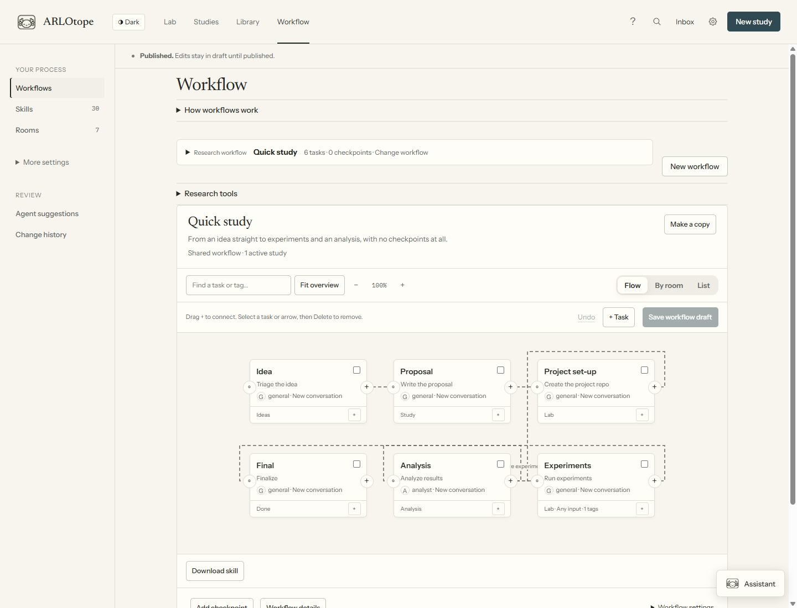

# Customize your research process

Use study instructions for a one-off change. Edit a workflow or skill when you want a reusable method.

## Choose the smallest edit

| Need | Where to change it |
|---|---|
| Add context for one study | Study **Instructions** |
| Change a task's goal or result | Its inspector in **Workflow → Flow** |
| Reuse a method | **Workflow → Skills** |
| Choose another agent or model | [Agent choices](agent-workflows.md#choose-agents) |
| Branch or return to earlier work | Task connections and named outcomes |
| Require a decision | Checkpoint |
| Change the agent's visual location | Room assignment |
| Leave context without requesting work | [Add note](knowledge.md#add-a-human-note) |

The supplied research stages are defaults. Your workflow can use any tasks and need not include
ideation, experiments or writing.

## Edit a shared workflow

1. Select a workflow. Use **Make a copy** for a variation or **New workflow** to start fresh.
2. Select a task to edit its name, skill, instructions and room. **View instructions** reads the full method.
3. Drag its **+** handle onto another task to connect them. Select an arrow for context and waiting choices. **+ Task** adds a task.
4. Select a task or arrow and press Delete/Backspace to remove it. **Undo** or Ctrl/Cmd+Z restores local edits; Escape cancels a connection.
5. Add checkpoints where decisions belong. Use **Advanced** only for named outcomes, loops or other extra settings.
6. **Save workflow draft**, then **Review & publish**. Check validation, changed files and affected studies before applying it.



*Example workflow; no agents are running.*

**Change history** can undo the latest publication if later changes do not conflict. Deleting a task
also removes its routes and associated checkpoint placements; the publication review shows the result.
Text fields keep their normal Delete and Undo behavior.

## Ask an agent to propose an edit

Use **Draft with an agent**, or **New workflow → Describe it**. Explain the process you want.
The designer writes a proposal in a private folder. Inspect it, take it into the shared draft,
then review and publish. Sending the request uses an agent turn; the designer does not publish for you.

For one study, **Instructions** saves local guidance in `studies/<slug>/workflow/`.
Removing it restores the Lab's instructions. A study can also select a skill variant without changing
other studies.

## Reuse a method

Import a `SKILL.md` folder or make a variant under **Workflow → Skills**.
Keep the method in the main file and longer optional guidance in `references/`.
Use task instructions for this assignment and role instructions for responsibility.
The shared run brief already supplies the workflow state, outcomes and checkpoints.

A variant supplies its own instruction body. Metadata inheritance through `arlotope.like` does not
include the parent's body. Use Lab or study additions to supplement a method; use a variant to replace it.
See [skill structure and project copies](skills.md).

## Edit the files directly

The editor uses `workflow/steps.yaml`, `workflow/workflows/*.yaml`, skill folders and
`lab/workflow/` overlays. Validate direct edits with:

```bash
uv run --with pyyaml python arlo.py check
```

**More settings → Task defaults** changes shared task definitions; ordinary map edits change the
selected workflow. Use the [workflow reference](workflow.md) for formats and
[extensions](extending.md) for new checks, project types or instruments.
