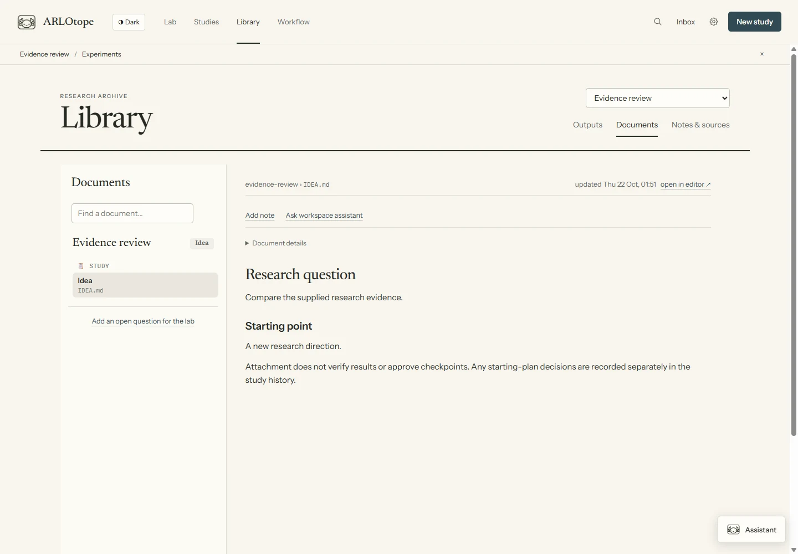
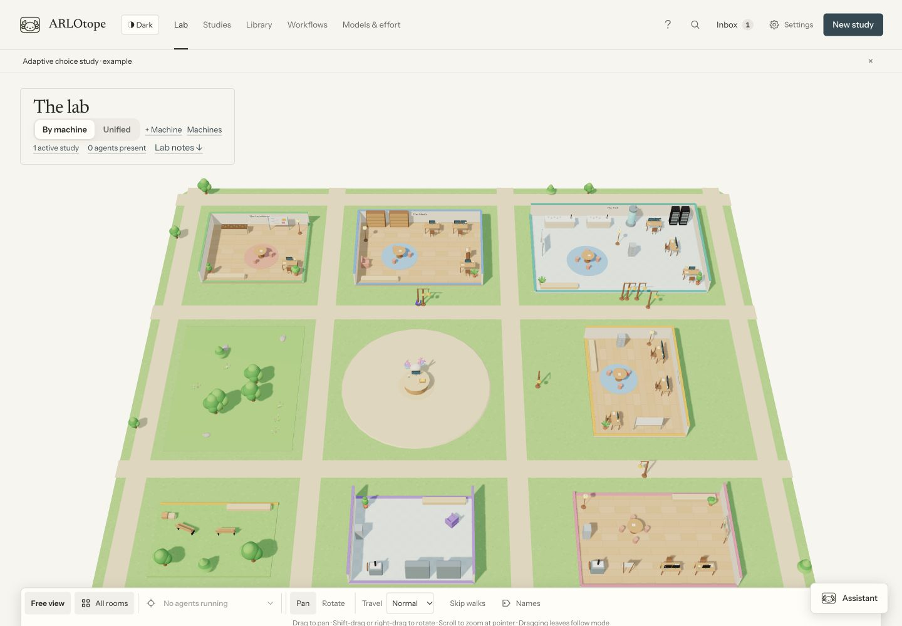
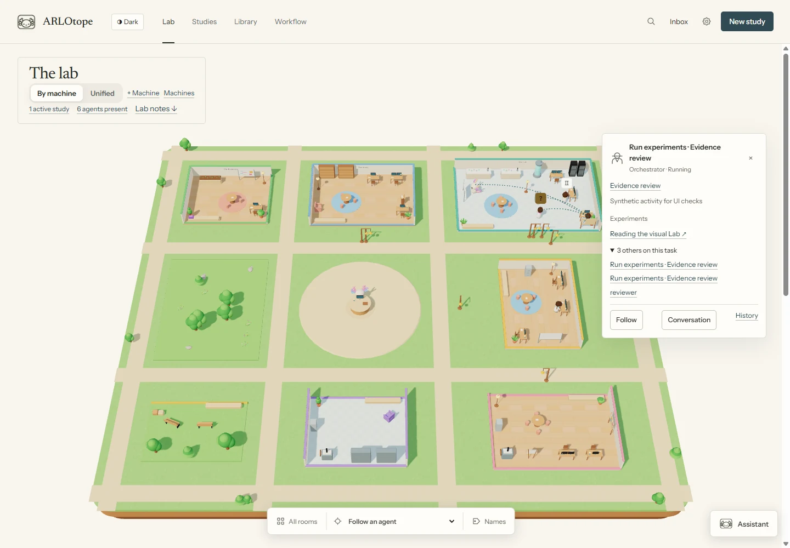
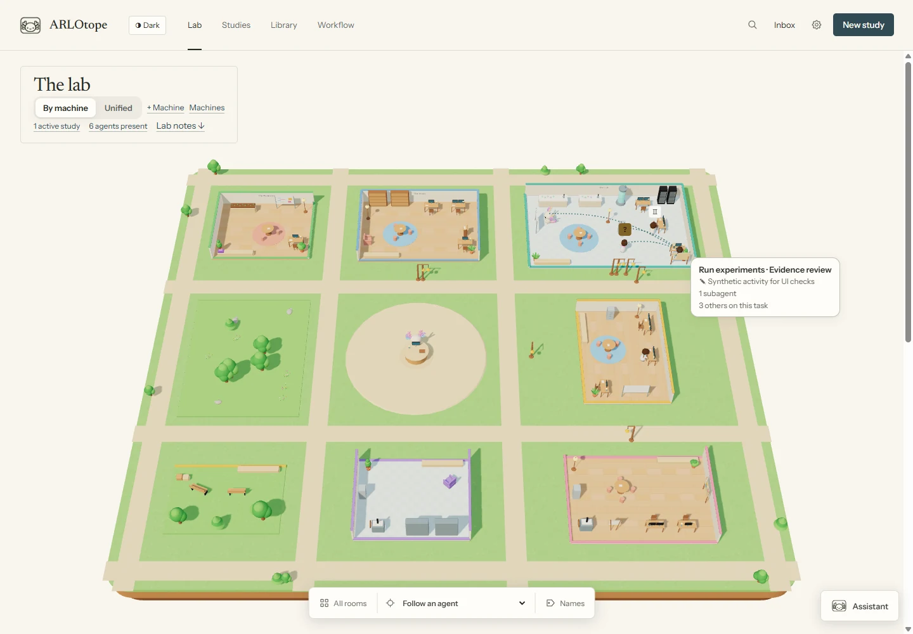
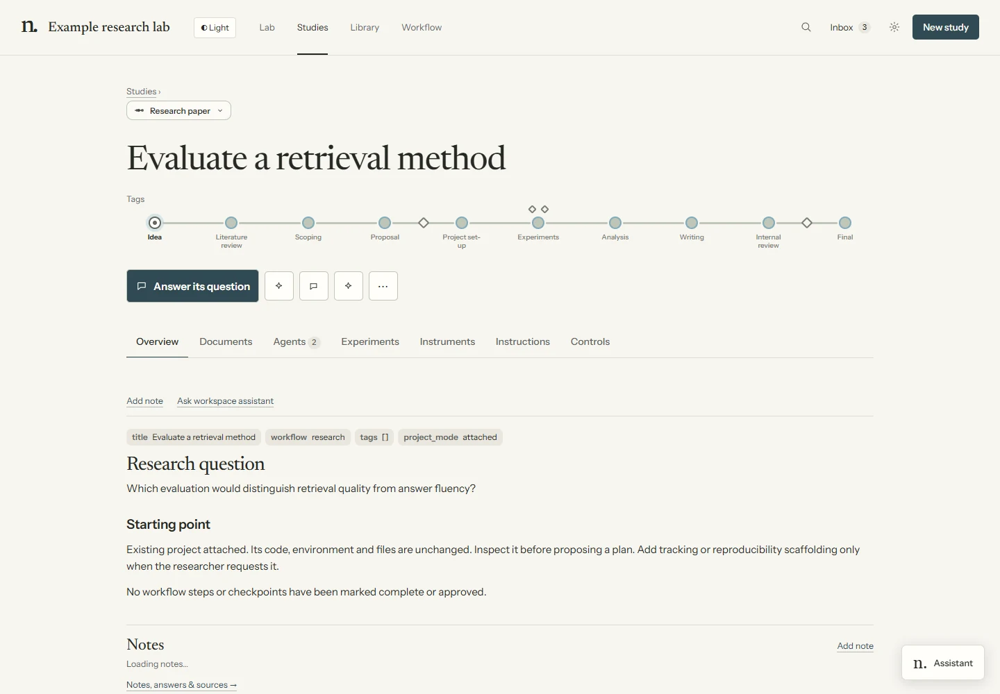
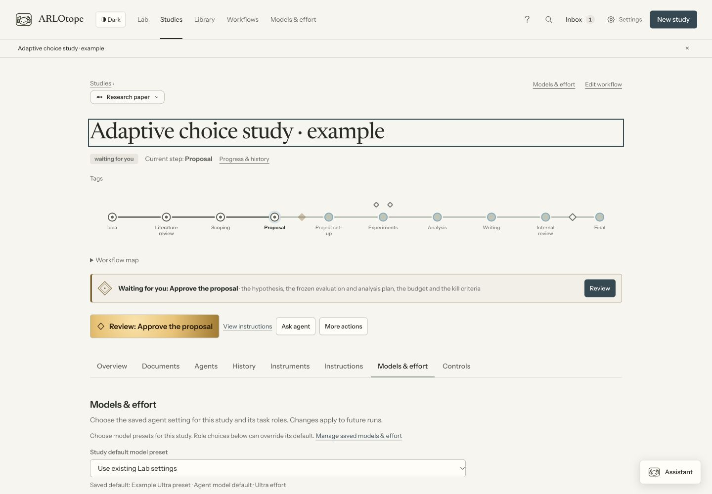
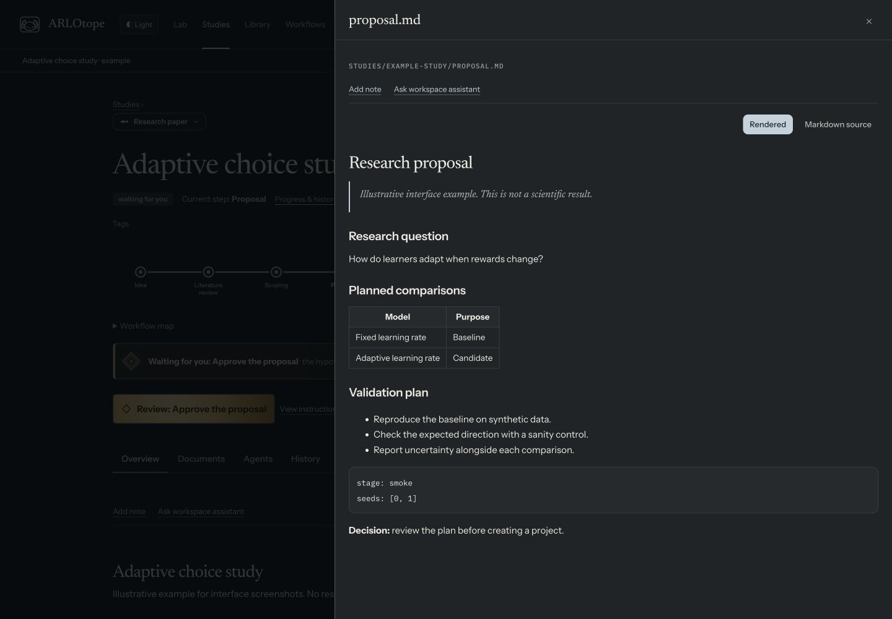

# The dashboard

The Lab shows agent teams across your studies. Click a character to inspect its task, activity
and conversation. Switch projects without stopping work; Inbox collects questions and decisions
across teams. Screenshots use demonstration data.

## Find the right place

| Control | Use it for |
|---|---|
| **Lab** | Follow working agents and see what needs attention |
| **Studies** | Open a question, its workflow, instructions and history |
| **Library** | Read outputs, documents, notes, sources and saved answers |
| **Workflows** | Build tasks, reuse skills, assign agents and configure checkpoints |
| **Models & effort** | Manage model presets, effort levels and Lab defaults |
| **New study** | Start from a question, existing folder or GitHub repository |
| **Inbox** | Answer questions, review permissions and make decisions |
| **Assistant** | Ask a separate agent about selected work |

**All agents**, **History** and **Machines** are in the footer. **Settings** holds agent and
execution options. Ctrl/Cmd+K opens search; **?** reopens the ARLO guide.

**Create workflow** is available in the footer and the Workflows page. It opens a creation dialog;
opening it does not change or publish a workflow. A study also has an **Edit workflow** shortcut.

## Keep your place

Selecting a study, task or agent adds a **Selected work** strip. It carries that selection between
Lab, Workflow and Library. Select other work to change scope, or **×** to clear it.

The shared inspector links each agent to its task, outputs and position in the Lab.
Unsent messages survive switching inspectors in the same browser tab, but not a page refresh.

## Follow work in the Lab

Use **Follow an agent** to follow a character or recorded child. **Free view** leaves follow mode,
and **All rooms** frames the whole Lab. Drag to pan; use **Rotate**, Shift-drag or right-drag to turn
the view. Scrolling zooms toward the location under the pointer. Manual navigation leaves follow
mode and keeps the view where you put it. The focused map also accepts WASD; browser shortcuts
such as Ctrl/Cmd+W retain their normal behavior.

**Travel** offers Normal, 4× faster and Instant walking. **Skip walks** immediately brings displayed
characters to their destinations. These controls change the animation only; task execution is unchanged.
Reduced-motion preferences also skip the walks.

The panel opens the conversation, study history and retained outputs. Questions and permissions
appear there too. Hover or select a character for dotted links to active agents on the same task
and pass, including recorded children. Other tasks in the same study remain separate.

### Inside a room

The task chooses the room; recorded activity chooses a working spot and gesture. Reading can use
a bookshelf, editing a desk, and planning a whiteboard. Agents keep a suitable spot through short
calls rather than walking after every event. These are activity cues; click for the underlying record.

Raised hands and markers distinguish questions, permissions, usage limits, unfinished tasks and
connection problems. Recorded children appear near their parent. Continued sessions keep their
character when a native session ID is available; fresh sessions and forks have separate characters.

**By machine** gives connected machines their own spaces. **Unified** places their agents in shared
rooms. These views use the same records. **+ Machine** connects a project machine.
Studies share rooms; add a new one explicitly in **Workflow → By room**.

**Names** toggles room labels. Theme and reduced-motion choices affect appearance only.
If the world cannot load, use **Retry 3D view** or **View work below**.
See [renderer details](internals.md#visual-activity) for movement and event handling.

## Inspect a study

Open a study from **Studies**, a run or an output. Its primary action shows the next task or decision.
Expand **Workflow map** and select a task to read its instructions, context, outputs and checkpoints.

- **Instructions** adds study-specific guidance.
- **Agents** opens agent conversations and task results.
- **Models & effort** sets the study default and task-role model presets. Manage the reusable presets
  and their model/effort fields from the matching top-level navigation link. Changes apply to future runs.
- **History** groups task passes, agent attempts, notes, decisions and outputs. **Save history to study** creates a readable snapshot.
- **More actions** holds other procedures, notes and controls. **Pending instructions** shows requests awaiting an agent.

On narrow screens, **Study section** switches these views. See
[starting and steering work](running-work.md) for launches, holds and multiple studies.

## Answer and recover

Open **Inbox** or the producing run for questions and tool permissions. Checkpoint decisions have
their own evidence sheet. Open an exhibit individually, or choose **read them all**, to read the full document.
Markdown opens rendered, with **Markdown source** available for inspecting the original text.
Terminal sessions observed by the Lab still receive input in their terminal.

An agent that stops without its task outcome stays unfinished. Inspect its work before
**Continue task** or **New agent with handoff**. See [recovery](recovering-work.md).

## Outputs and explanations

In **Library**, **Outputs** previews published reports; **Documents** browses existing files;
**Notes & sources** holds retained knowledge. The **Library study** selector carries scope between
tabs. Notes & sources opens one study or Lab-wide records; the other tabs also offer all studies.

**Add note** saves context. **Ask workspace assistant** starts separate Q&A; its **Focus** control
selects work and **Agent & settings** changes its agent. A run's **Visual summary** starts an
independent explainer. Both use your configured agent account.

Instruments pinned to **Lab notes** show compute or other readings. **All instruments** manages
them. **Retry data** rereads data; **Gather now** runs a collector. Custom collectors require code
review before execution; see [instruments](extending.md#collector-execution).

For details: [Notes and sources](knowledge.md) · [Outputs](artifacts.md) ·
[Task instructions](skills.md#read-the-instructions).
