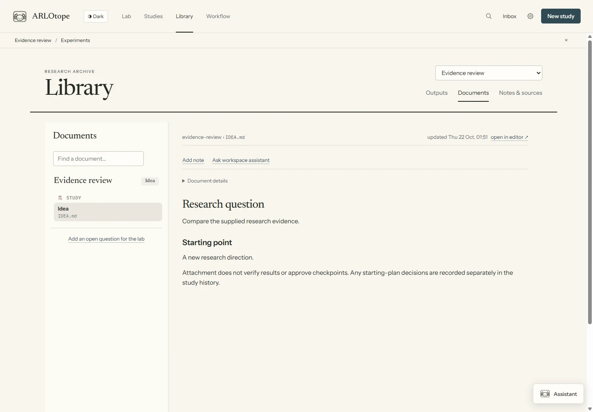
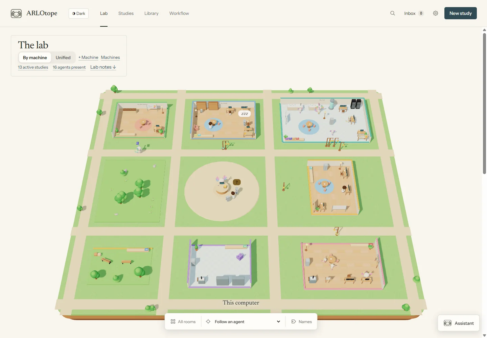
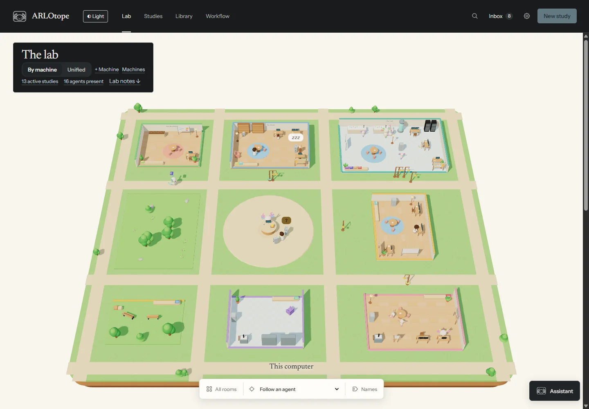
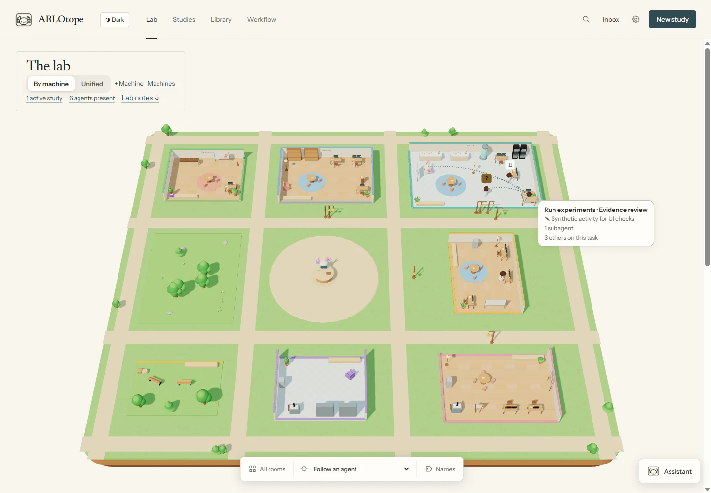
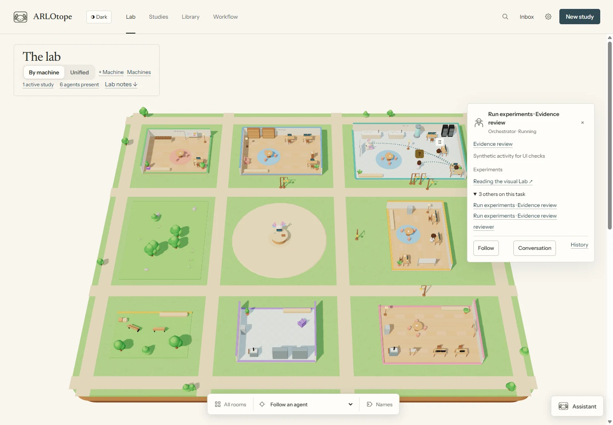
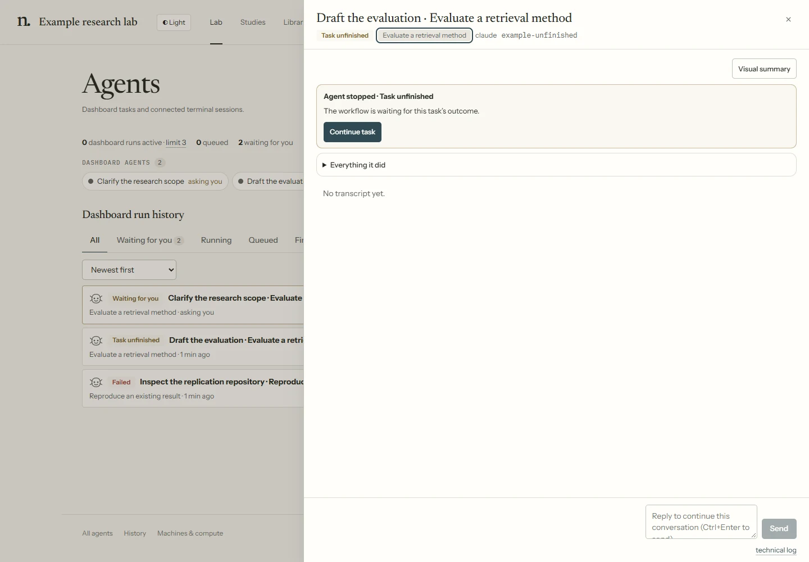
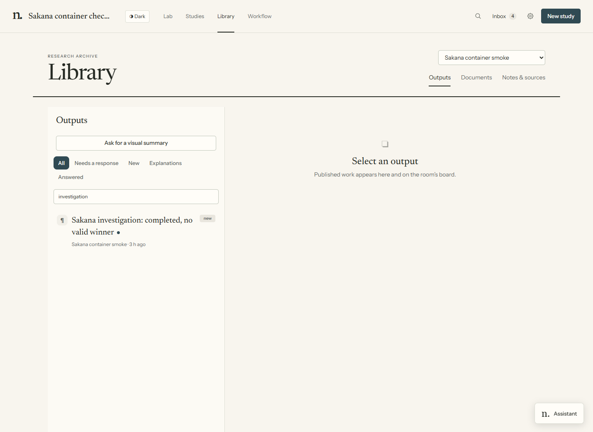

# The dashboard

Run `./arlo` on macOS/Linux, `.\arlo.cmd` on Windows, or use the platform launcher.
`uv run --with pyyaml python arlo.py` works on all three. Add the repository folder to PATH
to use `arlo` elsewhere. The local browser interface normally opens on port 8787; it can choose another free port.

## Find the right place

| Control | Use it for |
|---|---|
| **Lab** | Visual workspace, active agents, decisions and recent outputs |
| **Studies** | A study's question, tasks, files, instructions and history |
| **Library** | Outputs, existing documents, notes, sources and saved Q&A |
| **Workflow** | Tasks, reusable methods, roles, routes, rooms and checkpoints |
| **New study** | Create a study from a question, existing folder or GitHub repository |
| **Inbox** | Answer questions, review permissions and handle decisions |
| **Assistant** | Ask a separate workspace agent about selected work |

**All agents**, **History** and **Machines** are in the footer. Ctrl/Cmd+K opens search.
Settings holds agent, execution and appearance options. The theme button names its target mode.

In **Workflow**, use the map for task edits, **Skills** for reusable instructions and **Rooms** for
shared spaces. **More settings** holds shared task defaults, roles, rules and checks. The workspace
assistant opens on its conversation and question; expand **Focus** to select work or **Agent &
settings** to change the agent, model, conversation or automatic briefings.

Search finds studies, procedures and pages, including Machines, History and New study. Use Up/Down to choose a result, Enter to open it and Escape to close search. The search button is also available on small screens.

For segmented choices, use the arrow keys or Home/End; Tab moves to the next control. History tables scroll sideways on small screens, including with Left/Right when the table area is focused. Page navigation moves focus into the new page; dialogs and form autofocus keep their own focus.

For launch steps, multiple studies, session limits and notification behavior, see
[Start and follow work](running-work.md).

## Keep your place

Selecting a study, workflow task or agent adds a small **Selected work** strip above the page.
Navigation keeps that selection between Lab, Workflow and Library. Workflow opens the selected
task; Library shows the study's records. Select another study to change scope, or use **×** to
clear it. Selecting work starts no agent.

Agent conversations, workers and output previews reuse one inspector. Its **Task**, **Outputs**
and **Show in Lab** links lead back to the same work. Unsent replies and answers stay in the tab
when you switch inspectors. Refreshing or closing the tab clears them.

*Current dashboard with a local test study; selecting work filters the view, not execution.*

*Demonstration fixture: the scene and the records below it provide two ways to reach the same work.*

*The same fixture in the dark theme; changing appearance does not change study state.*

The newt keeps its cream body and family colors in both modes, with a little more self-illumination
at night. Room lighting can still tint shaded surfaces; the character does not switch palettes.

## Follow work in the Lab

Use the bottom camera/agent controls to follow a main agent or recorded child. Click a character for its task, activity and a link to details. **All rooms** returns to the overview; the close control stops following without resetting the camera. Viewing a character does not launch work.

**Show in lab** on current work focuses its character and opens its small task panel. The follow
selector does the same. Selecting work from Lab notes returns to the top of the world. The panel
links its conversation, study history and latest retained output,
and exposes pending questions or permissions. It stays still while you hover or use its controls.

**Names** shows room labels. This choice is saved in your browser and shared with room previews.

**By machine** gives connected machines their own spaces; **Unified** groups their agents into shared rooms. These are views of the same records. **+ Machine** opens connection setup; **Machines** opens existing connections and compute readings. The rest of the application remains usable when the 3D view is unavailable.

Studies share these rooms. Agents move to the room assigned to their task; adding a study or project
does not add a room. Add rooms explicitly in **Workflow → By room**.

### Inside a room

The task chooses the room; observed activity chooses a working spot inside it. A character reading
can use a bookshelf, editing can use a desk, and planning or spawning a child can use a whiteboard.
Furniture advertises the activities it serves and places where characters can stand. If no suitable
spot is available, the renderer uses the task/procedure station, a role station or a spare spot.

Characters keep a suitable current spot instead of moving for every short call. Activity changes
are smoothed: the current display waits at least eight seconds before switching and can linger for
twenty seconds between calls. Reading, searching, typing, planning and briefing have different
gestures. Idle, waiting and stalled sessions use different poses. Reduced-motion modes place agents
at their destinations without the walk.

Questions stay in the task's room with a raised hand and a question marker. Permission, usage-limit,
unfinished-task and connection markers explain other waits; hovering or following reveals the label.
On hover, questions and permissions also have a warm dotted link to the researcher's desk. Queued
work waits by the appropriate desk. Recorded children appear near their parent and share its family accent.
When a child disappears from the active records, it returns toward its parent and fades. This is
a visual transition, not proof that the child's task succeeded.

The room and activity are separate. An analysis task can read, search and edit while staying in
Analysis. A displayed character whose destination changes follows doors and paths between rooms.
When the harness supplies a native session ID, a continued conversation keeps its character across
workflow runs on the same backend and execution location. Fresh sessions and native forks remain
separate. Without a session ID, the renderer uses the run's identity. Visual continuity is held in
the open view; it does not create or merge conversation records.
The renderer uses coarse furniture avoidance within rooms, without a physics engine or guaranteed
collision-free paths. A courier carrying a study card is a presentation effect, not another agent run.

Activity comes from available harness events and trace hooks. Some commands are classified by their
names; missing events cannot reveal what an agent is thinking. A working animation does not certify
progress or a result. Click the character for its recorded activity, conversation and evidence.

Hover, select or follow a character to see dotted links to other active agents on the **same task and visit**,
including subagents and parallel workers. Another task in the same study or room is separate. Queued
and ended runs are excluded. Visible published output cards are linked too. Keyboard selection shows
the same relationships. The character's preview lists its task peers and retained outputs; an output's
**Show in Lab** action returns to its producing agent while that agent is present.

*Synthetic browser state: three active peers and a published output card. The stopped, quota-limited
agent keeps an attention marker and is excluded from active-task links.*

*Task peers stay under one expandable row; outputs open their retained records.*

If the view fails, use **Retry 3D view** or **View work below**. Technical details stay under **Details**. Loading and retrying the view do not restart agent tasks; room previews have their own retry control.

In **Lab notes**, **Inbox** identifies the study behind each request. **Work** shows running and queued tasks; waiting tasks already in the Inbox appear there once. The “more” links open the remaining tasks or requests.

Instruments pinned to **Lab** appear below the rooms in **Lab notes**. Select one to open its readings. **All instruments** opens the cabinet, where you can manage pins and archived instruments.

A custom instrument's collector runs on your machine after you review its code and hold **Let it run**. Failed code reads offer **Retry** without an approval button. Approval applies to the version shown: if the file changes before you approve, the Lab refuses that decision and reloads the code for another review. This does not start a research agent.

Execution uses the checked collector bytes even if its source changes before launch. See [collector execution](extending.md#collector-execution) when writing a custom instrument.

Instrument view failures offer **Retry**. **Retry data** rereads the instrument's data; **Gather now**
runs its collector. A failed refresh keeps labelled last-loaded data. A collector's own error may
also accompany usable last-good data. Switching study or instrument starts a separate view and
polling lifetime, so a late reply cannot appear as another study's readings.

## Inspect a study

Open a study from **Studies**, an output or a run. Its overview links the active task, documents, recent outputs and notes. Use **Instructions** for local method guidance and **Agents** for saved agent preferences. Attached project files stay in their project.

Expand **Workflow map** for a compact view of its task connections. Select a task to see its
instructions, conversation mode, outputs and checkpoints. The same diagram is used when starting
and reviewing a study; custom tasks and routes come from the saved workflow.

The study's primary action shows the next work or decision. **Ask agent** opens a direct instruction;
**More actions** contains other procedures, discussion, notes and controls. **History** organizes
task passes, agent sessions, outputs and workflow decisions, with an optional saved snapshot.

In the study list, select a title to open the study or a checkpoint diamond to inspect its evidence. Progress dots show the steps; long paths scroll sideways. Markdown frontmatter is preserved under **Document details**, including lists and nested fields.

**Pending instructions** shows steering requests awaiting an agent, even before a project exists.
**View hold** opens the study controls; a hold blocks new agents while leaving current work and
checkpoint decisions accessible. A failed History read offers **Retry** rather than an empty history.

*Demonstration fixture: start from the study to keep tasks and evidence in context.*

## Answer and recover

Open **Inbox** or the run conversation for a question or tool permission. Read the producing agent and request before answering. Terminal/editor sessions observed by the Lab keep their input in their original terminal.

Research checkpoints have their own evidence and decision sheet. A tool permission allows one native request; it is not approval of an experiment plan or paper. Holding a study, pausing the Lab and stopping one run have different scopes.

*Demonstration fixture: inspect the recorded stopping point before continuing or handing work to a new agent.*

## Outputs and explanations

- **Library → Outputs** displays published reports, pages, tables and figures. Search and study filters help find older work.
- **Documents** browses files from the Lab, studies and projects.
- **Notes & sources** stores separate notes, retained sources and Q&A records.
- **Add note** saves human context. Its default acknowledgement option requests a read receipt without queuing a task.
- **Ask workspace assistant** opens separate Q&A with the selected document or output as context. Sending uses an agent turn and saves the question and answer separately.

The **Library study** control above the tabs carries a selected study or **Lab-wide** scope between
Outputs, Documents and Notes & sources. Changing scope closes the selected item. Each tab keeps its
own search and filters. Outputs and Documents also support **All studies & lab**; Notes & sources
opens one study or the Lab, so entering it from All studies opens Lab-wide records.

*Isolated example Lab: records and outputs are scoped to one study; no research agent was launched.*

A run's **Visual summary** starts an independent explainer. It does not message the working source agent. Automatic assistant briefings are optional and use your agent account.

See [knowledge records](knowledge.md), [outputs and feedback](artifacts.md), [tasks and agents](agent-workflows.md) and [getting started](getting-started.md).
