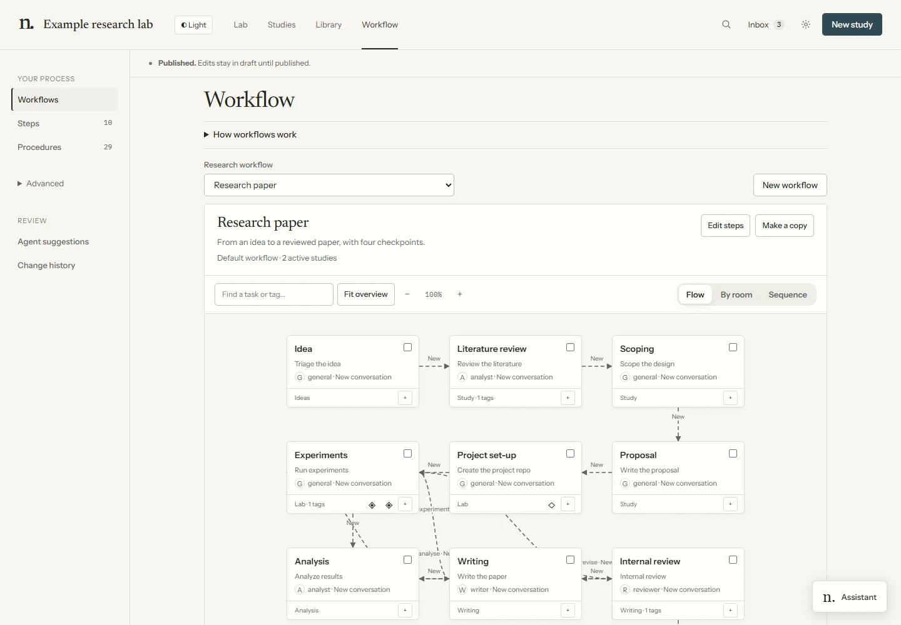
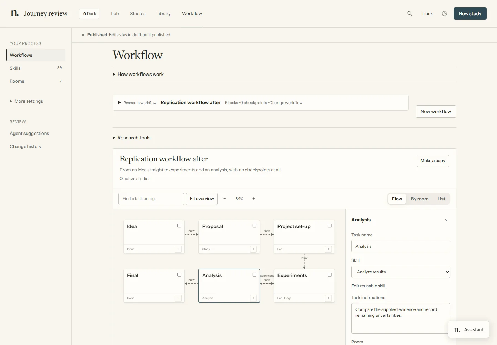

# Extending the Lab

Change a method or workflow through the existing definitions. **Workflow** offers the map, shared
steps and procedures; **Advanced** contains roles, stage groups, rules, checks, project types and
instruments. Agent harness/model presets belong in Settings, not in role instructions.

Dashboard edits stay in a draft. Use **Review & publish** to inspect changes and validation problems;
publishing applies them. **Change history** can undo the latest publication. An agent designer
proposes a draft; it cannot publish or approve its own changes.



For terminal edits, `newts` below means `uv run --with pyyaml python newts.py`.
Run `newts check` after editing definitions. Researcher-owned files and signature guards still apply.

## Add a step

A shared step gives an ordered workflow a label, procedure and optional role. For example:

```bash
uv run --with pyyaml python tools/new.py step replication --like analysis \
  --do replicate --label Replication --in research --after analysis
```

The procedure `replicate` must already exist. This copies the shared step and inserts it after
analysis in the research path. By hand, edit `workflow/steps.yaml` and the workflow’s `path`.
In the dashboard use **Steps → New step**, then **Edit steps** on the workflow.

A composed task can instead carry its own instructions and skill sequence. Select it on the map
to edit role, preset, expected files and context. Role describes the job; choosing it does not
implicitly change conversation inheritance.



## Make a variant of a procedure

```bash
uv run --with pyyaml python tools/new.py skill lit-review-quick --like lit-review --title "A quick scan"
```

The copied skill’s `newts.like` identifies its family. Edit its Markdown instructions while keeping
the intended outcome/evidence contract clear. It is a copy, not a live link to the original.

Use a variant through a workflow’s `use` mapping, a study’s **Instructions → Variant**, or a step’s
`do`. The CLI study swap is:

```bash
newts workflow use <study> lit-review=lit-review-quick
```

`lit-review=` removes the swap. Additive shared instructions live in
`lab/workflow/<procedure>.add.md`; study-specific instructions use the study’s workflow area.
The dashboard’s procedure editor exposes the same files and variants.

## Route an outcome

A procedure declares nonstandard outcomes in its frontmatter:

```yaml
newts:
  outcomes:
    regressed: something that passed before now fails
```

An ordered workflow maps them per step:

```yaml
routes:
  evaluate: {regressed: build}
```

Targets must be valid for that workflow. An unmapped outcome goes to the researcher.
For composed tasks, use the inspector’s **Named outcomes** and connections; branches and joins
are explicit. A room does not determine the next task.

## Add a checkpoint

Use **Add checkpoint** on the workflow and choose before/during placement, decision owner and evidence.
The editor also supports checks and watches. Review a removed or loosened checkpoint carefully
before publishing.

```yaml
checkpoints:
  - id: within-budget
    title: Within budget
    before: analysis
    approver: auto
    checks: [{budget-under: {usd: 50}}]
    evidence: ['studies/{study}/spend.json']
    means: the study spent no more than its budget
```

This example requires a real `budget-under` check; the label alone enforces nothing.
`checks` run when deciding the checkpoint. An explicitly automatic checkpoint needs all required
checks to pass. `watch` runs declared checks while the checkpoint is unapproved and raises flags
on failures. A working agent cannot approve its own task.

## Declare what a step reads and writes

Skill frontmatter can declare:

```yaml
newts:
  reads: ["studies/<slug>/SPEC.md"]
  outputs: ["studies/<slug>/BUILD.md: implementation and reproduction instructions"]
  writes: ["studies/<slug>/**"]
```

These lists inform briefs and validation. Declared study output paths are checked before accepting
completion. Read/output relationships catch missing upstream evidence in the workflow.
`writes` narrows allowed paths for applicable guards and detects changes outside the declaration;
it is not an OS filesystem sandbox. See [monitoring](monitoring.md).

## Rename a step

```bash
newts workflow rename-step active running --yes
```

This updates the shared identifier, workflow references and study positions through recorded remap
events. To change only the visible label, edit **Steps → step → About**. Do not rename history by
hand or edit the generated registry.

## Add a check

A check in `checks/` supplies a name, arguments and a verdict:

```python
NAME = "budget-under"

def add_args(parser):
    parser.add_argument("slug")
    parser.add_argument("--usd", type=float, required=True)

def run(args, guard):
    spent = read_recorded_spend(guard.HUB, args.slug)  # implement from evidence
    return guard._verdict(0 if spent <= args.usd else 1,
                          f"spent {spent} of {args.usd}")
```

This is a sketch; implement the evidence reader. Exit 0 passes, 1 blocks and 2 warns.
Automatic approval/campaign checks require a pass. Copy a starting check with:

```bash
uv run --with pyyaml python tools/new.py check budget-under --like writeback
```

## Add a workflow

Use **New workflow** or **Make a copy** on the map. For a file-based copy:

```bash
uv run --with pyyaml python tools/new.py workflow fast --like research --title "Fast lane"
```

Review its steps/tasks, routes, checkpoints and evidence requirements, then validate. A study chooses
a workflow at creation or through `newts workflow set <study> <workflow>`. Changing that choice is
separate from approving a checkpoint.

## Add a stage group

A stage group uses a stable `room` ID for related steps or tasks. It affects visual grouping,
not dependency order:

```bash
uv run --with pyyaml python tools/new.py room data --like lab --steps analysis --title "Data analysis"
```

For composed tasks, select them and choose **Create room & group** or an existing room.
The [room designer](room-design.md) refines appearance through a private preview/apply flow.


## Install an extension

The terminal extension interface remains available for researcher-supplied bundles:

```bash
newts extension list
newts extension install <name>
```

Installation previews the overlay and validates it before applying. No general software-product
extension ships with the Lab, and the current dashboard has no Ready-made extension catalog.

## Write an extension

An extension contains `extension.yaml` and files under supported roots:

```text
extensions/my-extension/
├── extension.yaml
├── workflow/steps.yaml
├── workflow/rooms.yaml
├── workflow/workflows/<id>.yaml
├── .claude/skills/<name>/SKILL.md
├── checks/<name>.py
└── agent-roles/<role>.yaml + .md
```

Steps and rooms merge by ID. Other supported files replace the same path as a whole. Only
`workflow/`, `.claude/skills/`, `checks/` and `agent-roles/` are laid over the Lab.
Use unique workflow/checkpoint IDs, inspect replacements and run validation. An extension is not
a way to bypass researcher-owned settings or checkpoints.

## Ask the designer

Use **Workflow → Draft with an agent** or `/design` for a concrete process change. The designer
writes an overlay under `lab/.bus/designs/workflow/<timestamp>/` and checks it:

```bash
newts check --design lab/.bus/designs/workflow/<timestamp>
```

The proposal remains separate until the researcher takes it into the shared draft, reviews and
publishes. Room appearance has its own `/design-room` flow; do not use it to change research logic.

## Research without a paper

Quick study, individual procedures and custom workflows can produce a replication report, dataset
analysis, simulation or verified derivation. Keep its agreed evidence and final checks explicit.
A methodology profile should adapt the contract rather than silently omit traceability or evaluation.
See [project types](project-types.md) and [skills](skills.md).
