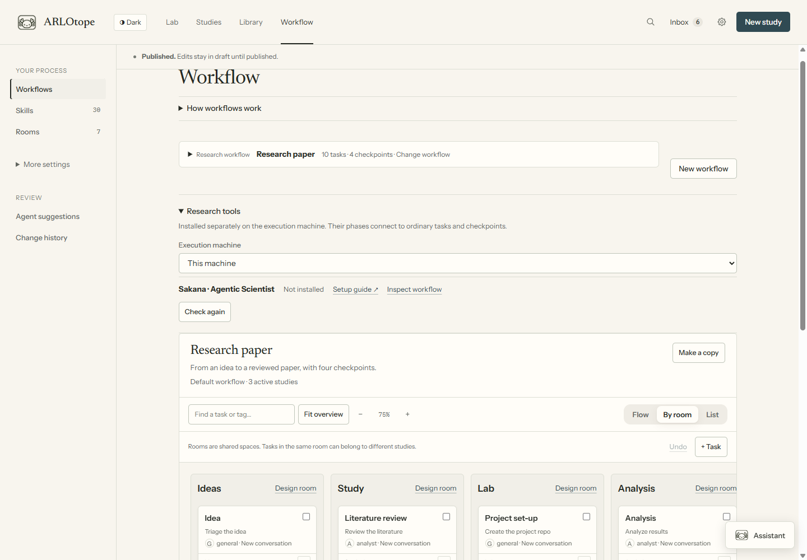
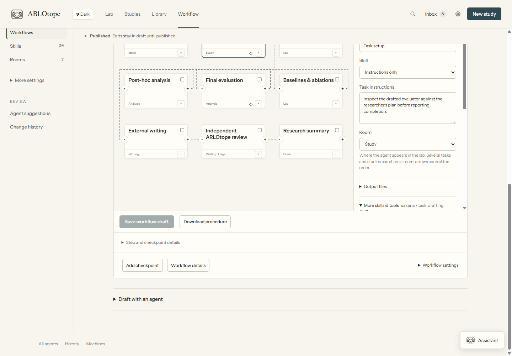
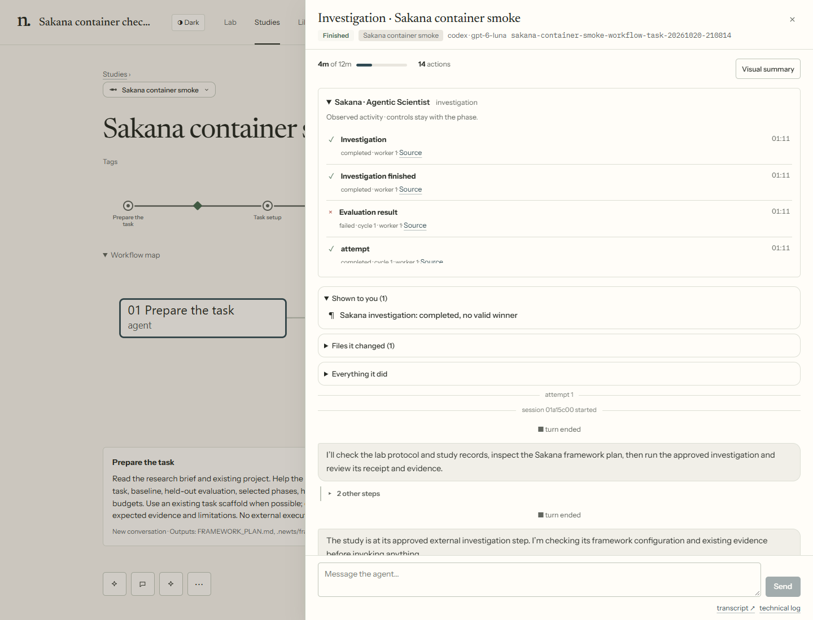

# External research frameworks

Optional research tools appear under **Workflow → Research tools**. A workflow requiring
an unavailable tool stays visible but cannot be selected. Choose the execution machine there;
**New study** checks the machine and project folder selected in the starter. **Check again**
refreshes detection. Detection only locates the configured executable; it does not run it, install
anything, or certify credentials, version compatibility or scientific validity.



**Inspect workflow** opens the preset for reading or editing even before the tool is installed.

The **Agentic Scientist · Sakana** preset uses the normal task graph, rooms, agents and checkpoints.
Its external phases are followed by an independent ARLOtope review and a Results summary. Copy it,
insert normal tasks, move checkpoints, change rooms, or remove phases whose downstream inputs you
already have. In the task inspector, expand **More skills & tools**, then use **Research tool** and **Tool phase**. Save,
review and publish as usual. A receiving agent reads original outputs; no shared conversation is
required. Skipping a phase does not synthesize its required evidence.



The phase screenshot shows the current task inspector in an example Lab. The preset can be inspected
before installation; no Sakana campaign was executed for this image.

## Set up Sakana

Install [The Agentic Scientist](https://github.com/SakanaAI/AI-Scientist-v3/blob/main/docs/install.md)
separately, preferably at a pinned revision on a connected Linux machine. Its documented Docker,
agent authentication, data and task-runtime requirements still apply. ARLOtope adds no Sakana,
Docker, Hydra or frontend dependency. The definition was source-reviewed against upstream
`df8313889a004f8a44a472e19a833cd547bb828a`. Local checks covered a native one-cycle investigation
and a shortened Docker workflow: task drafting, one investigation cycle, fresh ARLOtope review
and an HTML summary. The Docker investigation completed without a qualifying winner. Live
ablations, final evaluation, post-hoc and paper generation were not tested; the full preset
and other execution hosts are not certified.
Native Windows execution is unavailable in this preset; connecting to a Linux worker is supported.

On WSL, keep the installation, project and run directories on the Linux filesystem, such as under
`~/projects`. Default Windows mounts can fail upstream ownership and permission checks. Installing
inside WSL does not make a Windows dashboard's local executor a Linux executor; dashboard launches
still need a supported execution machine.

Run `agsci doctor` from the supervising agent's actual shell, not just a separate host terminal.
Its scratch-directory ownership checks can fail inside a harness sandbox even when they pass
on the host. Set `AGENTIC_TEMP_ROOT` to an existing, private, writable directory on that machine;
its ancestors must also satisfy upstream ownership checks. Keep Python caches writable too.
Do not disable upstream checks or silently widen the agent's permissions to make preflight pass.
Docker-controlling agents need explicitly configured access to the host Docker runtime.

Use a coding CLI version compatible with the chosen model and account. Verify its model list and
a small turn on that host, then set upstream `agent.model` explicitly when its default is unsuitable.
The ARLOtope supervising agent's model choice does not automatically configure Sakana's internal agent.
The pinned Headless runtime also needs a working npm Git-dependency install. These are external
runtime requirements, not dependencies added to the ARLOtope package.

At the reviewed revision, `agsci doctor` reports missing Docker as a failure even for a native
investigation configuration. A successful standalone native phase therefore does not establish
readiness for the complete preset. The ARLOtope preflight preserves that failure; install and verify
the documented Docker runtime before using the full preset.

In the attached project, create `.arlotope/frameworks.yaml`:

```yaml
sakana:
  command: [/absolute/path/AI-Scientist-v3/.venv/bin/agsci]
  cwd: /absolute/path/AI-Scientist-v3
  inputs:
    task: /absolute/path/research-project/task
  timeout_seconds: 3600  # example only: choose and approve your own phase budget
  args:
    - agent.name=codex
    - investigation.execution.max_idea_cycles=2
    - investigation.execution.max_program_evals_per_attempt=2
```

All paths refer to the execution machine. Use its folder picker in New study to attach the
project. The installation command defaults to `agsci` on that machine's PATH when not configured.
The task directory contains the upstream task scaffold or research brief; drafting from a bare
brief is experimental. Do not assume an arbitrary repository already implements that contract.
Keep API keys in the upstream-supported authentication environment, never this file or task text.

The first task helps prepare a written plan and project settings. A human checkpoint precedes
external execution, and another precedes final evaluation. Their policies remain editable.
The supervising agent can be Claude, Codex, OpenCode or ACP; upstream `agent.name` independently
selects a Sakana-supported coding harness. ACP is not an upstream transport selection.

The initial definition uses one internal investigation worker, represented by one task slot.
Parallel internal workers are intentionally not advertised: they need capacity and recovery
integration before claiming support. The moving character represents the current ARLOtope phase
task; internal sessions are not separately controllable characters in this first integration.

## See internal activity

Open the supervising run to see a read-only timeline of upstream events. The Sakana mapping
includes phase preparation, idea generation, evaluation attempts and cycle/worker labels, with
links to their original JSONL files. Failed candidates remain visible even when the investigation
itself completed successfully. The existing moving character uses the current mapped activity
while its supervising run is working; events do not create extra agents.



*Historical test capture from 20 October 2026, before the ARLOtope branding. Completed, one-cycle Docker test: the evaluation failed to produce a qualifying winner. This
history is observed evidence; individual events are not launch, pause or branch controls.*

The workflow controls major phases through ordinary tasks. Splitting an internal upstream step
into its own controllable task requires an upstream command and an explicit input/output contract.
A timeline entry alone does not establish that boundary. Completion still requires the phase
receipt and declared output checks; telemetry never moves a study or approves a checkpoint.

Activity is optional recipe data. Another tool emitting JSONL can use the same reader:

```yaml
activity:
  files: ['{phase}/events.jsonl']
  fields: {time: timestamp, event: event, label: fields.label, state: fields.status}
  events:
    step_start: {label_from: fields.step, state: running, kind: run}
    step_end: {label_from: fields.step}
```

Fields use dotted paths. Optional `phase_field` filters a shared stream to the current phase;
`kinds` maps its `phase` field to existing activities such as `plan`, `read` or `run`. Event mappings
can set `label`, `state` and `kind`, or read `label_from` and `state_from`. Only explicitly mapped
event types are displayed; raw configuration records are not copied into the timeline. File paths
stay inside the upstream run directory. Reads take at most the last 256 KiB per file and show the
most recent 160 mapped events. Missing files are normal before a phase starts; incomplete lines
are skipped and reported. Local activity uses the existing state refresh; connected projects use
the existing worker poll and run-detail request. There is no additional scheduler or event service.

## Execution and recovery

The generic tool is `tools/frameworks.py`. Task briefs supply its exact command, project, study,
definition and phase. `--plan` prints the resolved arguments without creating a receipt or running
the external tool. Executing performs the declared preflight and one phase, with no shell
interpolation. A single timeout covers both commands. For Sakana the preflight is `agsci doctor`.

State lives under the project, outside the installation:

```text
.arlotope/framework-runs/<study>/<framework>/
├── run/                 # authoritative upstream run directory, shared between phases
├── <phase>.json         # command, configuration fingerprint, status and evidence hashes
└── <phase>.log          # captured preflight and phase output
```

Only one phase of a campaign can execute at once. Successful repeated calls reuse the receipt
after checking its configuration and evidence hashes. Failed or interrupted attempts require
inspection and explicit `--retry`; retries preserve the run directory. Changed configurations
or changed completed evidence are rejected, not silently adopted. Start another study for a new
campaign. Ordinary agents can read these files and publish an explanation in Library; private
raw logs are not automatically published.

The graph refuses `done` unless the external phase has a current completion receipt and its
declared output checks pass. This is a completion/traceability check, not a scientific proof or
security boundary. Independent review still checks methodology, metrics and claims. Negative
investigations remain distinct from failed execution. Missing or degraded required outputs stop
the task even when an upstream command exits zero. The preset requires retained post-hoc evidence;
remove that task explicitly when it is not needed rather than treating missing evidence as success.

Timeouts and handled termination request native process-tree cleanup. A hard-killed controller,
detached service or Docker container can require upstream/manual cleanup. ARLOtope does not certify
container cleanup or general resumability. Inspect external activity before retrying. Upstream
parallel investigation recovery has restrictions; never delete its state to force a restart.

A local Docker probe verified handled termination, timeout, explicit retry and receipt reuse
for a simple foreground container. This is narrower than recovery of Sakana's own container
wrappers or an interrupted multi-phase campaign; those require separate verification.

## Add another framework

Use **one YAML definition**, not a new agent backend. Put it under
`workflow/frameworks/<id>.yaml` (part of the normal designer overlay and review/publish flow):

```yaml
title: My research tool
command: [my-research-tool]
setup: https://example.org/install
inputs: [task]
check: [check, '--task', '{task}']
run: [run, '--task', '{task}', '--output', '{run_dir}', '--phase', '{phase}', '{args}']
phases:
  investigate:
    outputs: [result.json]
    accept:
      result.json: {status: [completed]}
```

The executable is researcher-installed and trusted. Commands are argument arrays, never shell
strings. Placeholders are configured `inputs` plus `project`, `study`, `phase`, `run_dir`; a whole
`{args}` element expands the configured argument list. `platforms` can limit supported hosts.
`reserved_args` protects execution-critical key=value arguments from accidental extra overrides.
Each phase can supply its own `command`, `outputs` and optional top-level JSON `accept` checks.
Declared evidence files are relative to `run_dir`, regular files of at most 32 MiB; larger model/data
artifacts stay external and should be referenced by a small manifest. These are trusted tool
recipes, not a sandbox for untrusted executables.

Select it on an ordinary workflow task:

```yaml
external: {framework: my-tool, phase: investigate}
next: [my-normal-review-task]
```

Agent instructions, roles, skill sequences, rooms, named outcomes and checkpoints remain ordinary
workflow fields. Project `.arlotope/frameworks.yaml` supplies `<id>` configuration with `command`,
`cwd`, `inputs`, `args` and a required `timeout_seconds`. No Python plugin is needed for this
command-and-artifact contract. JSONL activity can use the optional mapping above. Interactive
authentication/questions, internal-worker controls, other stream formats and remote-service cleanup require a deliberately implemented adapter;
don't claim those capabilities merely because a command can launch.
