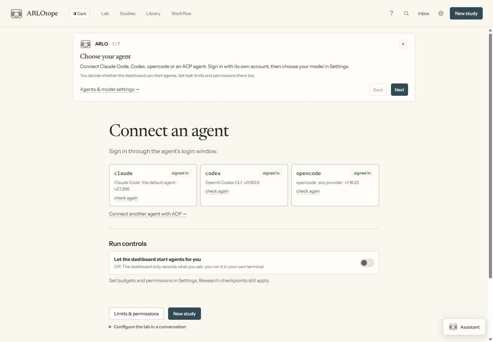
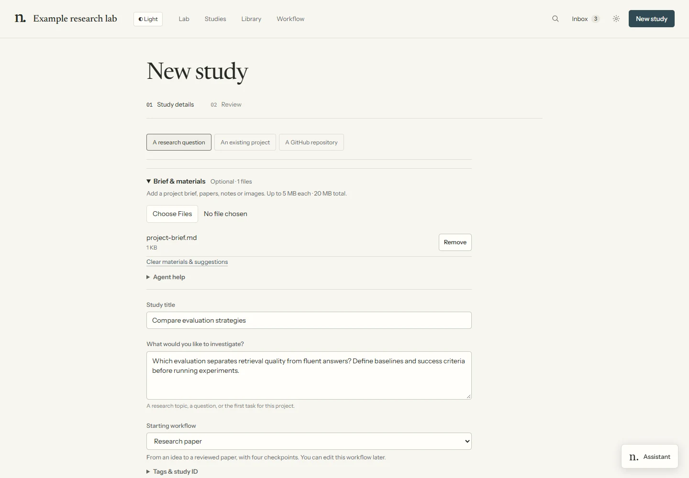
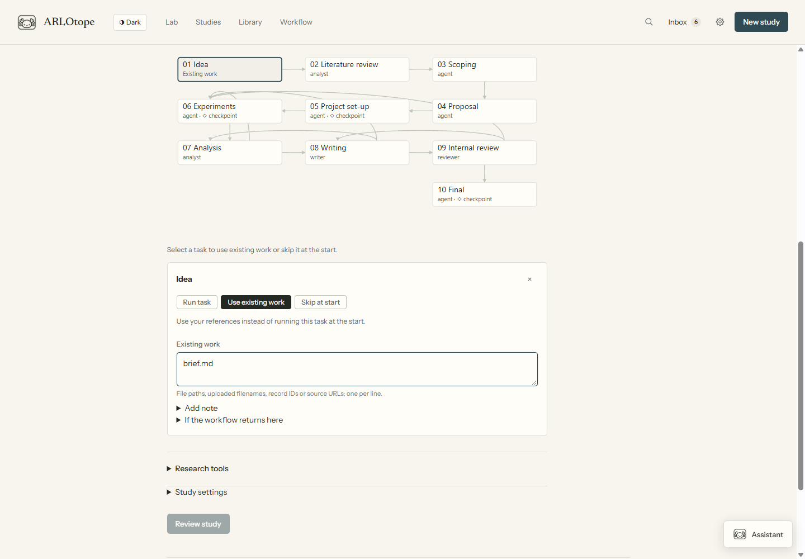
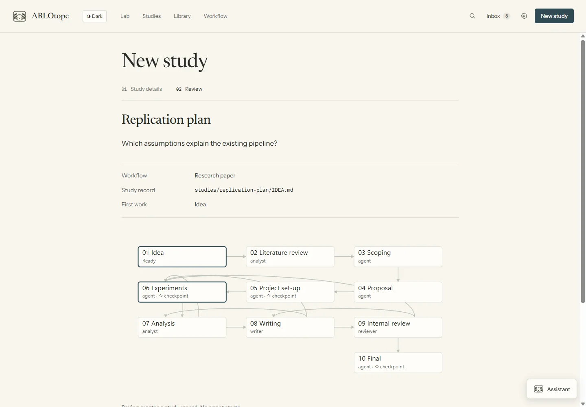
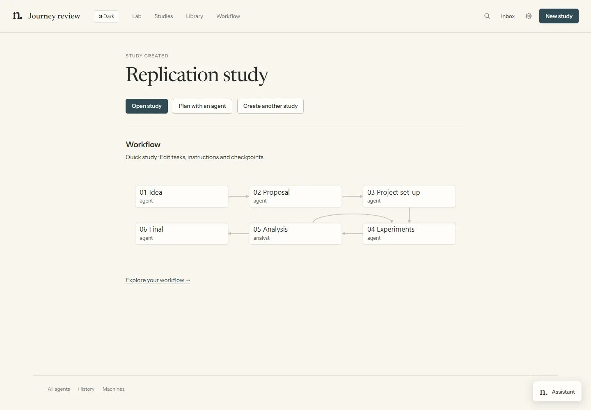

# Your first study

Bring a question or an existing project, start one task, and inspect its results.
Screenshots use demonstration data.

## 1. Open the Lab and connect an agent

Install [Git](https://git-scm.com/downloads) and
[uv](https://docs.astral.sh/uv/getting-started/installation/), then run:

```bash
git clone https://github.com/AkxarLabs/ARLOtope.git
cd ARLOtope
uv run --with pyyaml python arlo.py
```

The dashboard opens in your browser, normally at `http://127.0.0.1:8787`.
Later, use `./arlo` on macOS/Linux, `.\arlo.cmd` on Windows, or the platform launcher.
First use creates private settings for this clone; no frontend build is needed.

The ARLO guide introduces the main pages. Reopen it with **?** in the header.



In **Settings → Agents & models**, connect an installed agent and complete its sign-in.
Use **Connect ACP agent** for another compatible tool. Enable launches in **Limits & permissions**.
For OpenAI, Anthropic, Google, OpenRouter or another API key, use
**Connect API provider** and [choose its agent](api-providers.md).
You can create studies before connecting an agent.

## 2. Create a study from the work you have

Choose **New study**, then:

| Starting point | What to choose |
|---|---|
| A question | **A research question**; no repository needed yet |
| An existing project | **An existing project**, its machine, then **Browse…** |
| A GitHub repository | Enter its name or URL, or use **Choose repository**; **Connect GitHub** signs in when needed |

Enter a title and question. **Add a brief or files** accepts supporting materials.
Optionally use **Agent help → Suggest study details**, then review the suggestion before applying it.
Uploading files alone starts no agent.



## 3. Check the workflow

The **Starting workflow** map shows the tasks. Select one, then **View instructions** to read its method,
or choose **Change workflow**.

- **Run task:** let an agent do it.
- **Use existing work:** supply files or references in place of doing it again.
- **Skip at start:** leave it out; no explanation required.

Reuse and skip choices apply when the task is first reached. If a later loop returns to it, the
task runs normally. Checkpoints still apply. Keep **Study settings** closed to use default agents and tags.



## 4. Review and create

Choose **Review study**, check the details, then **Create study** or **Clone & create study**.
Attaching keeps existing code and environments. Cloning downloads source without running it.
Neither action launches an agent.



## 5. Start and follow work

Choose **Open study**, then its next task. **Run ready tasks** starts eligible branches of a workflow.
For a separate planning conversation, choose **Plan with an agent** instead.



In **Lab**, click a character to inspect its task and conversation. **Inbox** holds questions,
permissions and checkpoint decisions. **Study → History** keeps task passes and agent attempts.
An ended agent turn does not finish a task without a recorded outcome.


Open **Library → Outputs** for reports and interactive HTML, **Documents** for files, or
**Notes & sources** for notes and saved answers. **Visual summary** on a run starts a separate explainer.

To work on another project, choose **New study** again. Existing agents keep working.
[Multiple studies](running-work.md#work-on-several-studies) explains team capacity and shared controls.

Next: [Dashboard tour](dashboard.md) · [Build a workflow](agent-workflows.md) ·
[Recover work](recovering-work.md). Before collecting research, set up
[backups](projects.md#storage-updates-and-backups) for your Lab and projects.
