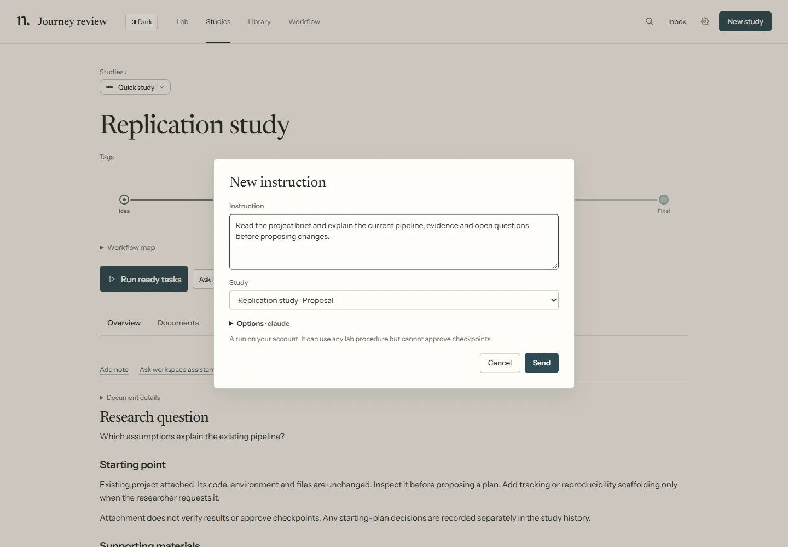

# Getting started

Create a study, give an agent one useful task, and inspect its answer. You can add a more detailed research process later.

## 1. Open the Lab

From the repository folder, with Git and uv installed, run:

```bash
uv run --with pyyaml python arlo.py
```

The short form is `./arlo` on macOS/Linux or `.\arlo.cmd` on Windows. With this repository on
PATH, use `arlo`, `arlo status` or `arlo --stop` from another folder. The one-click launchers
remain **Start ARLOtope.cmd** and **start-arlotope.command**.

The platform launcher opens the same application. The browser connects to a local server, normally on `http://127.0.0.1:8787`. Agent requests use the accounts configured in their own tools.

If you want dashboard-managed tasks, open **Settings → Agents & models**, then install or sign in to a harness. A **Connect an agent** link also appears when the Lab cannot find a usable harness. Enable agent runs in **Settings → Limits & permissions** when you are ready to launch work. You can create a study and browse its files before doing this.


*Demonstration fixture: the Lab is the main workspace. Start a study from the top-right button.*

## 2. Enter study details

Choose **New study**, then select the starting point inline:

- **A research question** for a topic or first task without an attached repository.
- **An existing project** for a folder on this computer or a connected machine. Choose the machine and use **Browse…** to select the folder.
- **A GitHub repository** for an `owner/repository` or repository URL. The Lab reuses GitHub CLI sign-in on the selected machine. **Choose repository** lists up to 50 accessible repositories, including private ones; type an exact name for anything else. If needed, use **Connect GitHub**, complete sign-in in the terminal/browser, then **Check connection**. Public URLs also work without GitHub CLI.

Fill in **Study title** and **What would you like to investigate?** The selected **Starting workflow** appears above its map. Open **Change workflow** to choose another. The map shows tasks, connections and checkpoints before you create anything. Select a task to inspect it. Selecting a starting point reveals its fields on this page; it does not create the study.


*Demonstration fixture: study details before saving. Use your own question and project location.*

Expand **Add a brief or files** if you have a brief, papers, notes or images. Uploading files does not launch an agent. The limits shown in the form are 5 MB per file and 20 MB per draft. **Agent help → Suggest study details** launches an agent turn; review its proposal before **Apply suggestion**.

If materials cannot load, **Retry** rereads the saved draft and keeps your typed details. Creation
waits until the materials are readable, including on the Review screen. If an upload response is
lost, reload the materials before uploading again: the first upload may already have been saved.
Retrying the read does not repeat an upload or launch another analysis agent.

Already have an idea, results or documentation? Select that task on the map. Keep **Run task**, choose **Use existing work** with references, or **Skip at start**. A note is optional. These choices use your workflow's tasks, including custom ones. They set where the study starts: if a loop returns to a skipped or reused task later, it runs normally. Checkpoints still require their configured decisions. Agent help may suggest these choices, but only applying and creating the study saves your starting choices.


*Isolated test Lab: the first task uses a supplied brief. No study or research agent was created for this screenshot. On a phone, task cards list their next destinations instead of shrinking the diagram.*

**Use existing work** means the task is already covered: name the work and supply references.
**Skip at start** means not to do that task at the beginning, without claiming completion. No reason is required.
For example, link a literature review you already wrote using the first option; use the second if
that review is not needed for this study. Both follow the selected outcome's route. Neither creates
missing outputs or verifies the quality of existing work.

**Study settings** contains tags, agent choices and the generated study ID. Leave it closed to use the defaults. Agent choices apply to this study; they are separate from the agent used for a suggestion. Review shows what you selected; use **Back** to change it rather than configuring it twice.

## 3. Review and create

Press **Review study**. Check the question, workflow, files, machine and project path. Use **Back** to correct anything.

When using a starting plan, the review also previews ready tasks, checkpoint waits and branches waiting at joins. Reusing a task records your evidence references; it does not claim that an agent performed or independently verified the work.

The workflow map stays visible on the review screen and is available under **Workflow map** on the study. Optional agent choices sit before the main action; they can remain at their defaults.


*Demonstration fixture: the review page makes the proposed study and attachment visible before creation.*

Choose **Create study**, or **Clone & create study** for GitHub. Attaching a folder adds Lab registration files; existing code and environment stay in place. Cloning downloads source without installing dependencies or running repository code. Creating a study does not start a research agent or approve a checkpoint.

For an attached or cloned project, expand **Files added to this project** on the review or success screen. It explains the portable `.arlotope/` records and local `.bus/` records. The Lab leaves your ignore files unchanged; see [what to keep in Git](knowledge.md#what-to-keep-in-git).

If attachment reports another Lab, it names the selected folder and recorded Lab ID or study/owner. Open the owning Lab or choose a different folder. A project-ID mismatch names both conflicting files and IDs; restore matching records from a known backup. Do not remove identity files to bypass the check. Failed identity validation creates no study and leaves existing registration records unchanged.

## 4. Start one task

After creation, choose **Open study** to inspect the record and its next work. **Run ready tasks** starts eligible workflow tasks with their saved instructions and agent assignments.

For an initial inspection or discussion, choose **Plan with an agent** instead. Review the prefilled **Instruction**, confirm its **Study**, and expand **Options** to change agents before **Send**. This is a separate instruction; it does not automatically run the next workflow task.

The success screen waits for the new study's details before offering those actions. If that read fails, **Retry** reloads the saved study; it does not create a second one.


*Demonstration fixture: creation and agent launch are separate actions.*

A useful first instruction for an existing project is: “Read the project instructions and explain the current pipeline, evidence and open questions before proposing changes.” For a new question, ask for a focused plan with success criteria and a small first check.



*Isolated test Lab: the instruction targets the created study. Opening or canceling it starts no agent.*

## 5. Inspect the conversation and result

Open the task's conversation from the study or **All agents**. Answer a pending question there or in **Inbox**. Tool permissions and research checkpoints are separate decisions. If a task stopped without completing its assigned outcome, inspect the record before using **Continue task** or **New agent with handoff**.


*Demonstration fixture: inspect what the agent actually recorded, rather than treating a finished turn as a verified result.*

Published pages appear in **Library → Outputs**; existing files are in **Documents**. **Notes & sources** holds separate notes and saved workspace Q&A. **Visual summary** on a run starts an independent explainer and leaves that run untouched.

Next: [dashboard tour](dashboard.md), [tasks and agents](agent-workflows.md), or [customize a workflow](customising.md).
