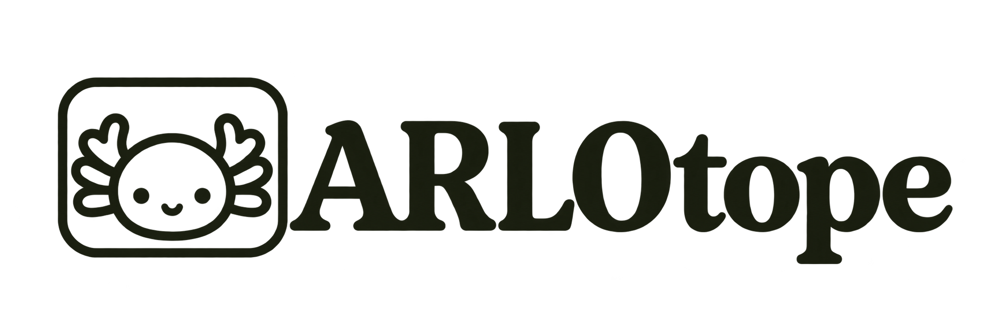

# ARLOtope

{ .brand-wordmark width="440" }

A visual research workspace for scientists working with coding agents. Bring a question or an
existing repository, keep your tools, and build a readable record of work, evidence and decisions.

[Create your first study](getting-started.md){ .md-button .md-button--primary }
[Explore the Lab](research-first.md){ .md-button }

*Current interface with demonstration studies. Screenshots show example data, not verified research results.*

## Start with the work you have

Save a research question, attach a local or remote folder, or clone a GitHub repository.
Private repositories use the connected GitHub account on the selected machine.
Upload a brief and supporting materials if you have them. Ask an agent to help refine the study,
then review its suggestions. Creating a study does not start work or approve a checkpoint.

Use Claude Code, Codex, opencode or a compatible ACP agent. The Lab organizes their work;
your agent accounts, existing repositories and research tools remain yours.

## Four places to work

| Page | What it is for |
|---|---|
| [Lab](dashboard.md) | Follow agents in the visual workspace, inspect their work and respond to decisions. |
| [Studies](projects.md) | Keep the question, project, workflow position, instructions and history together. |
| [Library](knowledge.md) | Read documents, sources, human notes, saved answers and published outputs. |
| [Workflow](agent-workflows.md) | Connect tasks, choose agent roles and context, assign shared rooms and configure checkpoints. |

## A process you can change

Start with a quick study or the paper workflow. Use your own skills and task instructions.
Continue one conversation, start independent reviewers or fork supported sessions for parallel work.
Branch on named outcomes, join parallel tasks and add human or delegated review gates.
Shared workflow edits stay in a draft until you review and publish them.

[Build a workflow](agent-workflows.md) · [Choose agents](acp.md) · [Connect a machine](remote-projects.md)

## Keep evidence close

The Library combines existing project files with plain Markdown knowledge records. A human note
adds context without queuing work. Workspace questions use a separate assistant and save their
answers separately from the source document. Independent explainers can publish interactive HTML
summaries inside the dashboard.

[Notes, answers and sources](knowledge.md) · [Reports and HTML explainers](artifacts.md)

## When an agent stops

An ended turn is not a completed task. The workflow needs a recorded outcome before moving on.
The Lab exposes pending questions, interrupted runs and assigned tasks that still need an outcome.
Resume a saved conversation when possible, or use a new agent with a handoff.

[Recover interrupted work](recovering-work.md) · [Approvals and evidence](monitoring.md)

## Plain files and existing tools

Procedures are Markdown; workflows and checkpoints are YAML; study state is an append-only journal.
Code and experiment artifacts stay in project repositories. The dashboard needs no frontend build.
Terminal procedures and the CLI remain available independently.

[Configuration](configuration.md) · [Project records](projects.md) · [Architecture](internals.md)
