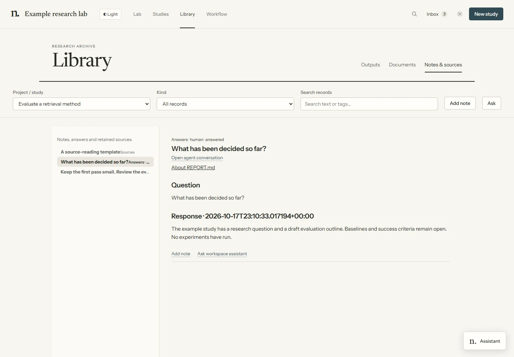
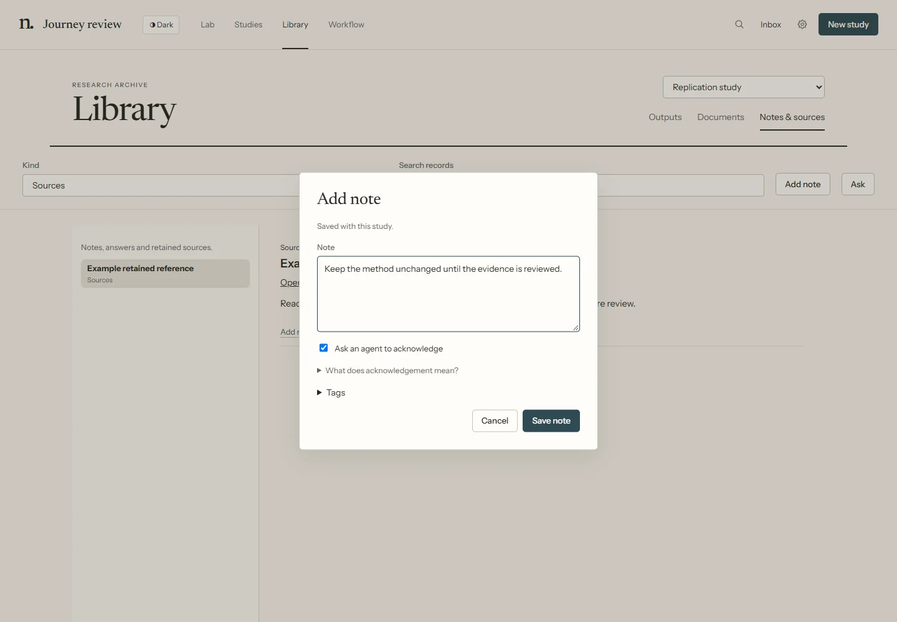
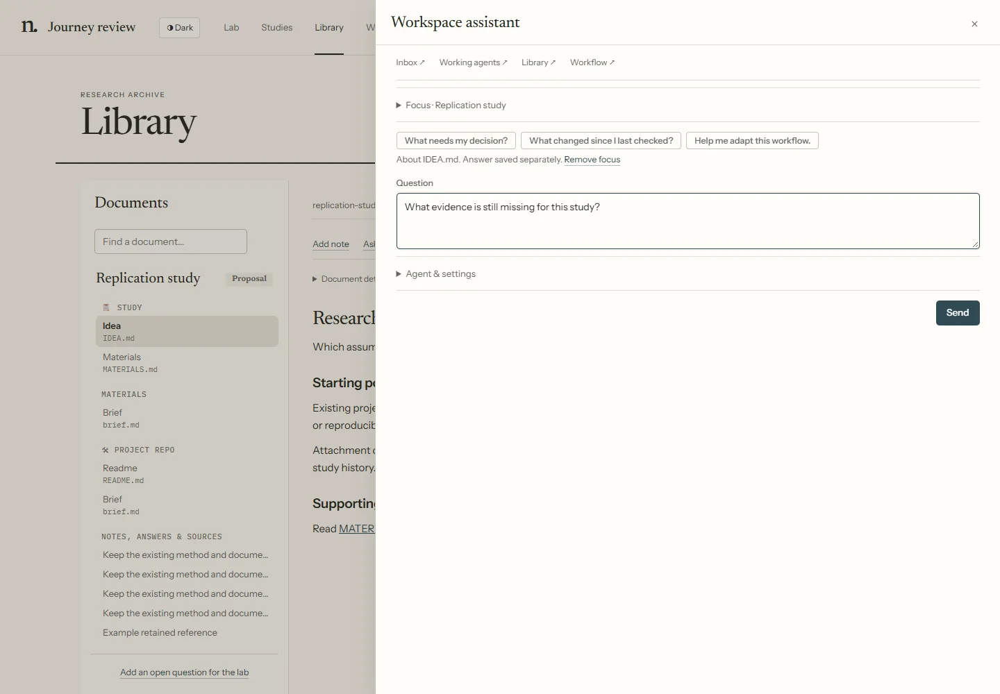
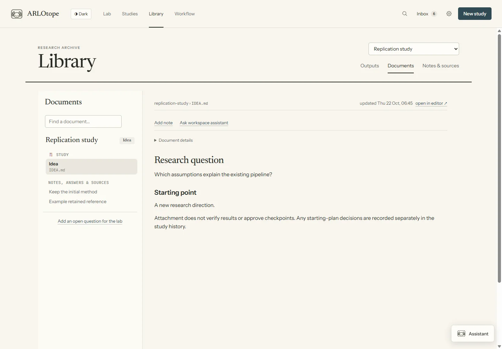
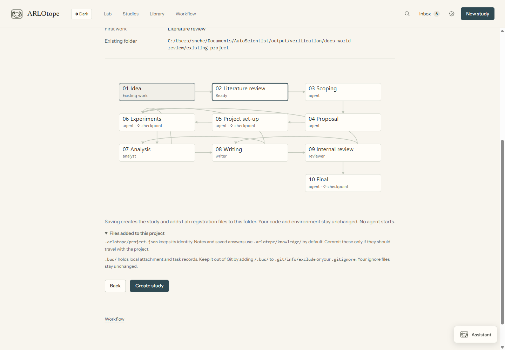

# Notes, sources and saved answers

Use **Library → Notes & sources** for retained knowledge. Choose **Library study**, a record kind and an optional search. Records live in ordinary files alongside the project or study they concern.



Screenshots use demonstration data.

## Choose the right action

| Action | What happens |
|---|---|
| **Documents** | Read an existing Lab, study or project file |
| **Add note** | Save a new human-authored record without starting work |
| **Ask workspace assistant** | Send a separate agent question and save its answer separately |
| **Send answer / Send instruction** on an output | Message its producing agent or queue a directive |
| **Start task** | Launch requested work through the executor |

These actions have different consequences. A saved note is context, not a task or approval.

## Add a human note

1. Open a document, output or record and choose **Add note**. From a study, use its Notes section. The Library toolbar can also create a note in the selected study or the Lab.
2. Write the note and optionally add tags.
3. **Ask an agent to acknowledge** is checked by default. Expand **What does acknowledgement mean?** for its explanation. Uncheck it when you do not want a read receipt.
4. Choose **Save note**.



Saving does not queue work, interrupt an agent or request an answer. An agent reading relevant records at its next check-in can acknowledge the note. That receipt means it read the note, not that it accepted directions or received an approval. The note's referenced document stays unchanged.

## Ask about a document or output

1. Choose **Ask workspace assistant** on the item. Check the selected study and the “About …” reference.
2. Write a question and **Send**. This uses an agent turn and your configured account.
3. Follow the response in Assistant, or open its conversation for a question or permission request.
4. Open **Saved question & answer** to return to the durable record.



Questions and answers are saved separately from their source files. A later response refreshes in the selected record. Failed starts and interrupted/unanswered turns have explicit states. If a remote project is unavailable during answer delivery, the Lab retains a local receipt and retries; warnings identify pending delivery. Changing the question does not discard an already captured answer.

The assistant sees supplied context and can use normal file/transcript tools. File formats, clipping and remote availability can limit what it reads. An explanation is not a verified scientific finding. Use a task and the research protocol for new experiments or source edits.

## Documents and generated reports

**Library → Documents** groups existing study records, project documents and Lab files. A generated report may be an ordinary Markdown file here and may also have a published copy in **Outputs**. Publication does not make every source file an output; the original remains available for editing.



## Where records live

| Location | Purpose |
|---|---|
| `.arlotope/project.json` | Project identity and configured knowledge directory |
| `.arlotope/knowledge/` | Default project notes, answers and retained sources |
| `studies/<slug>/knowledge/` | Records created before a project is attached |
| `lab/records/` | Lab-wide records |

Earlier study records remain visible after a project is attached. Existing plans, ledgers, experiment artifacts and published outputs keep their own locations. Project identity is separate from its display name; it contains no credentials. Commit the identity and knowledge files if they should travel with the repository.

## What to keep in Git

Attaching an existing repository leaves its `.gitignore` unchanged. The review and success screens explain the added files:



| Path | Git and backup guidance |
|---|---|
| `.arlotope/project.json` | Keep with the project if its stable identity should travel. It includes its owning Lab ID and knowledge location, not credentials. A copy still belongs to that Lab; copying it does not transfer ownership. |
| `.arlotope/knowledge/` | Review notes, answers and source attachments before committing. Keep selected records in Git if they should travel; leave private or large files local. A custom `knowledge_dir` uses that configured path instead. |
| `.bus/` | Local directives, task records and transcripts. Keep out of Git; back it up separately if you need that history. Project identity and ownership live in `.arlotope/project.json`. |

In a Git checkout, add `/.bus/` to `.git/info/exclude` for a local ignore, or to `.gitignore` for a shared rule. Worktrees use their Git directory's `info/exclude`. Do not blanket-ignore `.arlotope/` if you want its identity or knowledge committed. Ignore rules do not untrack already committed files.

When moving a Lab, preserve its `lab/identity.json` along with its studies and project records. The machine-local `~/.arlotope/projects.json` is a discovery index, not the durable project identity. Discovery can find `.arlotope/project.json` again when scanning a chosen folder. New clones do not carry local task history; a different Lab cannot claim them merely because `.bus/` is absent.

## Record and source reference

Records are Markdown, with optional YAML frontmatter. Kinds are `document`, `source`, `note`, `answer`, `output` and `log`; tags add finer organization. Search includes text and metadata. Plain files and subfolders are supported.

```yaml
---
id: source-example
kind: source
title: A useful paper
tags: [literature]
source:
  url: https://example.org/paper
  version: v2
  coverage: abstract
---
Read the abstract. These assumptions may be relevant.
```

Retain useful sources deliberately and record actual coverage: metadata, abstract, selected sections or full text. A URL or DOI is not evidence that the agent read the paper. Attachments preserve an already downloaded original; this does not fetch restricted papers or grant access.

```bash
uv run --with pyyaml python tools/knowledge.py --study my-study list
uv run --with pyyaml python tools/knowledge.py --study my-study search "validation"
uv run --with pyyaml python tools/knowledge.py --study my-study show RECORD_ID
uv run --with pyyaml python tools/knowledge.py --study my-study ack RECORD_ID
uv run --with pyyaml python tools/knowledge.py --study my-study add --kind source \
  --title "Useful paper" --url "https://example.org/paper" --coverage abstract \
  --text "Read the abstract; relevant to the evaluation design."
```

Omit `--study` for Lab records. From another directory, pass `--hub /path/to/lab`; on the project machine use `--project /path/to/project`. Source capture also accepts `--doi`, `--version` and `--attachment` for a local original up to 50 MB. Remote attachments must be added on their machine; a controller path is not a remote file.


## Workflow logs

Use a log for a decision, finding, failure or handoff worth retaining. The fields are the same for any custom workflow:

```bash
arlo log "The baseline failed its smoke check; see the error trace." --study my-study \
  --tag finding --ref runs/smoke/stderr.log
```

In a managed run, omit `--study`: the run supplies its study, run ID and attempt. Add `--agent CHILD_ID` only when the exported child ID is known. Tags and evidence references are optional and repeatable. Logs are ordinary knowledge records, shown beside their run in **Study → History** and searchable in **Library**. Human notes and saved workspace answers appear there too. Open the linked record to read its full text.

The shared run instructions describe this command once; imported skills need no Lab-specific logging format. A log records context. Complete tasks through the workflow's outcome command; approvals still use their checkpoint controls.
