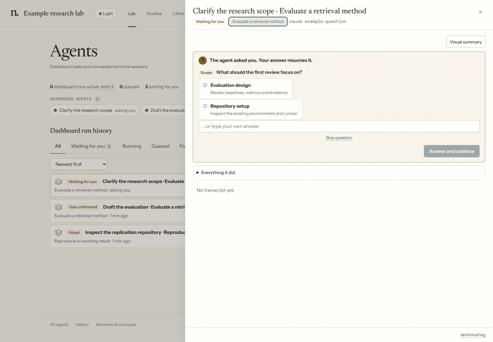

# Monitoring and guardrails

Use **Inbox** for questions, permissions, checkpoint decisions and alerts. Open a run to inspect
its conversation, actions and changed files. This reference explains which controls are enforced
by the workflow engine, which depend on the harness, and what remains visible for review.


Agents use their execution account's tools and permissions. Lab checks do not provide an
operating-system sandbox; see [what is not protected](#what-is-not-protected).

`arlo <verb>` is short for `uv run --with pyyaml python arlo.py <verb>`.

## The protections

### The signature guard

`tools/signature_guard.py` checks tool calls in supervised native runs (Claude: the run's settings
file; Codex: `-c hooks.PreToolUse` flags; opencode: a per-run plugin). The ACP client applies the same
guard to file writes and terminal commands requested through its client tools. It does not observe
arbitrary actions performed inside an ACP agent's own tools. The guard denies an observed call that would
write a protected path, from an edit tool or from a shell command that looks like a write (`>`, `cp`,
`mv`, `sed -i`, `write_text`, …). One list drives both checks:

- **The floor**, fixed in the guard: `lab/journal.jsonl`, `lab/REGISTRY.md`, `lab/approvals.jsonl`, the
  dashboard's and the keeper's records under `lab/.bus/`, `workflow/`, `.claude/skills/` and
  `.claude/agents/`, the Codex and opencode role folders, `agent-roles/`, `checks/`, `extensions/`, and the guard itself (`tools/signature_guard.py`, the opencode guard plugin), so a
  run can't switch it off through those checked calls.
- **`protected_paths` in `workflow/rules.yaml`**: the agent manuals, `templates/`, the PI's instructions
  (`lab/workflow/`, `studies/*/workflow/`), `lab/templates/`, `lab/rooms3d/` and `lab/panels/`.
- **`lab/config.yaml`**, except in the procedures listed under `config_procedures` (`setup-lab`,
  `configure`).

A procedure can confine its own runs with `writes:` in its frontmatter (globs, relative to the lab). The
workflow designer (`/design`) declares `lab/.bus/designs/workflow/**`; the room designer
(`/design-room`) declares `lab/.bus/room-drafts/**`. Their runs may write their drafts and
the system's temp folder, and nothing else, through an edit tool or a shell redirect (`>`, `tee`,
`Out-File`). Whatever such a run changes elsewhere anyway (a script it ran) raises a `writes-outside` flag.

It also denies the PI's verbs in a shell command: `arlo approve`, `revoke`, `changes`,
`approve-collector`, `ack`, `hold`, `release` and `pause`, and `tools/new.py`. Each denial is logged to the run's `permissions.jsonl`
and counted in its digest.

**It fails open.** If the guard itself errors, it allows the call, logs the error, and raises a `warn`
flag, because a broken guard must not wedge an unattended lab. Interactive sessions don't load it: the PI
is present there.

### The kernel refuses the PI's actions inside a run

Every headless run has `ARLOTOPE_RUN_ID` set. With it set, the kernel and `arlo` refuse approving, revoking
or asking for changes, `arlo move --to`, `arlo workflow set|use|rename-step`, `arlo ack`,
`arlo hold|release|pause|resume`, `arlo config set` (outside `/setup-lab` and `/configure`) and
`arlo extension install`. A run can file a study, but not past a checkpoint. A campaign's approvals go
through the executor's keeper, not the agent: only `me-or-campaign` checkpoints the PI delegated to it,
with every check passing. An `agent` checkpoint instead uses a separate gate-review run and validates
its recorded decision and evidence. Neither lets a working agent approve its own task.

### Moves and launches

`arlo move` refuses outcomes the step can't report, waits at unapproved `before:` checkpoints, and refuses
`done` while its declared outputs are missing ([The workflow](workflow.md#how-a-study-moves)).
Graph tasks additionally track the owning run, node visit, incoming lineage and output freshness.
Before the executor starts anything for a study, `check_launch` (`tools/lab_profile.py`) refuses it when:

- an open flag with `hold: true` holds the study;
- the procedure is a step's work (its `do:`) and the study isn't at that step;
- the procedure is a step's work and the study is shelved or finished;
- the procedure is a step's work and no such study has been filed.

What a step only offers (`also:`), drivers and utilities run anywhere. The executor also refuses a study
the PI put on hold (`arlo hold <study>`), and a campaign whose brief the PI hasn't approved.

### The backends' own approval modes

The lab doesn't build its own classifier or sandbox. It uses the backend's:

- **Claude** runs with `--permission-mode auto` (`agents.programmatic.permission_mode`): a classifier
  approves routine actions and blocks risky ones. Each run's settings add one allow list, the lab's
  record commands: `lab_bus.py emit|escalate` and `arlo.py move|next|brief|approved|status|flags|propose`.
- **Codex** runs with `--sandbox workspace-write` (`agents.programmatic.backends.codex.sandbox`), which
  confines writes to the run's workspace, with network off unless `network_access: true`. Its `approval`
  key sets the approval policy: a live session sends each approval request to the Inbox; a one-shot
  `codex exec` can't ask, so any value other than `never` rejects such operations.
- **opencode** runs with its own permission settings; the lab adds `--dangerously-skip-permissions` only
  when `skip_permissions` is set for it.
- **ACP** negotiates permission requests and client file/terminal capabilities. The agent's own
  configuration controls tools it runs internally; native CLI sandbox flags do not apply to it.

These settings are PI-owned config. The flags that would loosen them (`--permission-mode`,
`--dangerously-skip-permissions`, `--sandbox`, `--dangerously-bypass-approvals-and-sandbox`, `--yolo`,
`--full-auto`, …) are refused in a backend's `extra_args`. The executor enforces each attempt's wall-clock
allowance (`max_minutes`, with a five-minute attempt minimum) and the concurrency caps.

## What is not protected

- **An agent can run code.** The guard sees the agent's tool calls, and its shell check is a pattern match.
  A script the agent writes and then runs can change any file its user can. The journal is not
  tamper-proof.
- **`during:` checkpoints are cooperative.** The brief tells the agent to stop; a watch flags work done
  past it afterwards when that checkpoint has a matching watch.
- **Output checks do not validate scientific meaning.** Presence and graph freshness are checked;
  the content still needs the configured audits and review.
- **Experiment compute budgets need the research protocol or job scheduler.** GPU use is monitored;
  the agent executor does not cancel an experiment from its scientific budget field. A campaign's
  optional spend cap can stop agents using the cost their backends reported, which may be incomplete.
- **Interactive terminal sessions are traced, not guarded by the executor.**

Monitoring covers captured events and the folders included in the digest. Missing backend events,
files outside those folders and scientific errors can still require manual inspection.

## Who is at work

Activity comes from backend event streams and installed trace hooks, rather than asking the agent to
narrate every action in its skill. Detail varies by backend and CLI version.

| | the main agent | its subagents | how a subagent ends |
|---|---|---|---|
| **claude** | `stream-json` | the same stream, at every depth (`parent_tool_use_id`, `agent_id`) | its Agent call's result; for a background one, `task_notification` |
| **codex** (live) | app-server items | every thread's items (a child's `threadId`) | its thread's turn ends, or `wait` says so |
| **codex** (one-shot) | `exec --json` | the codex hooks (exec streams only the main thread) | the hooks |
| **opencode** (live) | server events | each child session's events (`parentID`) | its `task` call returns, or it goes idle |
| **ACP** | negotiated session updates and client tool requests | only child activity the agent exposes | reported by that agent; native subagent parity is not assumed |

The supervisor (`tools/executor/supervise.py`) folds these into the run's record (`<run>.json`). The record
keeps each subagent's parent, its depth, the call each agent is in (`in_tool`, with its activity), the last
thing each did, and how each ended. When the CLI fires no trace hooks, the supervisor also writes each
agent's worker log (`<bus>/workers/<run>.jsonl`, plus `<run>.<subagent>.jsonl`), in the tracer's format. A
CLI that does not stream child activity can use supported hooks; completeness still depends on the
installed CLI and its enabled features.
The snapshot's `agents` is that tree, live, and the Lab world, Agents page and run sheet all draw from it.

The supervisor also keeps the run's **action tree** for good, beside its record: `<run>.d/actions.jsonl`, one
line per action of any of its agents (`agent` null for the run's own, else a subagent's id), with each spawn
and each subagent's end (`tools/executor/actions.py`). Worker logs are pruned after a week; this is not. The
run sheet exposes its activity history. **Visual summary** can ask a separate explainer to turn those
records into a published page; that agent does not change the research task or report its outcome.



Process status and workflow completion are separate. A completed assigned run with no accepted
outcome is marked **Task unfinished**. A timeout or lost supervisor is a failure, not an inferred
success. See [Recovering interrupted work](recovering-work.md) for the controls and retry rules.

## The run digest

When a headless run ends, the executor computes a digest of what it did. The agent doesn't write it. It
compares git snapshots of the run's working folder, the lab and the study's project, taken at the start
and the end, so files changed by a script the agent ran are counted too. It holds:

- the outcome: the moves, waits or finish the run caused, or "reported no outcome";
- minutes, cost and turns;
- files written and deleted, and commits made;
- how many shell commands ran, with the notable ones listed (`git push`, `git reset`, `rm -`,
  `pip install`, `curl`, `ssh`, `sbatch`, …);
- denials: calls refused by the backend or by the signature guard;
- the flags the run's watches raised.

See it with `arlo run <id>` ("What it did"), or on the run's sheet in the dashboard (counts, a details
list, and each flag with an acknowledge button).

## Watches

A watch is a rule that raises a flag. After every headless run, the lab's watches are checked against the
digest. They live under `watch:` in `workflow/rules.yaml`:

```yaml
watch:
  - {id: control-edited, writes: ["{project}/control.yaml"], level: warn,
     say: "control.yaml (budgets, seeds, the frozen flag) was edited"}
  - {id: tests-removed, deletes: ["{project}/tests/**"], level: warn, say: "tests were deleted"}
  - {id: ledger-rewritten, check: append-only, when: project, level: block, hold: true,
     say: "a ledger (EXPERIMENT_LOG.md, runs/registry.jsonl) was rewritten"}
  - {id: refused, denials: 3, level: warn, say: "the run kept trying things the lab refuses"}
  - {id: pushed, runs: ["git push*"], level: info, say: "pushed to a remote"}
```

- `writes:` / `deletes:` are globs over the files the run changed. `{project}` is the study's project
  repository, `{hub}` the lab; other paths are relative to the lab.
- `runs:` are globs over the shell commands it ran.
- `denials: N` trips at N refused calls.
- `check: <name>` runs a check for the run's study and trips when it fails; `when: project` runs it only
  once the study has a project.
- `level` is `info`, `warn` or `block`; `hold: true` also holds the study; `say` is the flag's text.

A checkpoint adds its own watches (`watch:` on the checkpoint). They run after each run of a study on that
workflow while the checkpoint isn't approved, and raise a `block` flag: work done past the checkpoint
without its approval. A run that rewrites the journal, rather than appending to it, always raises a `block`
flag.

## Flags

| Level | Where it shows |
|---|---|
| `info` | The run's digest only. |
| `warn` | The journal, Inbox, the study's timeline, the run's digest. |
| `block` | The same, marked as blocking. |

A flag with `hold: true` stops anything new from starting for that study until it is acknowledged.
Acknowledging is the PI's: `arlo flags [<study>] [--all]` lists them, `arlo ack <flag> --note "…"`
acknowledges one, and the dashboard has an acknowledge action on the Inbox item and on the run sheet.
The acknowledgement is a journal event, and it releases the hold. Flags not tied to a study (such as a
guard failure) are listed by `arlo flags`.

## The journal as the timeline

`lab/journal.jsonl` is the record: every filing, move, wait, approval (with your note), workflow change,
step rename, flag and acknowledgement, with who did it (`pi`, `run:<id>`, `campaign:<name>`, `auto`). The
study page shows it as the study's timeline; `arlo approvals [<study>]` and `arlo flags` read it from a
terminal; `arlo status` shows what waits for you. Changes published from **Workflow** are kept in
**Change history**.
