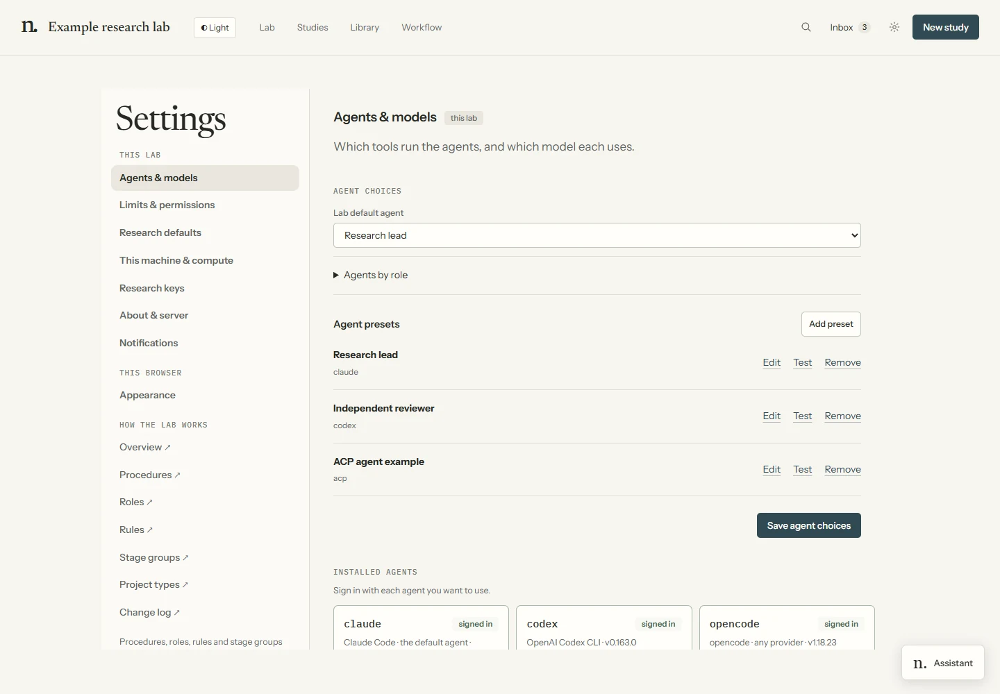

# Platforms and agents

Lab runs a browser dashboard and Python tools on a controller machine. It can start Claude Code,
Codex, opencode or an ACP-compatible agent locally, or use an SSH runner beside a remote project.
Each agent needs its own installation, account and model access.

## Set up an agent

Open **Settings → Agents & models**. Install or sign in through the agent’s own flow, then choose
**Check again**. For a saved harness/model combination, choose **Add preset**, keep the preset and
save the agent choices. A role assignment chooses which preset new tasks use; it does not keep an
agent running or change a task’s conversation history.



**Test** checks an executable; an ACP preset also negotiates the protocol. Neither establishes
that your account can use a requested model. Leave the model blank to use the selected agent’s
settings, or choose a model available to that account. See [agent workflows](agent-workflows.md).

## Platform scope

| Platform | Current scope |
|---|---|
| Windows | Local process, browser and worker checks; native terminal and cancellation paths |
| Linux | Local/controller and SSH-worker code paths; automated checks in an isolated Ubuntu environment |
| macOS | POSIX process and terminal-launch support in code; runtime verification remains incomplete |
| SSH project host | Linux/macOS-style host with OpenSSH, `bash` and Python 3.10+; Git when cloning |

The dashboard needs a modern browser; the 3D Lab needs WebGL. Studies and Library provide ordinary
lists and readers alongside the scene. Project dependencies are separate from Lab’s dependencies.
Native Windows SSH bootstrap is not implemented.

Automated peers test the application’s sessions, questions, permissions and failure paths without
provider credits. They do not verify live provider authentication or model access. Recorded manual
checks cover Windows Claude/Codex/opencode and Antigravity ACP turns and saved-session continuation,
plus native forks for the three CLI backends. A real Narval test covered SSH/MFA, a remote Claude
turn, and recovery of the same session and attempt after disconnecting its tunnel. These are narrow
checks, not certification of every tool, model,
OS or outage scenario. See [remote projects](remote-projects.md) and [ACP](acp.md).

## Verify macOS

The existing `.github/workflows/ci.yml` includes `macos-latest` in both the full test suite and the
generated-project smoke job. On the version uploaded to GitHub, these check Python tools, process
handling, the generated project's readiness/tests, and a two-seed toy sweep on a real macOS runner.
They do not test unpublished local edits or establish live provider access.

On a Mac, run the same checks from a clean checkout:

```bash
uv run --with pyyaml --with pytest python -m pytest tests/ -q
uv run --with pyyaml python newts.py
```

Then verify a new study, workflow launch, conversation, HTML output and recovery in Safari and Chrome.
Check Terminal sign-in windows, browser notification permissions and the temporary `caffeinate`
keep-awake request. Test one authenticated provider turn and continuation, and SSH reconnection.
Desktop and provider sign-in flows need an interactive session; a passing headless CI job alone
does not cover them. Linux containers and WSL do not exercise macOS-specific behavior.

## Transports and capabilities

| Harness | Live connection | One-shot mode |
|---|---|---|
| Claude Code | stream-json input/output and control requests | `claude -p` |
| Codex | `codex app-server` JSON-RPC | `codex exec --json` |
| opencode | `opencode serve` HTTP/events | `opencode run --format json` |
| ACP | JSON-RPC over stdio | None |

Workflow tasks, checkpoints, scheduling and published outputs belong to Lab above these transports.
Continuation and native forks depend on the selected backend and installed version. An unsupported
operation reports a limitation; a new conversation with an explicit evidence handoff is a separate
choice. Agent context does not migrate between machines.

Agent processes run with their execution account’s tools and permissions. Lab’s guards and
checkpoints support the research protocol; they are not an OS sandbox for untrusted code.
Provider credentials remain with the agent. Terminal output and agent-visible form responses can
contain sensitive information, so use the provider’s credential flow rather than pasting secrets
into a question or note.
