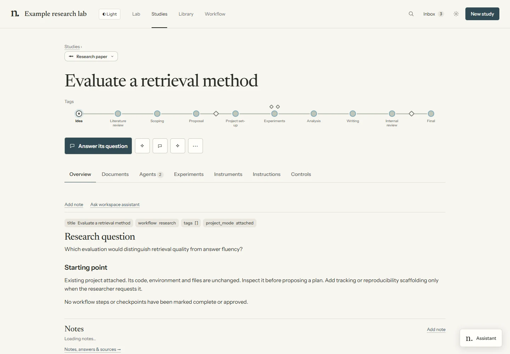

# Projects

A project is the repository behind a study. **New study → An existing project** attaches a local or
remote folder without replacing its code, runner or environment. Attachment adds Lab registration
files. A GitHub starting point creates a new clone. Neither operation starts an agent or verifies
existing results.

For a new structured experiment project, `/spawn-project` applies `templates/project/` after the
relevant proposal checkpoint. The scaffold below describes those generated projects; add it to an
existing repository only when requested.

## Shared study records



| Record | Location |
|---|---|
| Question, literature, proposal and decisions | `studies/<slug>/` |
| Notes, saved Q&A and retained sources | Project `.newts/knowledge/`; before attachment, `studies/<slug>/knowledge/` |
| Uploaded materials | `studies/<slug>/materials/`, indexed by `MATERIALS.md` |
| Discussions, critiques, paper and reviews | Study `sessions/`, `critiques/` and `paper/` |
| Code, data and original run evidence | Project repository |
| Experiment memory, when used | Project `NOTES.md`, `EXPERIMENT_LOG.md`, `runs/registry.jsonl` |
| Published output copies and feedback | `lab/.bus/artifacts/<id>/` |
| Workflow state and approvals | Kernel-owned `lab/journal.jsonl` |

Open **Study → Documents** or **Library → Documents** for source files. **Library → Outputs** holds
published reports and interactive summaries; **Notes & sources** holds human notes, saved answers
and retained reading. Output search covers metadata; record search also covers saved text.
These are different from a full-text index of every project file.

An agent can list published work with `python tools/artifact.py list --study <slug>`. Notes are
context, not queued tasks, and acknowledgement is only a read receipt. A workspace answer is saved
separately from the document discussed. See [study knowledge](knowledge.md).

Queued remote runs receive fixed instruction/material snapshots. Editing the source later does not
change an already queued snapshot. Whole repositories, ignored datasets and uncommitted files are
not automatically shared between machines or worktrees. Give reviewers and workers explicit evidence
paths; only the parent writes shared experiment ledgers.

## Where projects live

Generated projects live outside the Lab at `lab.projects_root`, default
`../newts-lab-projects/<slug>`. Each has its own Git repository. The Lab records its path; it does
not store all experiment artifacts in the hub.

Attached repositories stay where they are. `.newts/project.json` records stable project identity
and the knowledge location; the compatible `.bus/newts-owner.json` records execution ownership.
Keep those files when moving a project, and update its registered path deliberately.
See [remote projects](remote-projects.md).

## Anatomy

```text
<project>/
├── AGENTS.md, CLAUDE.md       # project protocol and orientation
├── SYSTEM.md                 # optional machine instructions
├── TYPE.md, DOMAIN.md         # methodology card and optional domain
├── control.yaml              # budgets, seeds, loop and runner settings
├── PLAN.md                   # frozen evaluation, staged attempts, stopping rules
├── NOTES.md                  # durable lessons with evidence pointers
├── EXPERIMENT_LOG.md          # append-only attempt history
├── configs/base.yaml
├── configs/experiments/      # a new config for each attempt
├── src/project_pkg/          # runner interface and method implementation
├── scripts/                  # run, sweep, compare, status and figure tools
├── runs/                     # ignored artifacts; committed registry.jsonl
└── tests/                    # smoke and runner checks
```

The type card defines what an experiment means. ML, empirical, simulation, theory and target-driven
work use different evidence and replication checks. The toy scaffold proves the runner; it does not
implement a research method for you. See [project types](project-types.md).

## The reproducibility contract

A generated project should document how to restore its environment and reproduce each reported run:

```bash
uv sync
uv run pytest
uv run python scripts/run.py --config configs/experiments/<experiment>.yaml --seed <seed>
```

Runs retain the resolved configuration, Git SHA, seed, environment metadata and metrics under
`runs/<run_id>/`; a dirty code patch is recorded when applicable. The registry summarizes runs.
Data, external models, credentials and compatible hardware may still need separate provision.
A lockfile and logged seed alone do not guarantee numerical reproduction.

Experiment configuration layers are `control.yaml → configs/base.yaml → experiment YAML → -o`
overrides. The generated scheduler helper separately inherits the hub’s scheduler through
`hub_path`, then applies project scheduler overrides. Configure the execution host explicitly,
especially for remote work. See [compute](compute.md) and [configuration](configuration.md).

## Project memory — chronological + distilled

Read all three before trying an idea:

- `EXPERIMENT_LOG.md`: append-only attempts, failures, parent/operator lineage and conclusions.
- `runs/registry.jsonl` and Git history: recorded runs and code revisions.
- `NOTES.md`: gotchas/fixes, abandoned approaches and settled recipes, each linked to evidence.

Project lessons belong in `NOTES.md`; transferable lessons also go to `lab/knowledge/`.
Long-term conclusions should not live only in a chat transcript.

## The hardened hub↔project boundary

For a paper, scripts synchronize generated figures to `studies/<slug>/paper/figures/` and record
their provenance. Finalization archives claim-linked metrics into the paper’s artifact directory and
checks hashes. This supports auditing the archived numerical claims after the project moves; it
does not archive every dataset or guarantee the paper’s scientific correctness.

A standalone project session can use `tools/hub_writeback.py` to return lessons and an outcome.
If the hub is unavailable, it leaves a pending write-back block in the experiment log for the next
hub reconciliation. A blocked loop can emit an escalation; it cannot grant its own approval.
Attached projects without a copied bus script use the hub’s
`tools/lab_bus.py --project <path> inbox`.

## Extensibility rules (how the code stays extendable)

1. Give a new attempt a new configuration; preserve past configurations.
2. Put method variants behind interfaces alongside the baseline.
3. Keep evaluation and budgets fixed unless the researcher authorizes a recorded change.
4. Append corrections to ledgers instead of rewriting history.
5. Commit each experiment attempt with its ID and outcome.
6. Generate paper figures and tables from evidence with committed scripts.

## For human researchers extending a project

Start with its plan, notes, ledger and Git history. Add a config and any new module, run the staged
checks, record the result and link the evidence. A negative result is useful project memory.
The same contract applies to a human’s experiments and an agent’s.

## Adopting an external repo as a project

Attach first, inspect second, then agree what work and tracking are useful. `/adopt` records the
chosen entry point and any waived stages. Existing claims still need supporting evidence or
reproduction; attachment certifies nothing.

If a structured pipeline is requested, preserve the package name and runner. The generated wrapper
can use `package:` in `control.yaml`; adapt its interface instead of renaming the repository.
Explain any added files and map existing outputs to Lab evidence.

## Domain-specific templates

A reusable domain template can extend the base after its contract is understood. Keep config,
artifact, budget and ledger conventions consistent. Use methodology cards and domain profiles for
light variations; use a template variant only when it supplies a concrete recurring implementation.
See [extending](extending.md).
