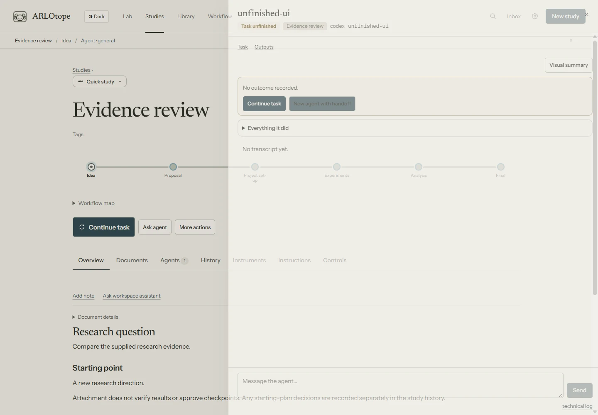

# Recovering interrupted work

An agent turn, an executor run and a workflow task are different things. A CLI can finish its turn
successfully while the assigned task still needs work. The Lab does not guess completion from a
sentence such as “done.”

## What the status means

| What you see | What happened | What to do |
|---|---|---|
| **Running** | The supervisor is still observing the agent | Open the run to inspect activity or send a message |
| **Your turn** or a question | The agent is waiting for input, or its conversation ended without a formal task outcome | Answer or reply with the next instruction |
| **Task unfinished** | The run completed, but its assigned workflow task still has no accepted outcome | Read its work, then choose **Continue task** |
| **Failed**, **Timed out** or **Stopped** | Execution ended without a clean completion | Inspect the reason and partial work before resuming |
| A checkpoint | The workflow needs its configured decision | Review its evidence and decide the checkpoint |
| **Queued** with a usage-limit hold | That backend is temporarily blocked from starting new work | Wait for the hold to expire, or use another configured agent where appropriate |

*Synthetic run in the current dashboard; no agent was launched for this example.*

**Task unfinished** is a mechanical check for formally assigned tasks. For an ordered workflow, the
Lab checks whether the assigned step has an accepted move, wait or finish since assignment. For a
graph, it checks the exact node visit and owning run. A free-form conversation has no equivalent
workflow contract, so ending one does not prove that its goal was achieved or missed.

## Continue the work

1. Open the agent or its entry in **All agents**.
2. Read the final message, actions, changed files and outputs. Existing files are retained after a
   timeout or stop; an interruption does not roll them back.
3. Use **Continue task** for an unfinished assigned task. The Inbox and run window send the same
   follow-up to the saved session, asking it to check existing work and report the task's outcome.
   **New agent with handoff** starts a separate agent instead. It remains available when a saved
   session exists, including when its harness cannot load that session.
4. For a failed or stopped run with a saved session, use **Resume**, or send a more specific message
   from the run window. Resume asks it to check what happened and continue after the interruption.
   If its conversation has already continued elsewhere, use that newer conversation.

Resuming normally continues the same backend session. The original assignment, current study state
and session ownership still matter. A new agent with a handoff gets a separate session with the
relevant records; it does not inherit hidden context. Native session loading and forking depend on
the backend's capabilities.

You can reply to a completed workflow task to discuss or revise its output, including after the
study finishes. The conversation keeps its original task binding; it does not reopen the study
or advance another step. This requires a recorded completion for that exact run and task visit.
It does not let an unfinished task pass a checkpoint, or resume a shelved study.

An interrupted task must check what already happened before repeating work. A command may have
finished, a file may already exist, or a workflow outcome may already have been recorded. The Lab
does not silently mark the task done just to get past the interruption.

## Questions and approvals

A checkpoint request in a run's message does not finish its workflow task. If the engine has not
recorded a checkpoint wait, approval records permission only; continue the agent from its run.
**Approve and start** appears when the engine is waiting at that checkpoint and can advance.
When the study is held, only approval is offered; the hold remains until you release it. On small
screens, approval actions stack, and each approval button shows its hold gesture.

Supported live agents can send choice questions, free-text questions and permission requests.
ACP agents can also supply negotiated question forms or an external interaction link. The dashboard
renders the request it received; it cannot reliably infer an unstated request from arbitrary prose.

By default, an unanswered question parks its process after 60 minutes while retaining the question.
Answering can resume the saved session. An undecided permission request is denied after 30 minutes.
Campaign permissions are denied immediately; eligible choice questions can instead use their
recorded recommended answer after the campaign question deadline. ACP forms and questions without
usable choices are not automatically filled in.

A chat answer, note or artifact reply is not a workflow approval. Checkpoint decisions use the
checkpoint controls and journal.

## Usage limits and retrying

When a failed run is recognized as a provider usage limit, the scheduler holds **new queued work for
that backend** until a reset parsed from the error, or a 30-minute fallback. This is local error
classification, not a guarantee that the provider quota has reset. Reaching that time allows queued
launches; it does **not** automatically resume the failed standalone run. Resume it yourself after
checking its state.

The hold is keyed by adapter (`claude`, `codex`, `opencode` or `acp`), not by provider account or
model. Multiple ACP presets share the `acp` hold. Changing backend means starting a separate
conversation or handoff; **Resume** keeps the original session's backend.

Approved campaigns have extra recovery: a resumable dispatched task can retry at most three times
after timeout, recognized usage limit or transient failure. Usage-limit retries wait an additional
two minutes after the reset or fallback. Authentication and installation failures need attention;
ordinary research failures are not blindly retried. See [Autonomy](autonomy.md#campaigns).

## In-browser terminal recovery

If terminal output cannot be read, **Retry** continues reading the same process from the last
received byte. It does not repeat your command or restart sign-in. If older output has fallen out
of the terminal's bounded buffer, the terminal says so. A failed terminal-library load can also retry.

If input could not be confirmed, the Lab pauses typing and asks you to check the output. **Continue
input** enables typing again; it never resends the uncertain text. Terminal creation retries use the
same request ID while the server retains the session, avoiding a second process after a lost response.
Closing the terminal still stops its process. A server restart or expired session requires a new terminal.

## Dashboard and supervisor recovery

If an interface script or stylesheet cannot load, a notice offers **Reload the page**, even when the main interface did not start. Reloading retries those files; it does not restart an agent or mark a task complete. If it happens again, inspect the browser's failed requests and server log rather than treating a partial interface as an empty Lab.

Reloading the dashboard leaves supervised runs intact. The scheduler reconciles runs whose
supervisor disappeared, using its process lock rather than assuming a quiet agent is dead. A lost
supervisor is recorded as a failed run; a surviving unobserved child process can be stopped during
reconciliation. A supervisor that failed before starting any agent can be requeued, with a bounded
startup retry count. Remote workers reconcile their own runs; a network disconnect is not evidence
that their work stopped.

If the final `run_report` footer is missing, the UI can still show the last message and action record.
Workflow movement comes from the accepted journal outcome, not that footer. If there is no accepted
outcome, the assigned task stays unfinished. Required-output checks test the configured contract;
they do not establish that a scientific conclusion is correct. See [Monitoring](monitoring.md) and
[Research workflow limits](research-limits.md).
