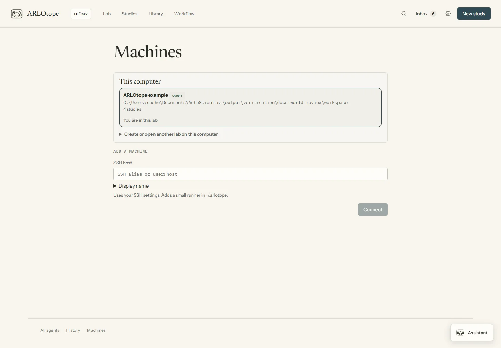
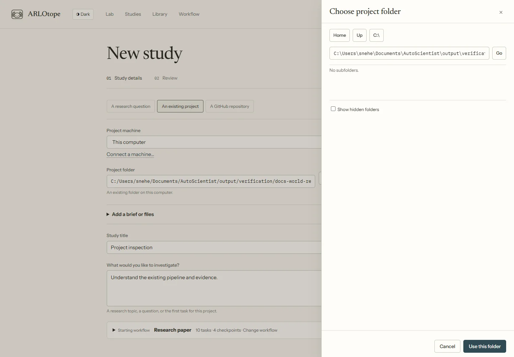

# Projects on other machines

Keep the study, workflow and decisions in one Lab while the project stays on its execution machine.
A small SSH runner starts agents beside that project; the remote host does not need a second Lab.

## Connect and attach

1. Choose **+ Machine** in the Lab, or **New study → An existing project → Connect a machine**.
2. Enter an SSH alias or `user@host`. Complete any password, MFA or host-key prompt in the SSH window
   and keep it open.
3. Select a registered project, or use **Find projects** to search a chosen folder.
4. In New study, check the project folder and machine. Review and create the study.
5. Start work separately when ready. Creating the study does not launch an agent.

**Browse** selects a folder on the chosen machine. For a GitHub clone, select its parent: Lab creates
a new repository folder inside it. A path can also be typed. Attachment adds Lab identity files,
not a new environment or replacement runner.

*Screenshots use demonstration data.*

The host needs OpenSSH, `bash` and Python 3.10+; cloning needs Git. This bootstrap targets
Linux/macOS-style hosts. Native Windows SSH bootstrap is not implemented. The controller has
Windows and POSIX code paths; see [platform verification](platforms-and-agents.md).

The packaged runner goes under `~/.arlotope/workers`, with bundled Python support. It does not require
remote `pip` or a system service. Agents, datasets and project dependencies remain your responsibility.
The bundle includes its source files, Lab license and dependency notices.

## Sign-in, commands and recovery

SSH uses your normal aliases, keys and jump-host configuration. Lab does not save SSH passwords or
copy local provider credentials. **Agents & commands** opens the remote agent’s installation/login
and custom command controls. Sign-in through a terminal sheet can send terminal output through the
controller; use the provider’s intended credential flow.

**Restart sign-in** replaces a missed prompt; **Cancel connection** stops an attempt. An expired
attempt leaves the machine saved so you can **Try again** later. Authentication prompts are not
replayed automatically. Network failures use bounded connection retries and reconnect backoff.

Choose **Disconnect** to close the project runner’s connection. Existing remote work may continue;
new requests and progress collection wait for reconnection. **Forget** removes the saved machine.
Neither action grants approval, cancels arbitrary research jobs, or transfers project ownership.

On reconnection, inspect the run before retrying work. Dispatch and reply receipts reduce accidental
replays, but arbitrary agent actions are not exactly-once. An uncertain delivery is flagged rather
than blindly resent. Explicit continuation requires backend session-loading support and stays on the
original execution machine.

Stopping and resuming use attempt-specific cancellation markers, so an earlier Stop does not cancel
the resumed attempt. Intentionally parked questions remain answerable without a running supervisor;
you can also stop that waiting task. An unexpectedly lost active supervisor is still reported.

## Files and decisions

Finished runs stop background polling once the worker is idle, all transcript, action and conversation chunks have
arrived and pending requests are settled. A reply or resume starts synchronization again. Incomplete
or disconnected runs continue to retry; opening a project file still reads from the connected worker.

| Place | Records |
|---|---|
| Owning Lab | Study journal, workflows, approvals, queue and mirrored run records |
| Project machine | Repository, environment, provider credentials, supervisor and full run files |
| Project `.bus/arlotope/<owner>/agents/` | Remote manifests, instruction snapshots and delivery receipts |
| Lab `lab/.bus/remote-projects/<study>/` | Controller run mirror, not the whole repository |
| Project `.arlotope/knowledge/` | Human notes, saved Q&A and retained sources |

Each dispatch carries a fixed instruction snapshot, including uploaded materials. Later edits do not
change an already queued run’s snapshot. The Library reads remote documents through the runner;
large datasets, environments and the whole repository are not automatically synchronized.

The worker reports task outcomes and checkpoint queries through a study-scoped controller command.
The controller checks outputs and records transitions. The worker cannot approve checkpoints or
address another study through that interface. If the tunnel drops, an unanswered controller request
remains pending.

A remote agent can publish a selected report, image or self-contained HTML page to **Library →
Outputs**. The published copy records study, run and source machine. Feedback returns through the
normal scheduler; after the original turn ends, it may queue continuation. See [outputs](artifacts.md)
and [notes and Q&A](knowledge.md).

## Identity and discovery

`lab/identity.json` holds a stable Lab ID and execution owner. Keep it when moving or backing up
the Lab. Attachment writes project identity and execution ownership in `.arlotope/project.json`;
a per-machine `~/.arlotope/projects.json` index supports discovery.
These are ownership/discovery metadata, not authentication.

Discovery checks identities and paths, flags missing folders and duplicate copied identities, and
scans a chosen folder to bounded depth. It does not attach projects by itself. A project owned by
another Lab is refused. Do not delete an ownership file to force a transfer.

Attachment errors name the selected folder and recorded Lab ID or study/execution owner. If the discovery index disagrees with the project configuration, the error names both IDs. Restore the correct identity rather than deleting its configuration. Local and remote attachment validate identities before writing registration records, so a rejected claim can be corrected and retried. See [Git and backup guidance](knowledge.md#what-to-keep-in-git) for which files travel with a project.

**By machine**, the default Lab layout, gives machines separate spaces. **Unified** places the same
work in shared rooms. This changes presentation, not execution, filtering or context.

## Separate remote Labs

**Machines → Separate Labs** opens or creates a full Lab on that host.
Switching to it changes the dashboard’s owning journal and settings; it does not merge studies.
**Keep connected** refreshes its activity on the Machines page.

## Security and verification limits

The runner endpoint binds loopback and is reached through SSH. Account/session checks protect the
connection; agents still run with their execution account’s permissions. Lab’s protocol is not an
OS sandbox for untrusted code. Updated worker builds use separate endpoints; idle old endpoints are
not automatically removed. Reopen terminals after a worker/dashboard change if their handles expired.

Automated tests cover packaged workers, requests, outcomes, checkpoints and recovery. Recorded
live checks on a Linux cluster covered password/MFA, worker setup, project discovery, a Claude
task, and recovery of the same session and attempt after a forced tunnel disconnect. This was a
small connection/task test, not an end-to-end research campaign. Other hosts, provider tools and
native macOS sign-in flows need separate checks; see [platform scope](platforms-and-agents.md).
