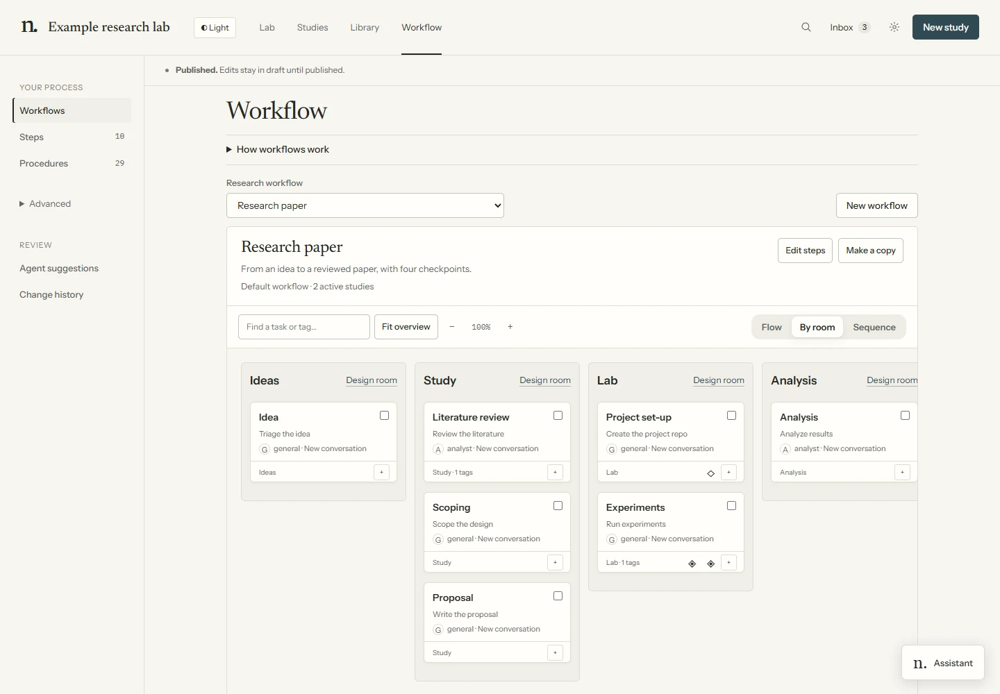

# Design a room

Rooms group work in the visual Lab. Moving a task to a room does not change dependencies, context, agent assignment or checkpoint authority.

Studies share the defined rooms. Starting or attaching a study does not create a room. Each agent
uses its own workflow task's room, including parallel tasks. Create a room explicitly and assign
tasks to it when you need another space. **By machine** repeats the room set for each machine;
**Unified** shows one shared set.

## Group tasks first

1. Open **Workflow → By room**.
2. Select tasks and choose an existing room, then **Group in room**; or enter a name and choose **Create room & group**.
3. Save the composition to draft and review/publish the workflow change.



*Demonstration fixture: room grouping presents the workflow without changing its task connections.*

## Preview a room change

1. In **By room**, choose **Design room** beside a room.
2. Describe the change and choose **Design with an agent**. This launches or continues the ordinary designer conversation.
3. Open that conversation for feedback or questions. Return and **Refresh preview** after edits.
4. Toggle **Show full lab** to inspect the room in context.
5. Review the preview and choose **Apply this room** when ready. **Close draft** leaves the draft for later.

Drafting does not change the live room. The preview uses the application's renderer. Check any reported preview limitations before applying. For direct data edits, expand **Edit the room definition**, edit the JSON and use **Save & preview**.

## Files for custom geometry

Drafts live in `lab/.bus/room-drafts/<id>/`; applied resources live in `lab/rooms/<room>/`. Keep the room's stable ID. The data file is `room.json`; use the existing room properties and components rather than editing the renderer.

The definition supports `base`, `size`, `floor`, `wall`, `accent`, `walls`, `shell`, `props`, `stations` and `roleStation`. A prop looks like:

```json
{"c":"bookshelf","at":[-3,-2.8],"rot":0,"props":{"w":1.8}}
```

## Give furniture a purpose

Characters can move between activity spots within the same room. The component's `uses` list names
activities such as `read`, `search`, `edit`, `run`, `bash`, `git`, `plan` or `spawn`. Its `stands`
provides local `[x, z, facing]` positions (facing in radians), or a function of the component's props. The renderer rotates
and translates these with the placed object; room designers do not need to calculate world positions.

Built-in bookshelves serve `read`; workstations serve editing and terminal/tool work; lab benches
serve `run`; whiteboards serve `plan` and `spawn`. The actual furniture present determines the choices.
A custom component can advertise the same activities through `Lab3D.defineComponent` in its `extra.js`.
This changes presentation, not the agent's tools or workflow.

`stations` maps a procedure or `task:<task-id>` to a preferred `[x, z, facing]` position.
`roleStation` does the same for a role, such as `reviewer`. Activity furniture takes priority in
the candidate list; an available, still-suitable current spot is kept to reduce unnecessary walking.
Leave usable standing and walking space around each prop. The coarse route planner uses component
bounds and may fall back to a direct route when no route is found; it is not a collision simulation.

For example, a review task in Analysis can use a bookshelf while reading, then a workstation while
editing its report. It does not need a different workflow task or room for each tool call. See
[Inside a room](dashboard.md#inside-a-room) for gestures, attention states and activity limits.

Components are in `dashboard/static/world3d/components.js`; builders and materials are in `kit.js`. Existing room definitions are under `world3d/rooms/`.

For room-specific geometry, a draft may include `extra.js`, an ES module exporting `default function (Lab3D) { ... }`. Register a uniquely named component with `Lab3D.defineComponent`, then use it in `room.json`. The module loads in draft and applied views. Keep changes within the assigned draft and inspect browser errors before applying.

A running dashboard exposes the preview at `/static/lab-view.html?roomdraft=<id>`. This opens the draft in the dashboard's room-design sheet. Both draft and applied geometry run in an isolated frame; the dashboard supplies their definitions and module source. Room scripts can build geometry but cannot access the dashboard's DOM or authenticated APIs. Use the designer's normal shell/browser tools for project files and references. No separate renderer or tool service is needed. See [customizing the process](customising.md) for workflow edits.
