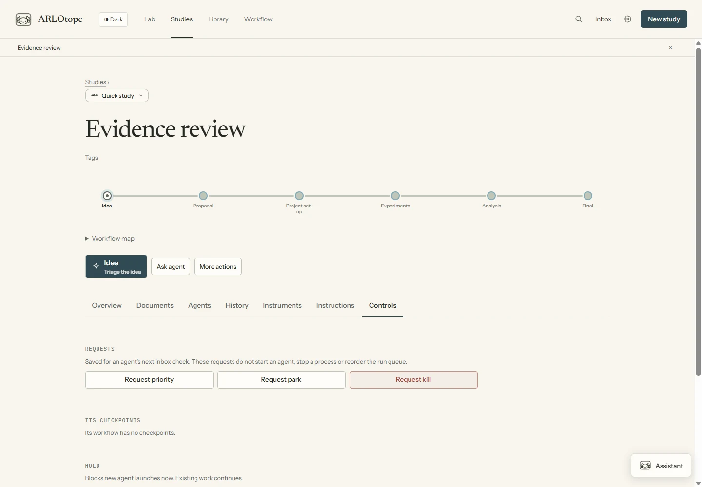

# Start work and follow it

Creating a study saves its question, workflow and materials. Starting an agent is a separate action.
You can create several studies before launching any work.

## Start a task

1. Connect an installed harness in **Settings → Agents & models** and enable launching in
   **Limits & permissions**. Each harness uses its own account and model access.
2. Choose **New study**, review its details and create it. For an existing study, open **Studies**.
3. Choose the next task, or write a direct instruction. The task button shows its skill underneath.
   For a graph, **Run ready tasks** queues eligible nodes. Check the agent, role and context.
4. Launch. The Lab saves the instruction and agent settings, then queues the run. The scheduler
   checks capacity, holds, workflow eligibility, gates, backend availability and usage backoff.
5. Use **Show in lab** to focus the character and its task panel, open its conversation, or use **All agents**. A queued task waits for
   admission; creating or queuing it does not mean the model is already running.

**Plan with an agent** and **Ask agent** open a separate instruction. They can
inspect a project or discuss a plan without automatically dispatching the workflow. **Run ready
tasks** starts the saved task contracts. Creating a study or opening either form starts no agent.

An accepted outcome updates the workflow. Ordered tasks can launch the next step when that option
is enabled. Graph connections make branches ready; joins wait for their inputs.

An agent turn ending without an outcome leaves the task unfinished. **Continue task** opens its
attempt so you can continue the conversation or start a new agent with a handoff. The Lab checks
recorded outcomes, not whether the agent wrote “done” in its reply. See [recovery](recovering-work.md).

The study's **History** tab keeps task passes and agent attempts together. Saving its generated
history snapshot is optional; the underlying workflow and run records are already retained.

## Ask about ongoing work

Click a character and choose **Ask assistant**, or use the same button in its conversation.
The workspace assistant opens with that run selected. Selecting a subagent preserves that focus;
expand **Focus** to change it. Ask your question and choose **Send**. The answer arrives when the
assistant finishes its turn and is saved separately in the study's Library.

The assistant reads recorded conversations, actions and project files. It does not interrupt the
working agent to answer a question. Missing or shortened records limit what it can explain;
independently started terminal agents may have only activity records.

You can also ask it to compare agents or summarize a study. Each question refreshes its Lab snapshot;
the assistant can find older sessions, read workflow history and inspect each run's evidence.
It uses ordinary file and shell tools with supplied command paths. Remote records are local mirrors;
project-file reads use the connected machine. It can re-read current records while answering, but
does not continuously receive every working agent's stream.

**Message** sends an instruction to the working agent instead. For a subagent, the message goes
through its parent. Use this when you want to steer the work, rather than ask the assistant about it.

## Agent compatibility

All adapters use the same studies, task outcomes, queue and research checkpoints. Conversation
features depend on the installed harness and its active transport:

| Agent | Live interaction | Continue or fork |
|---|---|---|
| Claude Code | Streamed questions and permissions | Resume a saved session; native fork through the CLI |
| Codex | App-server questions and approval requests | Resume a saved thread; native fork through the app server |
| opencode | Server questions and permission requests | Resume a saved session; native fork through the live server |
| ACP | Requests the server exports, including supported forms | Loading and native fork require the server's advertised capabilities |

Live interaction must be enabled and the installed harness must support that transport. The native
adapters can also use one-shot execution; it does not provide the same live conversation features.
ACP has no one-shot fallback. Continue requires a compatible saved session on the same backend,
machine and project. A new conversation with an evidence handoff remains a separate option;
it does not restore the full hidden conversation. See [task conversations](agent-workflows.md)
and [ACP configuration and verification limits](acp.md).

Protocol fixtures check request handling, continuation and failure paths without provider credits.
Recorded live checks cover Codex publication/interaction, an Antigravity ACP text turn and session
loading, and opencode ACP session setup. They do not certify every provider's tools, forms, model
access or native forks. Check your installed agent before assigning a long run.

## Work on several studies

Repeat **New study** for each question or repository, then start a task in each. Existing tasks
keep running while you navigate elsewhere. Use **Studies** to see each study's status, **All agents**
for sessions across studies, and **Inbox** for decisions. Tags organize the list without affecting
execution. There is no three-study limit.

The default is **7 task sessions across the Lab**, with a separate default of 7 per study.
Parallel branches that perform tasks each use a slot. Independent reviewers, gate judges, explainers
and assistants are excluded. Tasks beyond available capacity queue rather than
being refused. Change the limits in **Settings → Limits & permissions**. A campaign additionally
has its own approved project/dispatch limits; those do not restrict manually started studies.

An open task chat process reserves a slot even while waiting for your next message. A fully parked
question releases it. Native subagents and independently started terminals are outside the managed
session cap. See [what counts as a slot](compute.md#agent-slots-and-experiment-jobs).

## Hold or steer a study

**Hold** prevents new agents from starting for that study; existing work keeps running. Use
**View hold** or the study's **Controls** to release it. Checkpoint decisions can still be recorded
while held, but starting the next task waits for release.

**Ask agent to focus**, **Request park** and **Request kill** save instructions for an agent's next
inbox check. They do not start an idle agent, reorder the run queue, stop a process or immediately
change the workflow state. **Pending instructions** shows them in the study's
Overview and Controls, including before a project folder exists. The study list shows a pending
count. **Seen; awaiting action** means an agent has read an instruction without completing it yet.
Use **Withdraw** to cancel a pending request. Inbox and History also keep these records.

| Action | Effect |
|---|---|
| Ask agent to focus | Asks an agent to give the study attention; does not change scheduler priority |
| Request park | Asks an agent to defer the study and record a `park` outcome |
| Request kill | Asks an agent to abandon the direction and record its reason and a `kill` outcome |
| Hold | Immediately blocks new managed agent launches for the study; existing work continues |
| Stop, on a run | Stops that managed agent process; does not park or kill its study |
| Revive | Lets the PI move a parked or killed study to a selected workflow step |

Parked and killed are recorded shelving states. Both retain files and history and can be revived
by the PI. A move itself does not terminate other running processes. The queue separately admits
eligible runs using their saved priority, continuation preference and creation time, subject to
capacity, holds, gates and backoff. A priority request does not alter those saved queue values.

*Current local test study; these requests were not submitted for the screenshot.*

These instructions are separate from [human notes](knowledge.md#add-a-human-note), which provide
context and optional read receipts without queuing work.

## Know when something needs you

**Inbox** is the durable attention list. It includes questions, tool permissions, workflow decisions,
unfinished or failed tasks, alerts and escalations. The navigation badge and browser-tab title show
its non-informational count. Opening an item does not dismiss it. Resolving the underlying request
removes it; **Dismiss** hides that occurrence. A flag's **Acknowledge** action is separate and can
release its hold.

Character state and the conversation show exported agent questions. Failed or stopped agents may
leave the scene; their records and warnings remain in Inbox and All agents. The Lab cannot infer
every unstated human request from arbitrary model prose; task-outcome checks catch formally
assigned work that ended without completing its contract.

**Settings → Notifications** has optional delivery:

- **Desktop:** requires browser permission and the local preference. New items notify while the tab
  is in the background; simultaneous items are grouped. Opening the page does not replay its entire
  existing Inbox. Browser notifications require the page to remain open.
- **Phone & chat:** configure ntfy or a webhook. The scheduler sends actionable Inbox items even
  without a browser tab, once per destination. Failed deliveries retry without repeating successful
  destinations while a scheduler is running. The last supervisor also attempts delivery before
  exiting if the dashboard server has stopped. If that attempt fails with no work left, delivery
  retries when a scheduler runs again. Information-only completion reports are excluded.

Neither channel is enabled automatically. Messages contain a title and short excerpt, which can
include sensitive project text. No files or full transcripts are attached. A notification's dashboard
link needs an address reachable from that device, through an appropriate tunnel or proxy; changing
the link does not expose the loopback-only server. Inbox remains usable if delivery is unavailable.

Questions, notes and tool permissions do not approve a research checkpoint. Review those decisions
in their checkpoint sheet.
