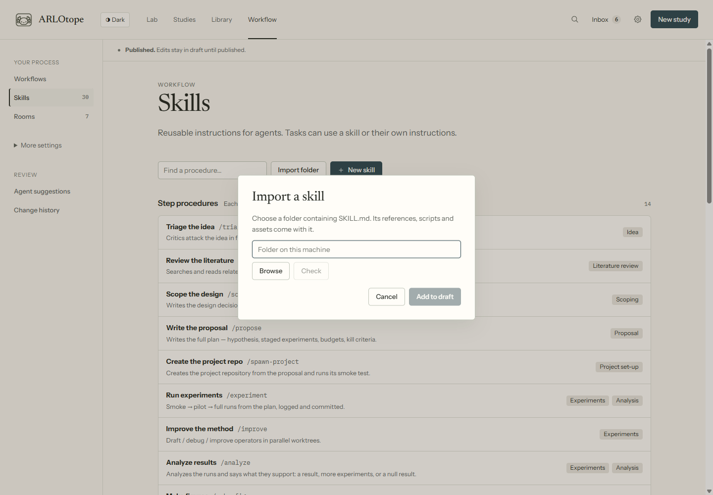
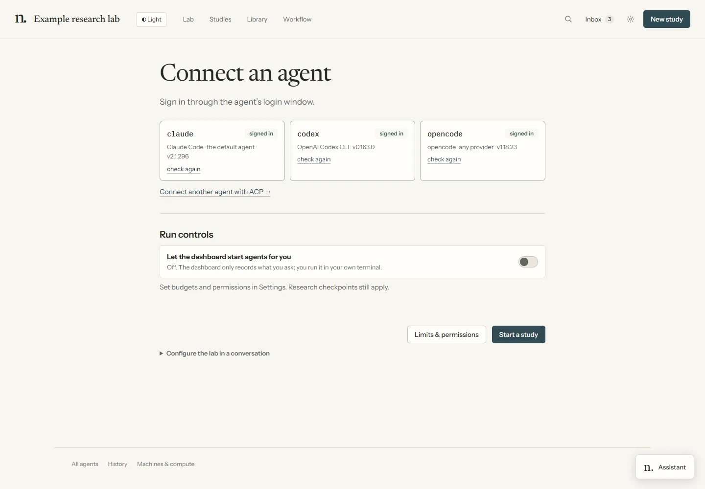

# Skills reference

Procedures are instructions in `.claude/skills/<name>/SKILL.md`. Claude Code exposes slash commands;
other harnesses read and execute the same files. Dashboard launches supply the selected procedure,
study and evidence brief. ACP is a transport, not a separate skill language.

The file is the full procedure; this page helps choose one. Workflow definitions determine which
procedures advance a study and which checkpoints wait for the researcher. A chat statement, note,
question answer or artifact reply does not approve a checkpoint.

## Reuse a skill

In **Workflow → Skills → Import folder**, browse to a folder containing `SKILL.md`, check its files,
then **Add to draft**. Review and publish before selecting it on a workflow task. **New skill** creates
plain Markdown instructions; **Make a copy** creates a variant of an existing method.



The `name` in the YAML header must match its folder. A `description` says when to use it. For example:

```markdown
---
name: evidence-check
description: Check whether claims are supported by the supplied evidence.
---

Read the evidence. Separate supported claims from uncertainties.
Write a short review with links to the source files.
```

Keep optional `references/`, `scripts/`, `assets/` and supplied license files inside that folder.
The import retains their bytes, adds a separate `.claude/skills/.imports/<name>.json` receipt with the source folder name and content
hash, and leaves the skill's instructions intact. It leaves out Git metadata, environments and caches.
Links outside the skill folder are rejected. Importing runs no scripts and installs no dependencies.
Review third-party instructions, dependencies and licenses before use. Skills from repositories such
as `academic-research-skills` can be imported locally; they are not bundled with ARLOtope.

### Project copies and run records

The Lab's reusable library lives in `.claude/skills/`. Adding a local method keeps installed defaults
available. A project receives its selected workflow methods and declared dependencies when scaffolded,
or before its first managed workflow run:

```text
project/
  .agents/skills/evidence-check/...
  .arlotope/
    project.json
    skills.json
    workflows/my-study.json
```

Existing project skills win in `.agents/skills/`, then `.claude/skills/`, then `.opencode/skills/`.
They are never overwritten by the Lab copy. Edit a project copy to adapt its method; changing the Lab
original does not silently change an established project. Attached repositories keep their own tooling.

Each managed workflow run with a project saves the resolved folders in its run directory under
`skills/<name>/`, alongside `skills/_manifest.json` and `skills/_workflow.json`. Instructions point
to those exact files. Later edits do not change that run's saved method. The project workflow snapshot
is a reference record; execution uses the Lab's published definition and refreshes the record per run.

This packaging path is shared by Claude Code, Codex, opencode and ACP. Native skill discovery remains
available outside managed runs. Remote project runners use the same structure; reconnect a machine
after updating ARLOtope to update its runner.

**Export as skill** bundles a workflow's Markdown procedure, selected skills and resources. Mechanical
gates, independent agents and native parallel forks still require an execution environment supporting them.

The command is `arlotope.py`; project records live under `.arlotope/` and environment variables use
the `ARLOTOPE_*` prefix. These are the canonical interfaces, with no old-name aliases.

## Setup & autonomy

### `/setup-lab`

Optional interview about research interests, compute, methodology and oversight. **New study**
works without it. Agent installation/login lives in **Settings → Agents & models**.



### `/autopilot`

Runs a portfolio within a campaign brief approved by the researcher. The brief fixes scope, budget,
stop conditions and any checkpoints delegated within bounds. An agent cannot grant itself those
permissions. Campaign scheduling and native harness conveniences differ; use the Lab’s configured
executor path rather than assuming a harness-specific loop command exists everywhere.

### `/advance [slug]`

Runs exactly the next procedure for one study, presents what changed and stops for verification.
At an unapproved checkpoint it presents the evidence and waits. Use it for a review-after-each-step pace.

### `/adopt`

Bring an idea, repository, analysis or draft into the Lab. Default to attachment; preserve existing
code and tools. Record the researcher’s chosen entry point and waived stages in `IDEA.md`.
Add experiment or paper scaffolding only when requested. Existing claims still need evidence.

### `/compete [slug-or-task]`

Define a fixed target, rules, evaluation, output and budgets, then use the target workflow.
The method space is open while task/evaluation/budgets stay fixed. External scoring and final-output
selection have their own researcher decisions. See [target-driven projects](compete.md).

## Orientation

### `/lab-status`

Inspect studies, pending decisions, inboxes and project write-backs; report blockers and suggest the
next useful action. Session orientation follows `AGENTS.md`; use this procedure when choosing what
to do next.

### `/configure [slug] [set key=value]`

Inspect effective settings and their source layers, or change the appropriate config file.
Budgets, frozen evaluation and other researcher-owned settings follow their ownership rules.
Changing a setting is not approval of work behind a checkpoint.

## Ideation → proposal

### `/discuss <purpose> [target]`

Collaborative questioning with logged research between turns. Produces a framing/session document,
then can seed direction, target, scope, in-project ideation or paper writing. It advances no checkpoint.
Unlike a saved workspace answer, this procedure deliberately develops research framing.
See [discussion sessions](discuss.md).

### `/ideate [direction]`

Mine existing knowledge and literature, generate mechanism-diverse candidates, then separate
novelty/feasibility/value criticism from synthesis. Revise or kill weak candidates, combine useful
survivors and rank before filing the best ideas. Depth and ensemble sizes come from `ideation.*`.

### `/triage <slug>`

Attack a filed idea’s novelty, feasibility and value before investing in it. Record the strongest
surviving objection and an evidenced recommendation; parking or killing retains the reason.
For replication, verification or exploration, judge value against the requested purpose; lack of
novelty alone does not justify killing a replication.

### `/lit-review <slug>`

Search iteratively, log queries and record what each paper actually supports. Produce a novelty
verdict and positioning against the closest work. Keep useful papers in the shared reading index.
Later citations must be checked against those notes rather than recalled from memory.

### `/critique-paper <arXiv|URL|PDF|slug>`

Assign separate review lenses to fresh reviewers. Give paths, lens/rubric and calibration, never the
author’s opinion. Aggregate scores by median and retain load-bearing minority objections.
Feedback must be checked against the paper and evidence before revisions.

### `/scope <slug>`

Compare design branches: framing, data, baselines, metrics, scale, method and ablations. Separate
advocacy for each option before deciding. Record decisions, rejected alternatives and conditions
for reopening them in `decisions.md`. Tie unresolved choices to informative pilot work.

### `/propose <slug>`

Turn the design into a testable plan: hypothesis, baselines, evaluation/selection discipline, staged
experiments with promotion criteria, ablations, budgets, success and kill criteria. Present the
proposal at its checkpoint; do not start full runs by implication.

## Experimentation

### `/spawn-project <slug>`

Reuse an attached repository and runner. For a new project, confirm methodology/domain, generate the
scaffold outside the hub, fill plan/control files from the proposal, then run smoke/readiness checks.
Creating a project does not authorize full-scale work. See [projects](projects.md).

### `/experiment <slug> [exp-id]`

Read the plan, ledger, notes and Git history. Create a new immutable config per attempt, progress
SMOKE → PILOT → FULL only when written criteria pass, and log failures as carefully as successes.
Use the project type’s replication analogue where literal multi-seed evaluation does not apply.

### `/improve <slug> [focus]`

Iterate with draft, debug, improve and crossover operators. Use distinct candidate approaches and
bounded debugging; combinations become ablation candidates. Experiment workers remain in assigned
worktrees and return result packets. The parent updates shared ledgers and decides what to retain.

### `/research-loop <slug>`

Run unattended only within an approved `LOOP_BRIEF.md` and applicable workflow permission.
Prioritize planned experiments, ablations and confirmation before expanding the search. Respect
fixed budgets, debug depth, stop conditions and frozen evaluation. A pause, failure or exhausted
budget is recorded, not hidden. See [autonomy](autonomy.md).

## Analysis → publication

### `/analyze <slug>`

Reconstruct measurements from artifacts and pre-written criteria. Check confounds, missing
ablations, negative results and alternative explanations before interpreting a pattern.
An overseer verifies interpretations where configured. Report whether writing or more experiments
are warranted and distill durable lessons.

### `/make-figures <slug>`

Generate figures and tables with committed scripts reading run artifacts. Inspect rendered results
for accuracy, uncertainty, readable labels and consistent presentation. Theory illustrations follow
the type card’s explicit evidence convention.

### `/write-paper <slug>`

Draft around verified artifacts and an evidence-backed bibliography. Write method/setup before
interpreting results, resolve citation placeholders against literature notes, and keep
`paper/claims.yaml` aligned with the text. Reflection rounds rerun compilation and integrity checks.

### `/review-paper <slug>`

Run mechanical claims/bibliography checks, then an independent reviewer ensemble. Every action item
gets an evidenced ACCEPT, REBUT or NEEDS-EXPERIMENT response. A missing experiment becomes planned
work; it cannot become an invented result during revision. Unresolved load-bearing objections block
acceptance. See [workflow safeguards](workflow.md).

### `/finalize <slug>`

Verify the agreed deliverable and reproduction steps, preserve evidence and distill lessons.
Paper projects check manuscript integrity and archived claims; target projects reproduce the
researcher-selected output; attached quick studies use their agreed deliverables. Failures and
manual checks remain explicit. External submission is still the researcher’s action.

## Workflow and room design

### `/design <request>`

Propose workflow/procedure changes in a separate draft. Validate it and show its consequences.
The researcher reviews and publishes; the designer does not change the live process by itself.

### `/design-room <request>`

Create a private room appearance draft and preview. Applying appearance is separate from publishing
workflow logic. See [room design](room-design.md).

### `/gate-review <request>`

Independently compare declared evidence against a checkpoint rubric. The kernel validates the
review and required checks before recording a delegated decision; a working agent cannot approve
its own task.

## Design & collaboration helpers (vendored)

### `/grill-with-docs`

The engineering helper combines one-question-at-a-time grilling with a `CONTEXT.md` glossary and
ADRs in `adr/`. `grilling` and `domain-modeling` also work alone. These helpers are vendored from
[mattpocock/skills](https://github.com/mattpocock/skills); their own notices/licenses apply.
Engineering ADRs are separate from research `decisions.md`. See [discussion sessions](discuss.md).

## Subagents used by skills

| Role | Independence contract |
|---|---|
| Fresh-context reviewer | Paper/evidence paths and one lens; no author framing |
| Experiment runner | One assigned variant, worktree confinement, result packet |
| Ideation critic / scoping advocate | Separate written criticism or advocacy before synthesis |
| Overseer | Evidence-only verification of a quoted claim; returns a verdict |

Native child agents, separate executor runs and sequential role approximation are different
mechanisms. Availability depends on the harness. Use the generated role files and the procedure’s
contract; do not claim fresh-session independence when all roles shared the same context.
