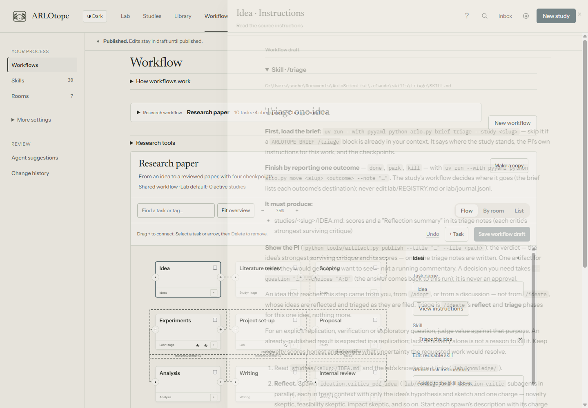

# Skills reference

Skills are ordinary folders containing `SKILL.md`, with optional references, scripts and assets.
The Lab's shared library lives in `.claude/skills/`; selected project copies live in `.agents/skills/`.
Claude Code exposes its native slash commands; managed runs on all supported harnesses receive the
exact selected skill paths and the study/evidence brief. ACP is a transport, not a separate skill language.

A skill supplies a method; a workflow assigns it to a task. The same skill can serve several tasks
or workflows. Reporting a task outcome advances the workflow. Ordinary replies do not approve
checkpoints.

Screenshots use demonstration data.

## How instructions fit together

`AGENTS.md` supplies the shared protocol. A managed run's brief adds the study, task, role,
checkpoints and project context. Its task can name one or more skills and add written instructions.
The selected skills supply the methods; they do not each complete the task independently.
Only the procedure assigned to finish the task reports its outcome.

Keep a skill's main file focused on its method. Put substantial optional branches in `references/`
and link them from the step that needs them. Those files travel with project copies and saved runs.
Avoid copying the shared protocol into every skill. Use configuration for budgets and model choices,
and task instructions for study-specific additions. The supplied research methods are editable defaults.

## Read the instructions

Select a task on the workflow map and choose **View instructions**. Read its skill, added task
instructions, role, context and expected outputs without leaving the map. Skills open as formatted
Markdown; supporting files are listed below them. **Workflow → Skills** also opens each skill in
this reading view. Use **Files → Edit** to change its source, or **Lab additions** for shared additions.



The map shows the shared workflow draft. A study's **View instructions** uses its published task
and project-local skill copies where present. Source paths identify which files you are reading.
Remote previews identify Lab definitions explicitly; the run's saved copies show what was resolved
on its machine.

On a run, **Recorded instructions** opens its saved task prompt, standing instructions and available
skill copies. It does not substitute today's skills when an old record is missing. These are the
Lab's recorded inputs; the harness may also supply its own system instructions and conversation history.

## Reuse a skill

In **Workflow → Skills → Import folder**, browse to a folder containing `SKILL.md`, check its files,
then **Add to draft**. Review and publish before selecting it on a workflow task. **New skill** creates
plain Markdown instructions; **Make a copy** creates a variant of an existing method.


The `name` in the YAML header must match its folder. A `description` says when to use it. For example:

```markdown
---
name: evidence-check
description: Check whether claims are supported by the supplied evidence.
---

Read the evidence. Separate supported claims from uncertainties.
Write a short review with links to the source files.
```

Keep optional `references/`, `scripts/`, `assets/` and supplied license files inside that folder.
The import retains their bytes, adds a separate `.claude/skills/.imports/<name>.json` receipt with the source folder name and content
hash, and leaves the skill's instructions intact. It leaves out Git metadata, environments and caches.
Links outside the skill folder are rejected. Importing runs no scripts and installs no dependencies.
Review third-party instructions, dependencies and licenses before use. Skills from repositories such
as `academic-research-skills` can be imported locally; they are not bundled with ARLOtope.

### Project copies and run records

The Lab's reusable library lives in `.claude/skills/`. Adding a local method keeps installed defaults
available. A project receives its selected workflow methods and declared dependencies when scaffolded,
or before its first managed workflow run:

```text
project/
  .agents/skills/evidence-check/...
  .arlotope/
    project.json
    skills.json
    workflows/my-study.json
```

Existing project skills win in `.agents/skills/`, then `.claude/skills/`, then `.opencode/skills/`.
They are never overwritten by the Lab copy. Edit a project copy to adapt its method; changing the Lab
original does not silently change an established project. Attached repositories keep their own tooling.

Each managed workflow run with a project saves the resolved folders in its run directory under
`skills/<name>/`, alongside `skills/_manifest.json` and `skills/_workflow.json`. Instructions point
to those exact files. Later edits do not change that run's saved method. The project workflow snapshot
is a reference record; execution uses the Lab's published definition and refreshes the record per run.

This packaging path is shared by Claude Code, Codex, opencode and ACP. Native skill discovery remains
available outside managed runs. Remote project runners use the same structure; reconnect a machine
after updating ARLOtope to update its runner.

**Export as skill** bundles a workflow's Markdown procedure, selected skills and resources. Mechanical
gates, independent agents and native parallel forks still require an execution environment supporting them.

## Setup & autonomy

The complete instructions live in each skill's `SKILL.md`. Open them in **Workflow → Skills**;
these descriptions help you choose a starting point. Built-in research skills are defaults, not
required workflow stages.

### `/setup-lab`

Optional interview about interests, compute and oversight. You can use **New study** without it.

### `/autopilot`

Run studies within an approved campaign's scope, budget and stop conditions. See [campaigns](autonomy.md#campaigns).

### `/advance [slug]`

Perform one study step, show its result, then stop for verification or a required checkpoint.

### `/adopt`

Bring in an existing idea, repository, analysis or draft. Preserve its tools and record the chosen entry point.

### `/compete [slug-or-task]`

Work toward a fixed target with explicit evaluation, output and budgets. See [target-driven projects](compete.md).

## Orientation

### `/lab-status`

Inspect studies, decisions, inboxes and project write-backs; identify blockers and useful next work.

### `/configure [slug] [set key=value]`

Inspect effective settings and their source layers, or change the appropriate config file.

## Ideation → proposal

### `/discuss <purpose> [target]`

Develop a question through discussion and logged research. Produces a framing document;
see [discussion sessions](discuss.md).

### `/ideate [direction]`

Research candidate ideas, challenge novelty, feasibility and value, then rank the surviving directions.

### `/triage <slug>`

Assess an idea before investing in it. Judge value against its purpose, including replication;
retain the evidence and reason if it is parked or killed.

### `/lit-review <slug>`

Search and record what each source supports, how it relates to the study, and which work is closest.

### `/critique-paper <arXiv|URL|PDF|slug>`

Use independent review lenses and retain serious minority objections. Check feedback against evidence before revising.

### `/scope <slug>`

Compare design options, record decisions and rejected alternatives, and identify pilot work that resolves uncertainties.

### `/propose <slug>`

Write a testable plan: hypothesis, baselines, evaluation, staged experiments, ablations, budgets,
success criteria and kill criteria. Present it at the configured checkpoint.

## Experimentation

### `/spawn-project <slug>`

Reuse an attached project or create an agreed scaffold outside the Lab. Confirm methodology
and run smoke/readiness checks. See [projects](projects.md).

### `/experiment <slug> [exp-id]`

Read the plan and prior attempts; run staged experiments from saved configurations and log their evidence.

### `/improve <slug> [focus]`

Explore variants with bounded debugging. Workers return results; the parent retains shared ledgers and decisions.

### `/research-loop <slug>`

Run unattended within an approved loop brief, fixed budgets and stop conditions. See [background work](autonomy.md).

## Analysis → publication

### `/analyze <slug>`

Interpret artifact-backed results against the planned criteria, confounds, missing tests and alternative explanations.

### `/make-figures <slug>`

Generate and inspect figures and tables from run artifacts using committed scripts.

### `/write-paper <slug>`

Draft from verified results and literature notes, keeping numerical claims linked through `paper/claims.yaml`.

### `/review-paper <slug>`

Run mechanical checks and independent reviews. Accept, rebut or request experiments with evidence;
missing experiments remain work to do.

### `/finalize <slug>`

Verify the agreed deliverable, reproduction steps and evidence archive. External submission remains the researcher's action.

## Workflow and room design

### `/design <request>`

Propose and validate workflow or skill changes in a private draft for researcher review and publication.

### `/design-room <request>`

Create a room appearance draft for preview and application. See [room design](room-design.md).

### `/gate-review <request>`

Independently judge checkpoint evidence against its rubric. The engine validates delegated decisions;
a working agent does not approve itself.

## Design & collaboration helpers (vendored)

### `/grill-with-docs`

Combine one-question-at-a-time discussion with a `CONTEXT.md` glossary and ADRs in `adr/`.
`grilling` and `domain-modeling` also work alone. These helpers come from
[mattpocock/skills](https://github.com/mattpocock/skills); their notices and licenses apply.

## Subagents used by skills

| Role | Independence contract |
|---|---|
| Fresh-context reviewer | Paper/evidence paths and one lens; no author framing |
| Experiment runner | One assigned variant, worktree confinement, result packet |
| Ideation critic / scoping advocate | Separate written criticism or advocacy before synthesis |
| Overseer | Evidence-only verification of a quoted claim; returns a verdict |

Native child agents, separate executor runs and sequential role approximation are different
mechanisms. Availability depends on the harness. Use the generated role files and the procedure’s
contract; do not claim fresh-session independence when all roles shared the same context.
