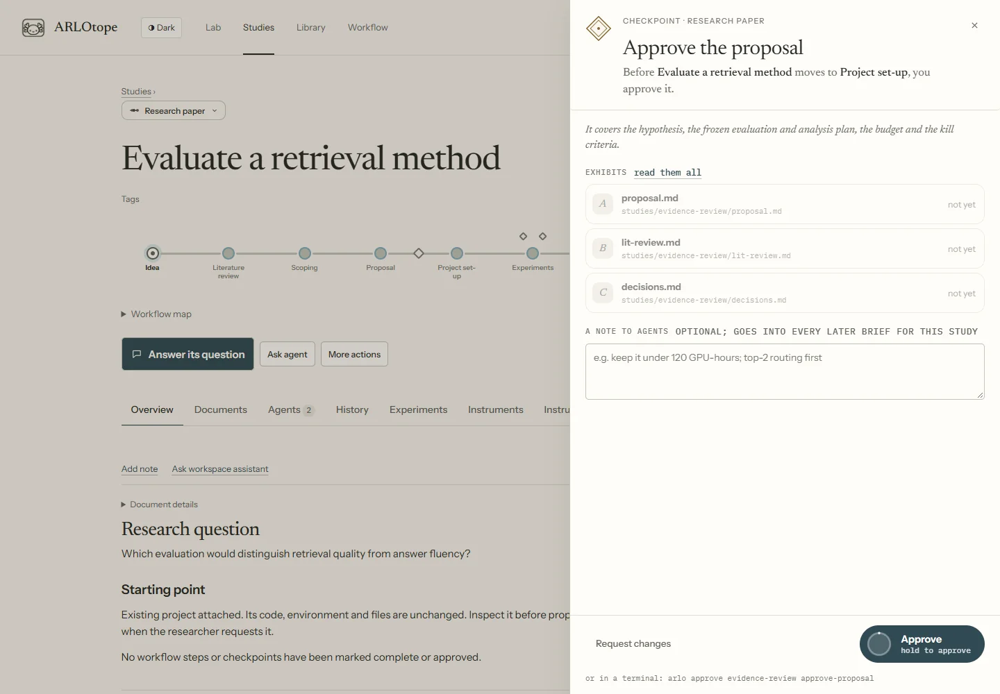

# Workflow reference

A workflow defines the tasks a study can do, the routes between them and the checkpoints on the way. For visual editing, use [Customize your process](customising.md). For presets, branches and conversation context, use [Tasks, agents and rooms](agent-workflows.md).

## Concepts

| Term | Meaning |
|---|---|
| Study | One question or project following a workflow |
| Shared step | A reusable step definition with a default procedure |
| Task | A step as configured in a composed workflow, with instructions, outputs and agent/context choices |
| Room | A shared visual location used by tasks across studies; independent of execution order |
| Procedure | A readable skill that tells an agent how to perform work |
| Outcome | The result the agent reports, such as `done` or a named revision route |
| Checkpoint | Authorization before a step or at a named point during it |
| Journal | The append-only record used to reconstruct study state |

A procedure reports an outcome; the workflow decides the destination. A role or preset does not grant checkpoint authority.

### Where the next-task button comes from

The journal records the current task. Its definition selects a skill or own instructions.
The start button shows the task name, with its skill underneath. For example, Quick study starts
at `seed`: the task is **Idea**, its skill is **Triage the idea**, and its room is Incubator.
The study's title does not change this assignment.

The task stays current until the kernel accepts an outcome. Writing a document or ending an agent
turn does not complete it. A finished attempt with no outcome offers **Continue task**. Graph
workflows track each task and pass separately; **Run ready tasks** starts their ready branches.

Change the task's skill or instructions in Workflow. The starter can also record existing work or
skip initial tasks. Rooms are shared locations, not extra tasks. `park` and `kill` are generic
shelving outcomes; see [study controls](running-work.md#hold-or-steer-a-study).

## Files

| File | Defines |
|---|---|
| `workflow/steps.yaml` | Shared steps, default procedures and optional role/tag metadata |
| `workflow/workflows/<id>.yaml` | Ordered path, procedure substitutions, routes, checkpoints and optional composed nodes |
| `workflow/rooms.yaml` | Room/stage labels and presentation |
| `.claude/skills/<name>/SKILL.md` | Skill instructions and optional `arlotope` contract metadata |
| `lab/workflow/` | Lab-added instructions |
| `studies/<slug>/workflow/` | Study-specific instruction and assignment overrides |
| `lab/journal.jsonl` | Kernel-owned study history |

`lab/REGISTRY.md` is generated from the journal. Edit neither to move a study. The dashboard writes shared changes through a draft and publication review. After direct definition edits, run `uv run --with pyyaml python arlo.py check`.

A shared step can declare a role:

```yaml
writing:
  label: Writing
  do: write-paper
  room: writing
  agent: {role: writer}
```

An ordered workflow uses `path` and optional `routes`:

```yaml
id: short-study
title: Short study
path: [seed, proposal, setup, active, analysis, final]
routes:
  analysis: {more-experiments: active, null-result: ask}
```

A composed workflow adds `nodes` using the same step IDs. `procedure: null` means own instructions; omitting it inherits the step's procedure. `next: []` ends a branch; omitting it inherits the following path entry. Output paths are relative to the project, or the study folder when there is no project. The composer adds shared definitions for newly created task IDs.

```yaml
path: [draft, review, revise]
nodes:
  draft:
    procedure: null
    instructions: Write a short evidence report.
    outputs: [draft.md]
    agent: {role: writer}
    next: [review]
  review:
    procedure: null
    instructions: Read draft.md and the evidence. Write review.md.
    outputs: [review.md]
    agent: {role: reviewer}
    context: {mode: fresh}
    next: [revise]
  revise:
    procedure: null
    instructions: Read review.md, address supported issues and write revised.md.
    outputs: [revised.md]
    agent: {role: writer}
    context: {mode: continue, from: draft}
    next: []
```

This declares a fresh reviewer and a revision in the writer's conversation, provided it remains the valid source head. Dependency order and context source are separate. See [context rules](agent-workflows.md#choose-context) for stale sources, loops and handoffs.

## Checkpoints

1. Open the checkpoint diamond on a task, or add one from the inspector.
2. Choose **before** a task or **during** one at a named point.
3. Set the approver, evidence and checks. Review exactly what approval covers.
4. Save and publish the shared definition. At a study's checkpoint, inspect its evidence before deciding.



*Demonstration fixture: checkpoint decisions are recorded separately from chat and tool permissions.*

| Field | Purpose |
|---|---|
| `id` | Stable checkpoint ID used by decision records |
| `before` | Holds entry to the named step |
| `during` and `at` | Instructs the agent to stop at a named point within a step |
| `approver` | `me`, `me-or-campaign`, `auto` or `agent` |
| `evidence` | Files to inspect, with `{study}` and `{project}` substitutions |
| `checks` | Required checks; automatic approval needs at least one |
| `watch` | Checks that raise flags while approval is absent |
| `means` and `tell` | Approval scope and the instruction in the agent's brief |
| `decisions` | Named decision-to-destination routes |

A during-task checkpoint depends on the working agent observing the named stopping point; it does not intercept arbitrary native commands. Checks and gates do not provide an OS sandbox.

An independent judge is explicitly configured, for example:

```yaml
checkpoints:
  - id: review-evidence
    title: Review the evidence
    before: writing
    approver: agent
    evidence: ['{project}/findings.md']
    judge:
      skill: gate-review
      rubric: Are the claims supported and their limits stated?
      max_attempts: 3
      max_visits: 3
      max_minutes: 15
    decisions: {proceed: continue, revise: analysis, stop: parked}
```

The judge returns a decision packet; the engine validates its declared decision and evidence before routing it. Changed evidence or a new visit requires the corresponding review. A judge cannot approve a researcher-only checkpoint merely by writing an opinion. Malformed, failed or stale review leaves it unresolved.

## How a study moves

Commands below run from the Lab folder. `done` follows the configured next step or ends the last task; named outcomes follow their routes; `park` and `kill` shelve work. A composed workflow can have several active tasks, each with a visit and owning run.

```bash
uv run --with pyyaml python arlo.py status
uv run --with pyyaml python arlo.py next my-study
uv run --with pyyaml python arlo.py brief experiment --study my-study
uv run --with pyyaml python arlo.py move my-study done --note "Required outputs recorded."
```

A run must produce required outputs and report its accepted outcome. A clean process exit alone does not complete a task. The bound visit rejects stale ownership and duplicate completions do not advance it twice. Joins wait for configured incoming branches; use an ordinary merge for alternatives.

The kernel holds an unapproved **before** checkpoint when the reported outcome reaches it. At a **during** checkpoint, the agent checks approval before doing that work. The researcher uses the checkpoint sheet or its CLI decision command. Inside an agent run, researcher-only decision verbs are refused.

```bash
# Researcher action: record the specific checkpoint decision.
uv run --with pyyaml python arlo.py approve my-study CHECKPOINT_ID
```

Prose, directives, notes, artifact replies and permissions are never research approvals. Checkpoints explicitly delegated to checks, independent judges or approved campaigns use their declared mechanisms.

## The brief

`arlo.py brief <procedure> --study <study>` describes that procedure's work, outputs, allowed outcomes, instructions and checkpoint status. Use `next <study>` to identify the next procedure first. Dashboard runs load their brief before execution. Variants may inherit procedure metadata through `arlotope.like` while supplying their own skill body.

## The journal

`lab/journal.jsonl` records study creation, task binding, outcomes and decisions. State is reconstructed from these events. The kernel owns this append-only history; use commands and dashboard decisions rather than editing it or the generated registry.

## The Lab's workflows

The following tables are generated from the shipped definitions. Edit the workflow source, not this block.

<!-- workflow:begin (generated by `arlo docs` — edit workflow/) -->
| Step | Its procedure | Also | Room |
|---|---|---|---|
| `seed` — Idea | `/triage` | `/discuss` | incubator |
| `lit-review` — Literature review | `/lit-review` | `/discuss` | study |
| `scoping` — Scoping | `/scope` | `/discuss` | study |
| `proposal` — Proposal | `/propose` |  | study |
| `setup` — Project set-up | `/spawn-project` |  | lab |
| `active` — Experiments | `/experiment` | `/improve`, `/research-loop`, `/analyze` | lab |
| `analysis` — Analysis | `/analyze` | `/experiment`, `/make-figures` | bench |
| `writing` — Writing | `/write-paper` | `/make-figures`, `/critique-paper` | writing |
| `internal-review` — Internal review | `/review-paper` | `/critique-paper`, `/write-paper` | writing |
| `final` — Final | `/finalize` |  | archive |
| `external-setup` — Task setup |  |  | study |
| `external-search` — Investigation |  |  | lab |
| `external-compare` — Baselines & ablations |  |  | lab |
| `external-eval` — Final evaluation |  |  | bench |
| `external-analyze` — Post-hoc analysis |  |  | bench |
| `external-write` — External writing |  |  | writing |

| Workflow | Path | Routes | Checkpoints |
|---|---|---|---|
| Research paper (`research`) — default | `seed` → `lit-review` → `scoping` → `proposal` → `setup` → `active` → `analysis` → `writing` → `internal-review` → `final` | analysis: `more-experiments` → active, `null-result` → ask; writing: `more-experiments` → active, `reanalyse` → analysis; internal-review: `revise` → writing, `more-experiments` → active | Approve the proposal (before `setup`); Approve full runs (during `active`, at full-scale runs); Approve the research loop (during `active`, at starting an unattended research loop); Finalize the paper (before `final`) |
| Agentic Scientist · Sakana (`sakana`) | `seed` → `external-setup` → `external-search` → `external-compare` → `external-eval` → `external-analyze` → `external-write` → `internal-review` → `final` | — | Review the task and budget (before `external-setup`); Review the frozen selection (before `external-eval`) |
| Quick study (`quick`) | `seed` → `proposal` → `setup` → `active` → `analysis` → `final` | analysis: `more-experiments` → active | none |
| Target-driven (`target`) | `active` → `final` | — | Approve external scoring (during `active`, at sending an output to an external scorer); Choose the final output (before `final`) |
<!-- workflow:end -->

## Research workflow safeguards

The default frozen-evaluation watch applies when a project's `control.yaml` exists at the start
or end of a run, including deletion during the run. Plain attached repositories need no Lab
evaluation contract. Explicit `frozen` checks in a procedure or checkpoint still require that
contract and remain strict. A custom watch can use `when: project` for any attached project, or
`when: project-control` for this contract-aware condition.

### The paper-refinement loop (and its safeguards)

Analysis, writing and review may return to earlier work through declared routes. Review feedback must be checked against evidence. Accept a supported correction, rebut it with evidence, or plan an experiment when new evidence is needed. Revisions must not invent results; claims retain explicit run-artifact pointers. The paper-finalization checkpoint remains distinct from an internal accept recommendation.

### Unattended protocol (/research-loop)

An unattended research loop requires its configured approval and an agreed brief/budget. It follows the project's fixed evaluation, seed, debug and write-back rules. The working agent cannot enlarge the budget or waive a checkpoint to continue. Use the `/research-loop` procedure and project `LOOP_BRIEF.md`; see [procedures](skills.md) and [autonomy](autonomy.md).
